# GHOST BOAT

**FLEET TACTICAL TRAINER · RESTRICTED**

*A game of patience. Run silent, run dark.*

[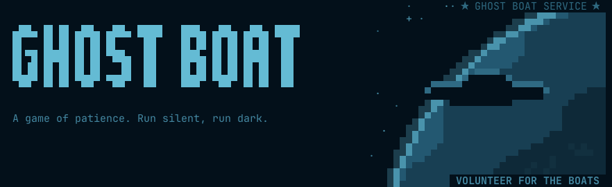](https://ghost-boat.com)

*The trainer's title screen. It hangs a different recruiting poster each time it starts.*

*Out of uniform:* Ghost Boat is a real-time submarine game set in space and played in the terminal, with the physics taken seriously. You find the enemy by bearings alone, work out its range, course and speed from them by target motion analysis, and fire on a GOOD solution. Ghosts are called boats by tradition, as submarines are. It runs on Linux, macOS and Windows. Every action has a key, and the mouse is optional. It plays over mosh, or over plain SSH with `--metered`. The rest of this page is the fleet talking.

> ```
> FM COMGHOSTFLT
> TO ALL GHOST BOATS
> INFO FLEET TRAINING COMMAND
> BT
> ```
>
> **FLOTILLA NOTICE 1. POSTED AT ALL DEPOTS.**
>
> **CAPTAINS WANTED** for long patrols in the black. Hazardous duty. Small boat, seventy crew, four tubes, and no one coming for you. Ability to sit very still is required. Ability to count bearings is preferred.
>
> Every recruit qualifies on the Fleet Tactical Trainer before taking a boat. Time on the trainer does not count toward time in the black.
>
> Applications: [recruitment@ghost-boat.net](mailto:recruitment@ghost-boat.net)
>
> By order of [RADM A. Giacalone](https://github.com/agiacalone), Commander, Ghost Fleet (COMGHOSTFLT).
>
> `BT`

## Service in the black

Nobody out here can see anyone. Hulls are painted black, and starlight shows nothing. A ship is found by what it cannot help giving off: the heat of its hull, the radio of its machinery, the pull of its magnetism. The enemy finds you the same way. Can anything hide in space? For a while. A boat hides only as long as she can hold her heat, and her drive gives her away.

[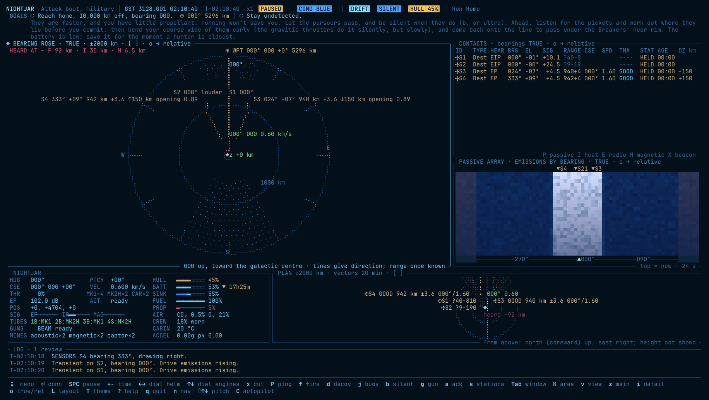](screenshots/run-home.png)

*Four destroyers on her track. Two dead ahead are lighting their drives, the nearer nine kilometres off and getting louder. The boat is hurt, silent, and still unheard.*

So you drift, and listen. A bearing comes up on the waterfall: a convoy, six merchants and one escort, crossing your patrol line. You don't know how far off they are. You have a bearing, and patience. Change course, let the bearings cross, and the range comes out of the geometry. When the solution firms to GOOD, you fire, and everyone hears you.

[](screenshots/torpedo-in-the-black.png)

*A torpedo in the black, close behind its launcher, and the boat turning away to run.*

## What the trainer teaches

The Fleet Tactical Trainer simulates war in the black as it is fought, with nothing simplified for the recruit. What you learn on it is what will keep your boat alive.

- **You fly by instruments alone.** A bearing rose, a waterfall of what the array hears, and a contacts table that firms up as you listen.
- **The drive is loud; speed is not.** A ghost coasting at any speed is a whisper. Light the drive and you are heard a hundred times farther off.
- **You are the captain, not the helmsman.** You give orders on the telegraph and the helm, and your crew carries them out, at the pace of a crew. All ahead one third.
- **The enemy plays by your rules.** Every captain out there has a sensor picture and a doctrine of its own. Green escorts search the wreck. Seasoned ones run down your torpedo's bearing to the firing point.
- **Every trick has a price.** Jam a seeker and you tell the world where you are. A homing torpedo forgives a poor solution; a straight runner needs a good one, and can't be jammed.
- **The physics do not care.** Newtonian flight in three dimensions, gravity wells that hide whole ships, magnetism in real units, and light-speed delay at astronomical range. Heat and radio are reckoned in decibels on a stand-in scale in nearly every fight. [The physics, plainly.](physics.md)
- **Real practice where it counts.** The radio follows marine practice: every ship guards channel 16, and a trader in trouble calls MAYDAY in full. Range comes from target motion analysis, worked from bearings as a fire-control party did it. The torpedoes are modelled on the early submarines' own, duds, prematures and circular runs included.
- **The boat is yours to run.** The board, the battery, the air, the fuel and the damage parties. Leave them to the crew, or reach in and nurse a hurt boat home.
- **The war changes.** Three eras: the happy time, the counters, and the hunters' war. Every technique arrives with its answer.

Orders are typed as a conning officer gives them, and every urgent action has a single key.

[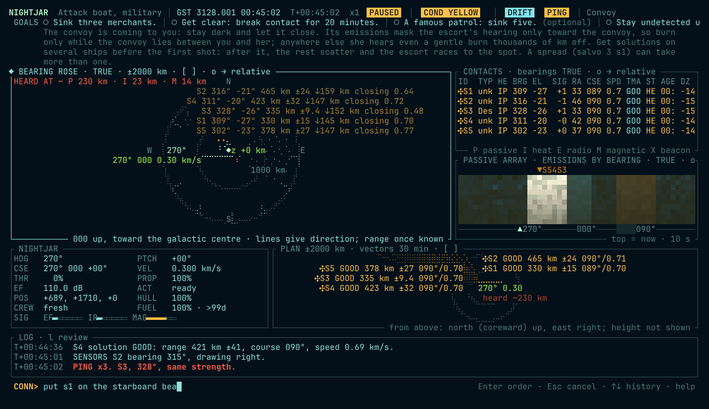](screenshots/conn-order.png)

*CONN> put s1 on the starboard beam, half typed. The convoy is closing.*

[](screenshots/convoy-hunt.png)

*A convoy on the rose, every contact tagged; the escort is pinging.*

[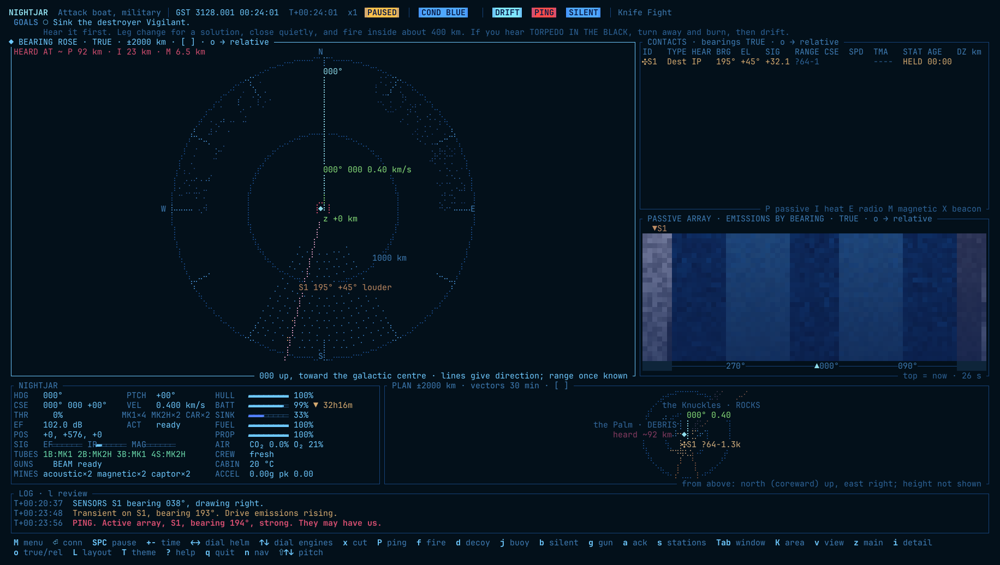](screenshots/knife-fight-ping.png)

*A destroyer close astern and above, pinging. They may have us. The boat coasts, silent, and waits.*

[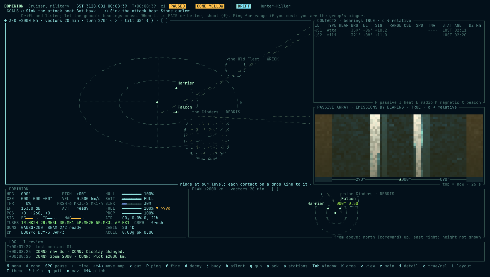](screenshots/three-d-view.png)

*Space has an up and a down. One boat above your level, one below.*

[](screenshots/sensors-station.png)

*The sensors station: the passive array and infrared, one target on both.*

## Sign on for the war

New Game signs you on for one war. One captain, one boat, and patrols from base until the war ends, you retire, command relieves you, or the boat doesn't come home.

- **Command gives the orders.** A zone and days on station, or a job: sink a tonnage, watch a site, land operatives, carry the mail, pick up survivors. Sometimes it offers two and you choose.
- **The patrol chart runs in hours.** Warp out to your zone, mind the fuel line home, and drop into a fight when something comes within reach. What you meet depends on the year, and nobody tells you the war has moved on.
- **Leaving takes nerve.** A warp bubble forms only round a boat at rest. Spinning it up takes a quarter of an hour, loud and deaf, so you get clear before you stop.
- **Nine named crew** stand their posts and get better at them. They tire, they take shore leave, and some don't come back.
- **The yard costs days.** Every day of a refit is a day of the war.
- **Rank is command's opinion** of your patrols. Do well and it may offer you a better boat.
- **Every war keeps a diary,** written out as plain text and Markdown when it ends. Iron mode, if you want it, means no reloads.

[](screenshots/career-chart.png)

*The patrol chart, a week out: on station, and a new contact on the log.*

[](screenshots/career-diary.png)

*The war diary keeps the whole war, from command's welcome letter on.*

## Recruiting posters

Posters are available at your nearest recruitment office. Hang one in the mess.

| | |
|---|---|
| 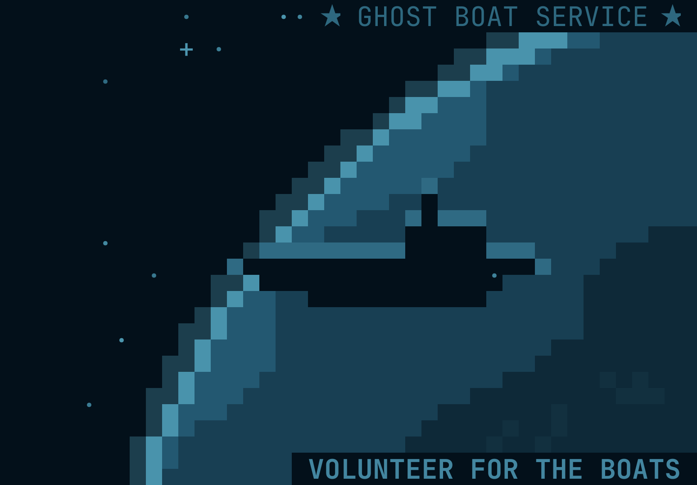 |  |
|  | 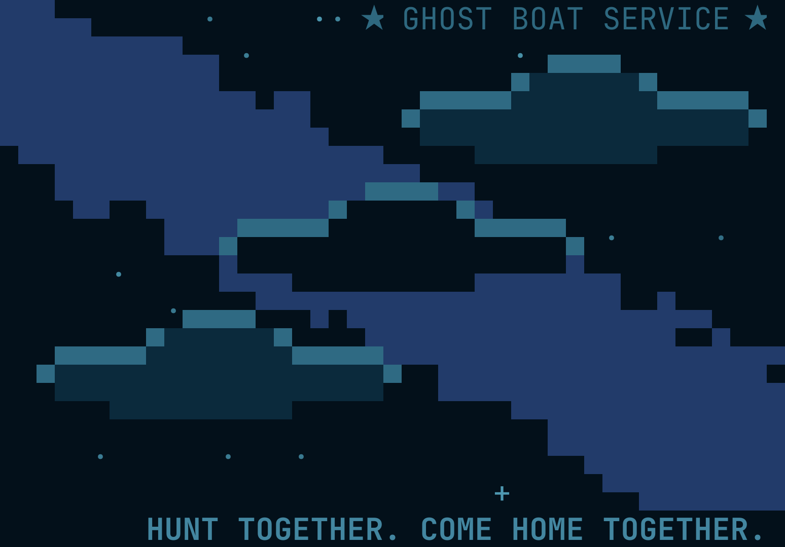 |
| 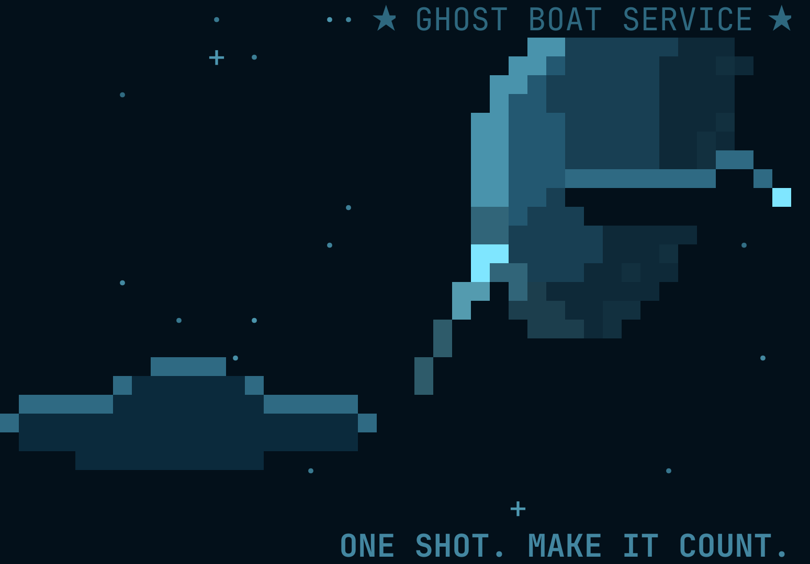 | 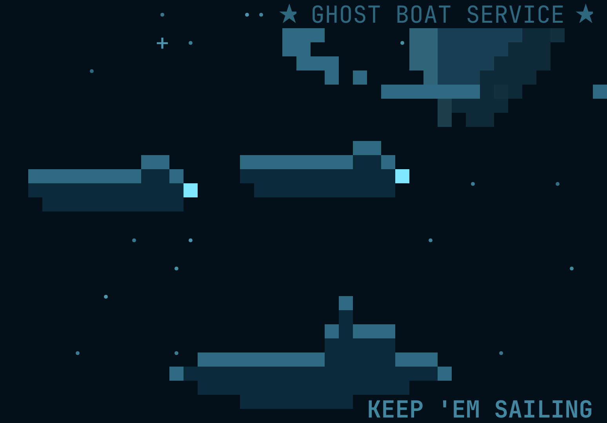 |
|  | 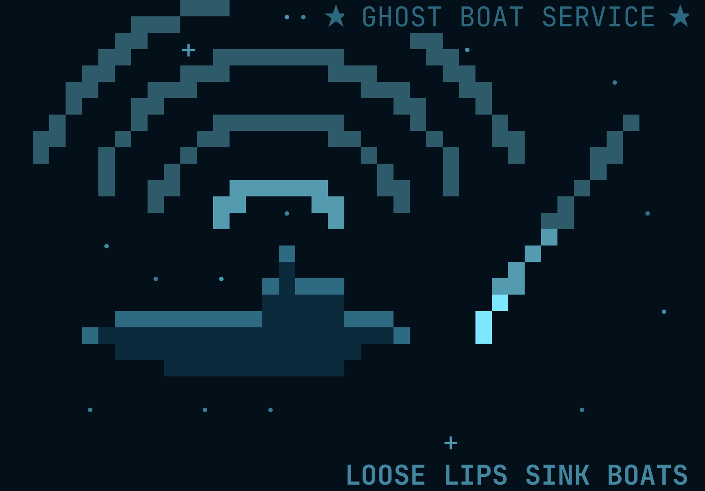 |
|  |  |

## The training programme

Recruits begin with lessons of one idea each, in four tracks: civilian, naval, ghost and hunter. The last three ghost lessons teach the career before a first war. Then recruits qualify on challenges rated from Routine to Severe, and fight the war campaign through its three eras. Every lost fight can be replayed from the true positions, so you see what really happened.

The trainer runs in any modern terminal, as large as the room allows. 160 columns by 45 rows is comfortable; a smaller one shows fewer windows. Thirty-five themes are fitted: the house blue-teal, green and amber phosphor, the home computers and terminals you grew up on, and five light ones for a bright room. `T` opens the theme menu.

[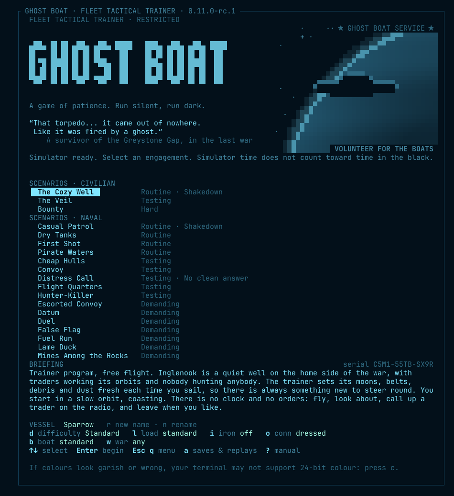](screenshots/scenarios.png)

*The first challenges, Routine to Hard.*

| | | |
|---|---|---|
| [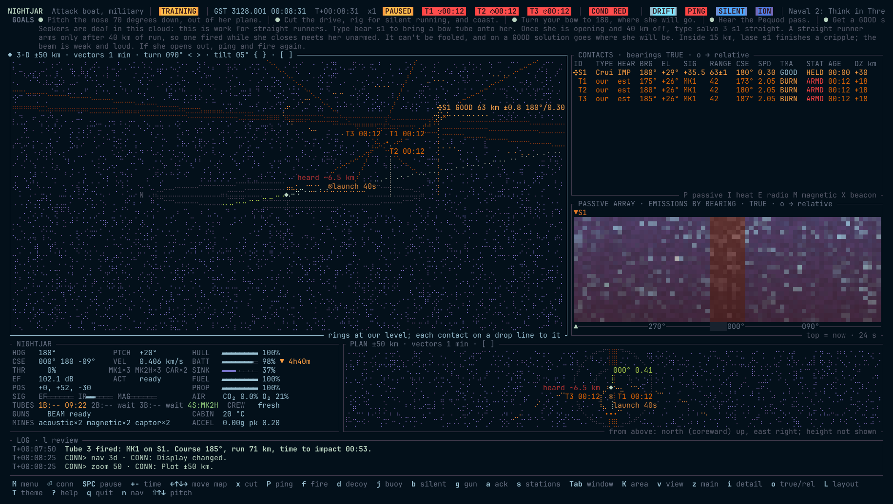](screenshots/naval-2.png) | [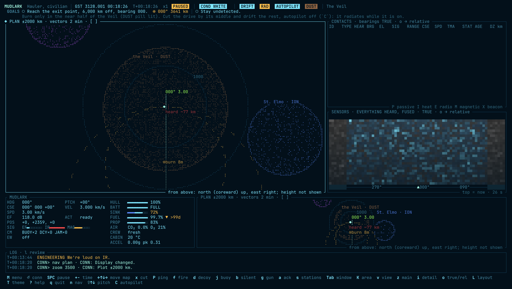](screenshots/the-veil.png) | [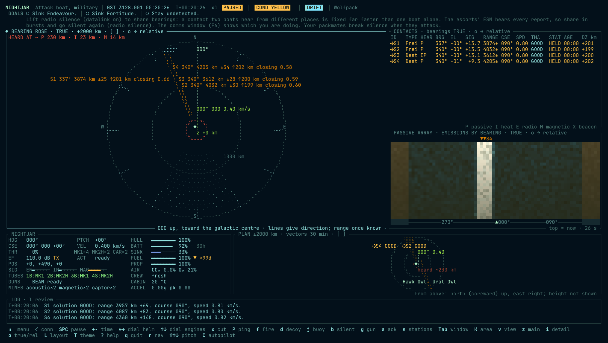](screenshots/wolfpack.png) |
| *Naval 2: drop out of her plane, go quiet, and shoot as she opens out.* | *The Veil: burn inside the dust, where the drive is muffled.* | *Wolfpack: the datalink goes up, and the pack's bearings cross.* |
| [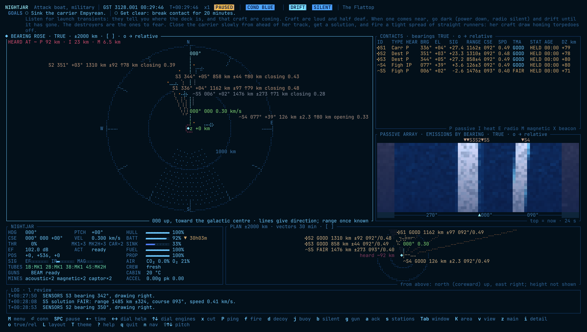](screenshots/the-flattop.png) | [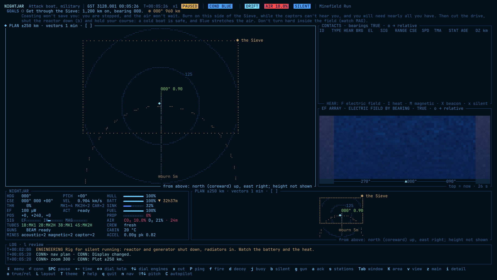](screenshots/minefield-run.png) |  |
| *The Flattop: a carrier group, and a picket passing close.* | *Minefield Run: cold through the Sieve, on bad air.* |  |

[](screenshots/replay-viewer.png)

*A lost fight, replayed: true positions, the moments that mattered, and the log.*

[](screenshots/polaris.png)

*Polaris, frost on polar night.*

[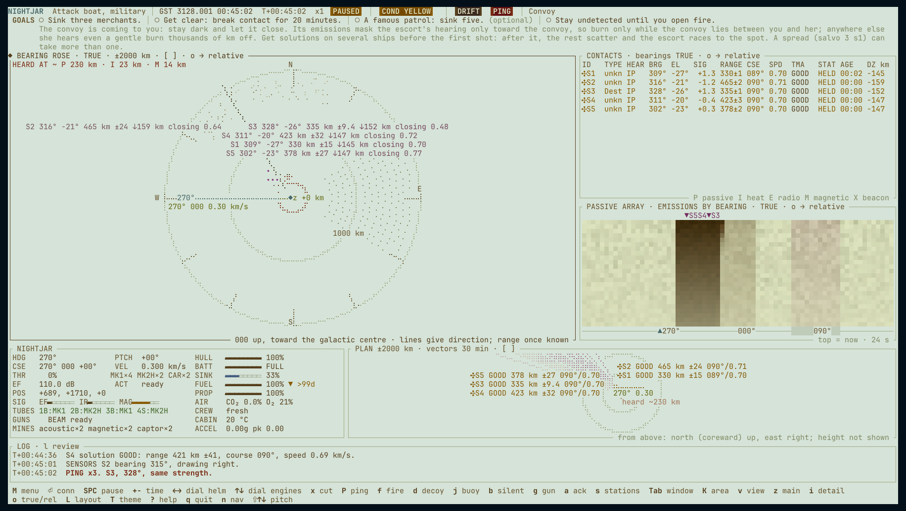](screenshots/via-lactea.png)

*Via Lactea, one of the five light themes.*

[](screenshots/breadbin.png)

*Breadbin, for the C64 crowd.*

[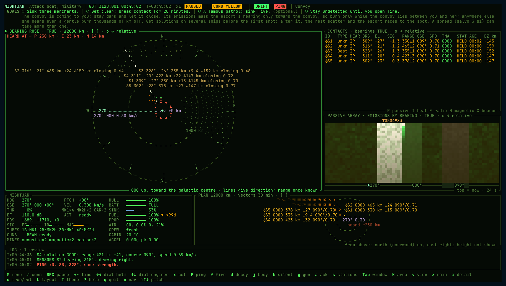](screenshots/pf3.png)

*PF3, a 3270's green screen.*

## Report for duty

Ghost Boat is in play-testing. Builds are issued for Linux, macOS and Windows: write to [recruitment@ghost-boat.net](mailto:recruitment@ghost-boat.net) and say which you sail on. Play-testers whose reports help shape the game get a free copy when 1.0 ships. [The road to 1.0](roadmap.md) shows what each release has brought and what comes next.

It runs in any modern terminal of 80 columns by 24 rows or more; 160 by 45 is comfortable. A keyboard is all you need. [Accessibility](accessibility.md) says what works today for captains who play by keyboard alone, with low vision or with colour blindness, and what does not.

## Buy war bonds

Back the fleet. In plain words: Ghost Boat will be sold direct from us and through stores such as Steam. Buy it once and every update after is free. There will be no paid expansions and no DLC. No DRM, no accounts, and nothing collected: the trainer never goes online, your saves stay on your own machine, and every release comes with its source. The requisition office opens soon.

Citizens who wish to support the trainer programme may do so on Patreon. That office opens soon too.

## Out of uniform: inspirations

*Spacewar!*, *Objects in Space*, *Space Rogue* (1989), *Super Star Trek*, *Star Control 2*, *Microsoft Space Simulator* (1994), *Star Fleet I*, *Star Fleet Battles* (the Deluxe Edition), *Star Fleet Command: Orion Pirates* (2000), *Silent Service II*, *Silent Hunter 4* and its Fall of the Rising Sun mod, *Das Boot*, *Gato* (1984), the sub-sim where Anthony started, *Planetfall* and the rest of Infocom's text games, *The Hitchhiker's Guide to the Galaxy* (the books and Infocom's game), Sierra's *Space Quest*, and *Ultima VI* and *VII*. Nightmare, the hardest setting, is a nod to *DOOM*. Ghost Boat borrows their feel, never their text, art or names.

## Papers issued to recruits

| Paper | Contents |
|---|---|
| [Captain's manual](manual.md) | every instrument, order and system aboard, and how the enemy thinks |
| [Quick reference card](quickref.md) | one page of keys and orders, to keep beside the console |
| [The physics](physics.md) | why a ghost can hide, and how she is found: signal and noise, bearings, wells and warp |
| [The road to 1.0](roadmap.md) | what each release has brought, and what comes next |
| [Accessibility](accessibility.md) | what works today for captains with a disability, what does not, and how to tell us |
| [Terms of issue](LICENSE) | what you may do with the trainer and its workings |

Every issue of the trainer comes with its workings open to inspection: the source of each release is issued beside it.

## Keeping the site in step

The site is built by GitHub Pages with Jekyll, straight from `main`. At each release of the game:

1. **Refresh the papers and the colours.** `scripts/refresh-from-game.sh v0.12.0` (a tag or a branch of the game's repository, which it expects at `../dev`) copies the game's `docs/manual.md`, `docs/quickref.md` and `docs/tokens.json`. The stylesheet takes Deep Signal's colours from the tokens when Jekyll builds the site. The body text keeps the site's own colour, `#5eafc7`.
2. **Move the roadmap on.** In `roadmap.md`, the release in play-testing moves under *Shipped*, newest first, with its date. Its lines come from that release's section of the game's `CHANGELOG.md`. The next release takes its place, from the changelog's *Unreleased* section. *The plan to 1.0* follows the release plan in the game's `docs/roadmap.md`.
3. **Check the physics and accessibility pages** against the game's `docs/physics.md`, `docs/design/accessibility.md` and the manual. They show only what a release build does.
4. **Check the front page and this README** against the changelog, and retake any screenshot the release has made stale.

The roadmap stays short and plain: short lines, no roadmap row numbers, and none of how the work is done. Every page describes the game as it is; only the roadmap's plan looks ahead.

---

*Issued by the recruiting office, Fleet Training Command, by order of [RADM A. Giacalone](https://github.com/agiacalone), COMGHOSTFLT. Do not reply to this notice. Correspondence to Fleet Training Command: [command@ghost-boat.net](mailto:command@ghost-boat.net). Requisitions: [requisition@ghost-boat.net](mailto:requisition@ghost-boat.net).*
