# GHOST BOAT

**FLEET TACTICAL TRAINER · RESTRICTED**

*A game of patience. Run silent, run dark.*

*The trainer's title screen. It hangs a different recruiting poster each time it starts.*

> **FLOTILLA NOTICE 1. POSTED AT ALL DEPOTS.**
>
> **CAPTAINS WANTED** for long patrols in the black. Hazardous duty. Small boat, seventy crew, four tubes, and no one coming for you. Ability to sit very still is required. Ability to count bearings is preferred.
>
> Apply to the Fleet Tactical Trainer. Time on the trainer does not count toward time in the black.
>
> Applications: [recruitment@ghost-boat.net](mailto:recruitment@ghost-boat.net)

## The black

Nobody out here can see anyone. Hulls are painted black, and starlight shows nothing. A ship is found by what it cannot help giving off: the heat of its hull, the radio of its machinery, the pull of its magnetism. The enemy finds you the same way.

So you drift, and listen. A bearing comes up on the waterfall: a convoy, six merchants and one escort, crossing your patrol line. You don't know how far off they are. You have a bearing, and patience. Change course, let the bearings cross, and the range comes out of the geometry. When the solution firms to GOOD, you fire, and everyone hears you.

*Condition red: a torpedo in the black, and the boat turning away to run.*

## What the trainer teaches

- **You fly by instruments alone.** A bearing rose, a waterfall of what the array hears, and a contacts table that firms up as you listen.
- **The drive is loud; speed is not.** A ghost coasting at any speed is a whisper. Light the drive and you are heard a hundred times farther off.
- **You are the captain, not the helmsman.** You give orders on the telegraph and the helm, and your crew carries them out, at the pace of a crew. All ahead one third.
- **The enemy plays by your rules.** Every captain out there has a sensor picture and a doctrine of its own. Green escorts search the wreck. Seasoned ones run down your torpedo's bearing to the firing point.
- **Every trick has a price.** Jam a seeker and you tell the world where you are. A homing torpedo forgives a poor solution; a straight runner needs a good one, and can't be jammed.
- **The physics do not care.** Newtonian flight in three dimensions, heat and radio in real units, gravity wells that hide whole ships, and light-speed delay at astronomical range.
- **The boat is yours to run.** The board, the battery, the air, the fuel and the damage parties. Leave them to the crew, or reach in and nurse a hurt boat home.
- **The war changes.** Three eras: the happy time, the counters, and the hunters' war. Every technique arrives with its answer.

*A convoy on the rose, every contact tagged; the escort is pinging.*

*Space has an up and a down. One boat above your level, one below.*

*The sensors station: the passive array and infrared on one target.*

## Posted at all depots

The Ghost Boat Service recruits at every depot in the fleet.

| | |
|---|---|
| 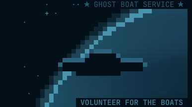 | 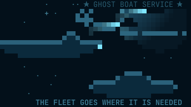 |
| 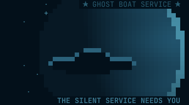 | 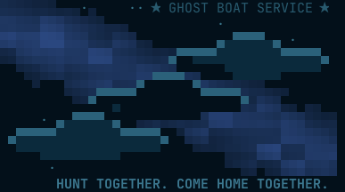 |
| 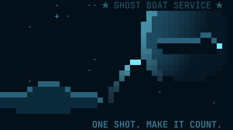 | 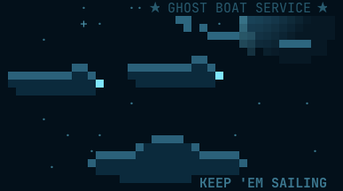 |
| 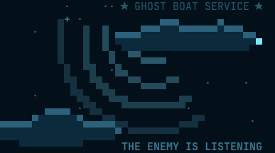 | 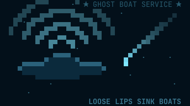 |
| 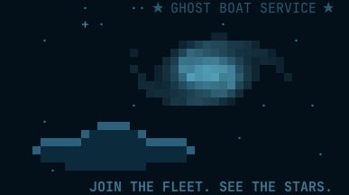 | 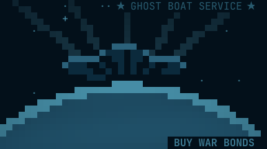 |

## The trainer room

The trainer runs on any modern console, as large as the room allows: 160 columns by 45 rows is comfortable, and a smaller one shows fewer windows. Training lessons teach one idea each, the challenges are rated from Routine to Severe, and every lost fight can be replayed from the true positions. Sixteen colour schemes are fitted, from Deep Signal to Polaris.

[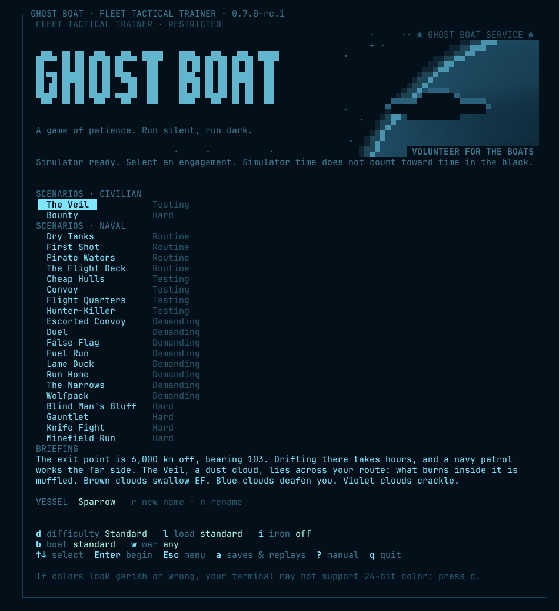](screenshots/scenarios.png)

*The challenges, Routine to Severe.*

[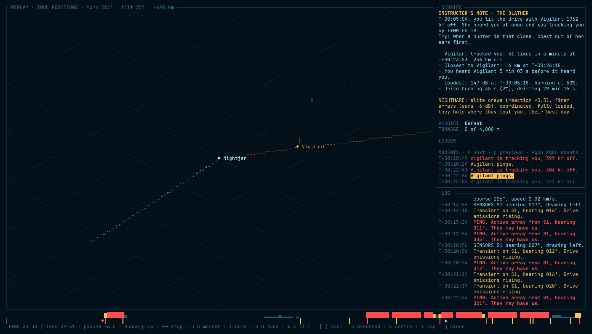](screenshots/replay-viewer.png)

*The replay shows what really happened.*

*One of sixteen colour schemes fitted to the trainer: Polaris.*

## Requisition

Copies of the trainer will be issued through Steam. Buy war bonds: buy the game once, and every update after is free. There will be no paid expansions and no DLC. The requisition office opens soon.

Captains who wish to support the trainer programme may do so on Patreon. That office opens soon too.

## Papers issued with the trainer

| Paper | Contents |
|---|---|
| [Captain's manual](manual.md) | every instrument, order and system aboard, and how the enemy thinks |
| [Quick reference card](quickref.md) | one page of keys and orders, to keep beside the console |
| [Terms of issue](LICENSE) | what you may do with the trainer and its workings |

Every issue of the trainer comes with its workings open to inspection: the source of each release is issued beside it.

---

*Prepared for Fleet Training Command by A. Giacalone. Do not reply to this notice. Correspondence to Fleet Training Command: [command@ghost-boat.net](mailto:command@ghost-boat.net). Requisitions: [requisition@ghost-boat.net](mailto:requisition@ghost-boat.net).*
