# GHOST BOAT

**FLEET TACTICAL TRAINER · RESTRICTED**

*A game of patience. Run silent, run dark.*

*The trainer's title screen. It hangs a different recruiting poster each time it starts.*

*Out of uniform:* Ghost Boat is a real-time submarine game set in space and played in the terminal, with the physics taken seriously. Ghosts are called boats by tradition, as submarines are. It runs on Linux, macOS and Windows. Every action has a key, and the mouse is optional. It plays over mosh, or over plain SSH with `--metered`. The rest of this page is the fleet talking.

> **FLOTILLA NOTICE 1. POSTED AT ALL DEPOTS.**
>
> **CAPTAINS WANTED** for long patrols in the black. Hazardous duty. Small boat, seventy crew, four tubes, and no one coming for you. Ability to sit very still is required. Ability to count bearings is preferred.
>
> Every recruit qualifies on the Fleet Tactical Trainer before taking a boat. Time on the trainer does not count toward time in the black.
>
> Applications: [recruitment@ghost-boat.net](mailto:recruitment@ghost-boat.net)

## Service in the black

Nobody out here can see anyone. Hulls are painted black, and starlight shows nothing. A ship is found by what it cannot help giving off: the heat of its hull, the radio of its machinery, the pull of its magnetism. The enemy finds you the same way.

So you drift, and listen. A bearing comes up on the waterfall: a convoy, six merchants and one escort, crossing your patrol line. You don't know how far off they are. You have a bearing, and patience. Change course, let the bearings cross, and the range comes out of the geometry. When the solution firms to GOOD, you fire, and everyone hears you.

[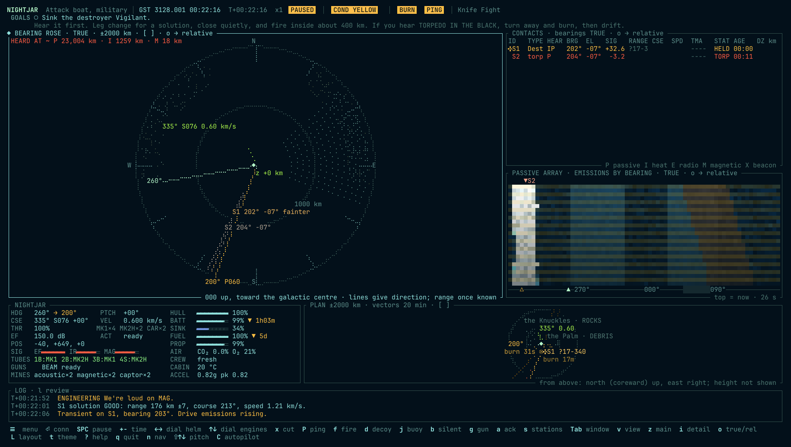](screenshots/torpedo-in-the-black.png)

*A torpedo in the black, close behind its launcher, and the boat turning away to run.*

## What the trainer teaches

The Fleet Tactical Trainer simulates war in the black as it is fought, with nothing simplified for the recruit. What you learn on it is what will keep your boat alive.

- **You fly by instruments alone.** A bearing rose, a waterfall of what the array hears, and a contacts table that firms up as you listen.
- **The drive is loud; speed is not.** A ghost coasting at any speed is a whisper. Light the drive and you are heard a hundred times farther off.
- **You are the captain, not the helmsman.** You give orders on the telegraph and the helm, and your crew carries them out, at the pace of a crew. All ahead one third.
- **The enemy plays by your rules.** Every captain out there has a sensor picture and a doctrine of its own. Green escorts search the wreck. Seasoned ones run down your torpedo's bearing to the firing point.
- **Every trick has a price.** Jam a seeker and you tell the world where you are. A homing torpedo forgives a poor solution; a straight runner needs a good one, and can't be jammed.
- **The physics do not care.** Newtonian flight in three dimensions, heat and radio in real units, gravity wells that hide whole ships, and light-speed delay at astronomical range.
- **The boat is yours to run.** The board, the battery, the air, the fuel and the damage parties. Leave them to the crew, or reach in and nurse a hurt boat home.
- **The war changes.** Three eras: the happy time, the counters, and the hunters' war. Every technique arrives with its answer.

[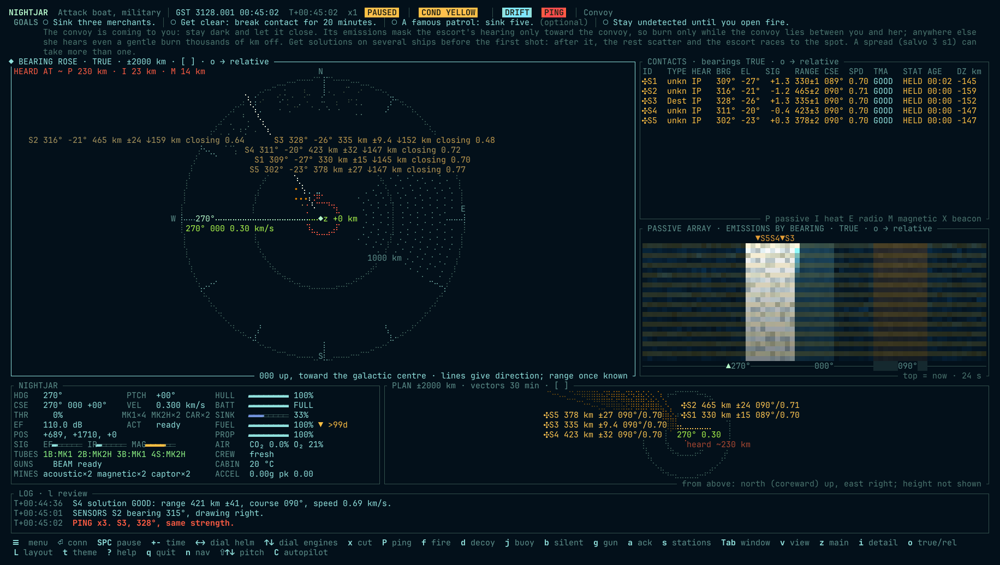](screenshots/convoy-hunt.png)

*A convoy on the rose, every contact tagged; the escort is pinging.*

*Space has an up and a down. One boat above your level, one below.*

[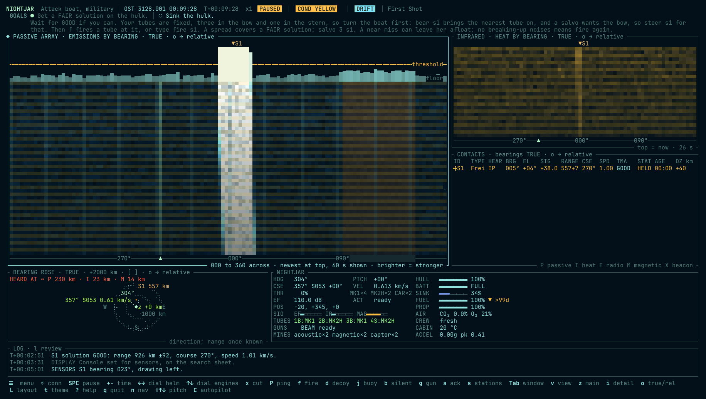](screenshots/sensors-station.png)

*The sensors station: the passive array and infrared, one target on both.*

## Sign on for the war

New Game signs you on for one war. One captain, one boat, and patrols from base until the war ends, you retire, command relieves you, or the boat doesn't come home.

- **Command gives the orders.** A zone and days on station, or a job: sink a tonnage, watch a site, land operatives, carry the mail, pick up survivors. Sometimes it offers two and you choose.
- **The patrol chart runs in hours.** Warp out to your zone, mind the fuel line home, and drop into a fight when something comes within reach. What you meet depends on the year, and nobody tells you the war has moved on.
- **Nine named crew** stand their posts and get better at them. They tire, they take shore leave, and some don't come back.
- **The yard costs days.** Every day of a refit is a day of the war.
- **Rank is command's opinion** of your patrols. Do well and it may offer you a better boat.
- **Every war keeps a diary,** written out as plain text and Markdown when it ends. Iron mode, if you want it, means no reloads.

[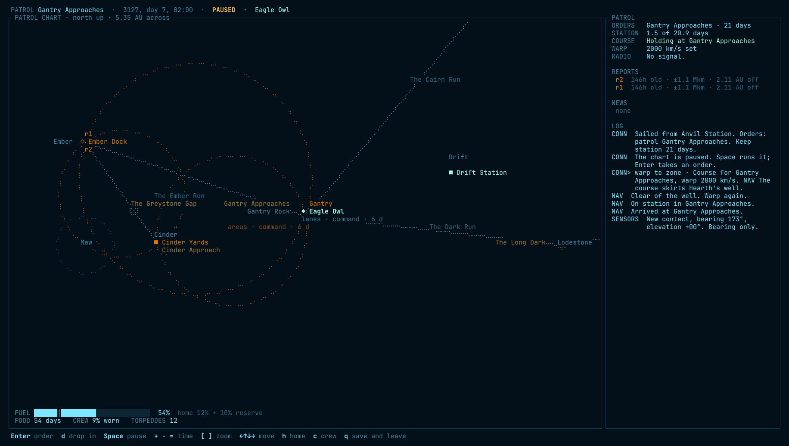](screenshots/career-chart.png)

*The patrol chart, a week out: on station, and a new contact on the log.*

[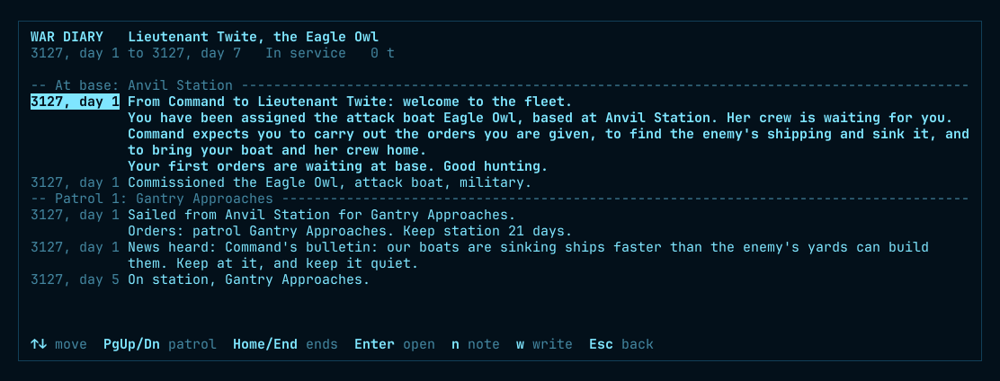](screenshots/career-diary.png)

*The war diary keeps the whole war, from command's welcome letter on.*

## Recruiting posters

Posters are available at your nearest recruitment office. Hang one in the mess.

| | |
|---|---|
|  | 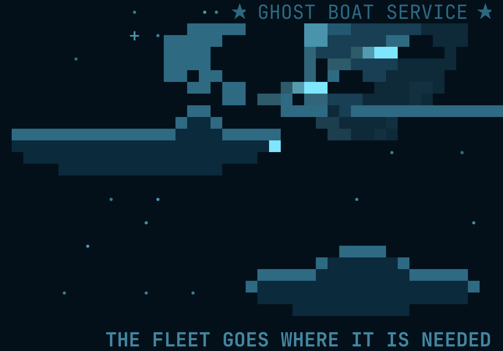 |
| 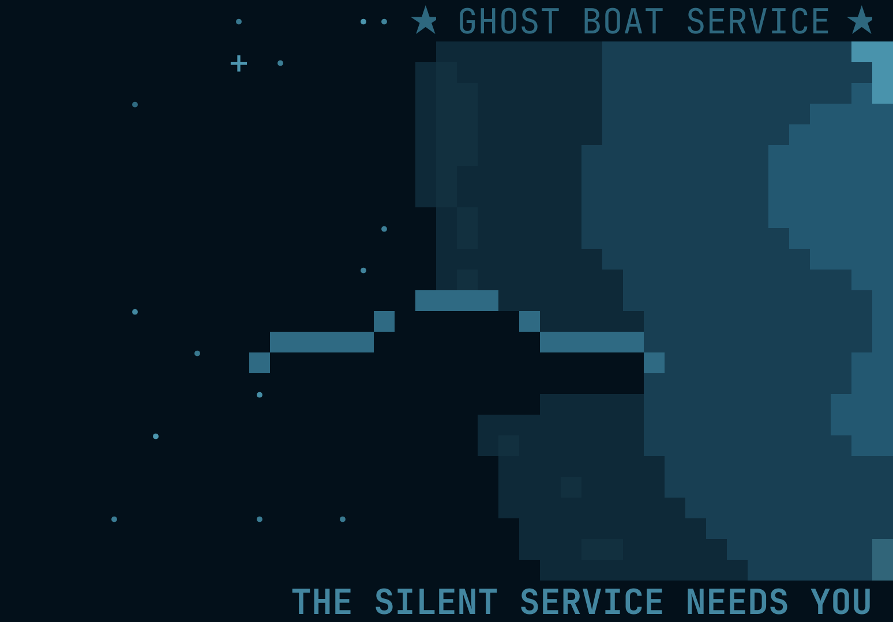 |  |
|  |  |
| 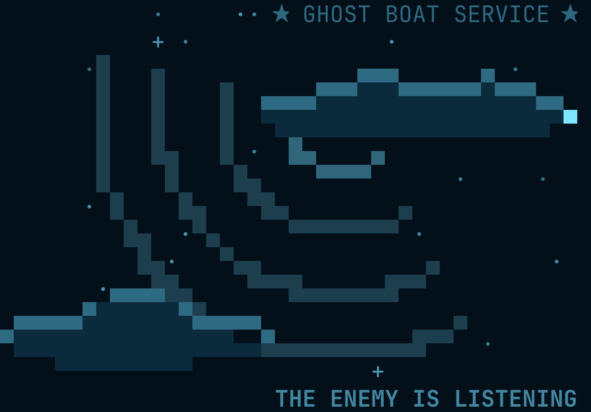 |  |
| 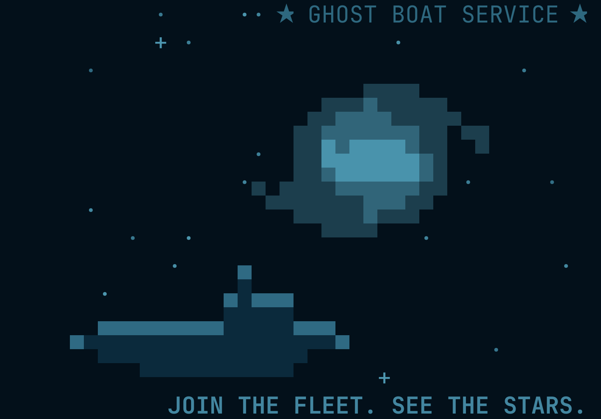 | 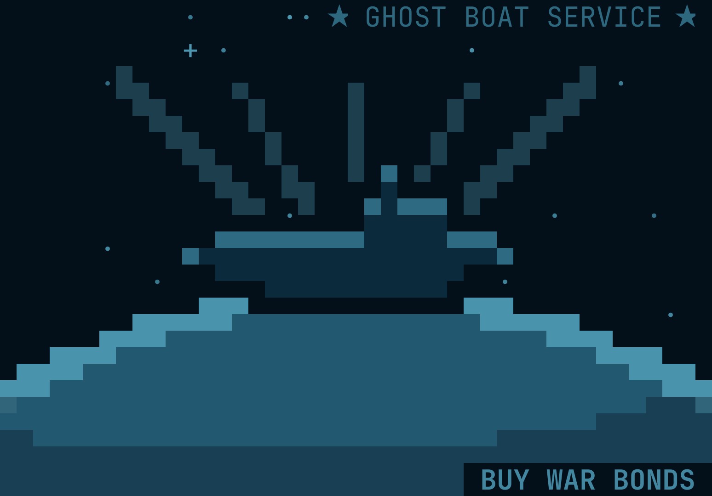 |

## The training programme

Recruits begin with lessons of one idea each, then qualify on challenges rated from Routine to Severe, then fight the war campaign through its three eras. Every lost fight can be replayed from the true positions, so you see what really happened.

The trainer runs in any modern terminal, as large as the room allows. 160 columns by 45 rows is comfortable; a smaller one shows fewer windows. Thirty-five themes are fitted: the house blue-teal, green and amber phosphor, the home computers and terminals you grew up on, and five light ones for a bright room.

*The challenges, Routine to Severe.*

[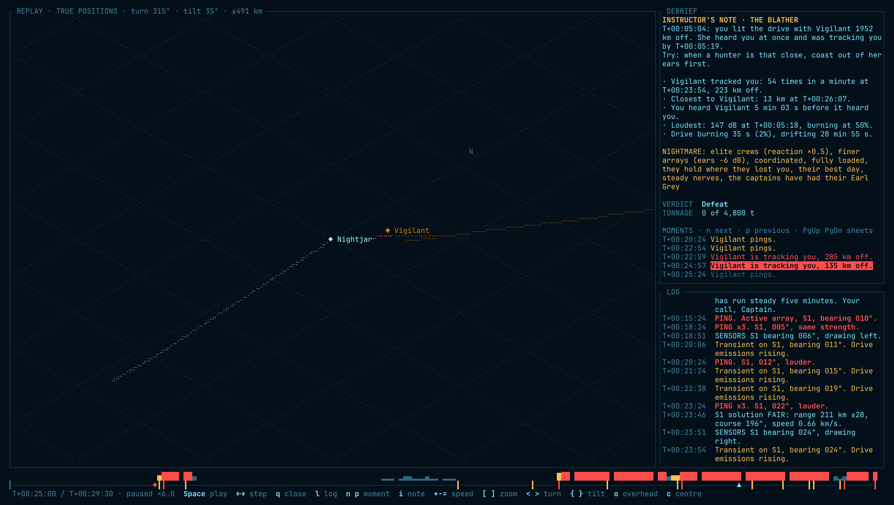](screenshots/replay-viewer.png)

*A lost fight, replayed: true positions, the moments that mattered, and the log.*

[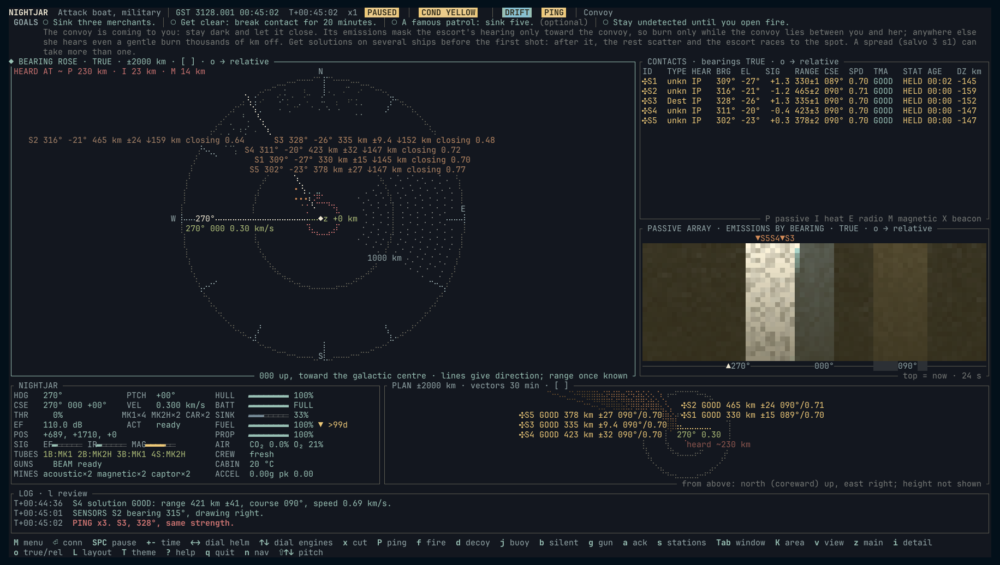](screenshots/polaris.png)

*Polaris, frost on polar night.*

*Via Lactea, one of the five light themes.*

[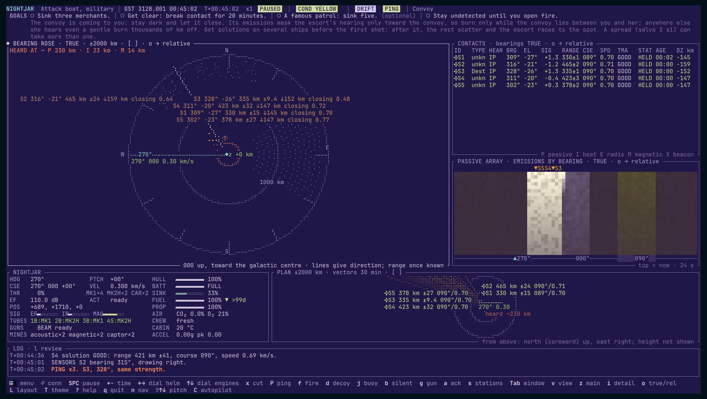](screenshots/breadbin.png)

*Breadbin, for the C64 crowd.*

*PF3, a 3270's green screen.*

## Buy war bonds

Back the fleet. In plain words: Ghost Boat will be sold direct from us and through stores such as Steam. Buy it once and every update after is free. There will be no paid expansions and no DLC. The requisition office opens soon.

Citizens who wish to support the trainer programme may do so on Patreon. That office opens soon too.

## Papers issued to recruits

| Paper | Contents |
|---|---|
| [Captain's manual](manual.md) | every instrument, order and system aboard, and how the enemy thinks |
| [Quick reference card](quickref.md) | one page of keys and orders, to keep beside the console |
| [Terms of issue](LICENSE) | what you may do with the trainer and its workings |

Every issue of the trainer comes with its workings open to inspection: the source of each release is issued beside it.

---

*Prepared for Fleet Training Command by A. Giacalone. Do not reply to this notice. Correspondence to Fleet Training Command: [command@ghost-boat.net](mailto:command@ghost-boat.net). Requisitions: [requisition@ghost-boat.net](mailto:requisition@ghost-boat.net).*
