# Ghost Boat: captain's manual

*Issued with every registered vessel. Read it before the hull is breached, not after.*

**Reading this at the console:** press `?` (or `F1`) at any time. The trainer pauses while you read. `↑`/`↓` scroll a line; `PgUp`/`PgDn`, `Shift+↑`/`Shift+↓`, or `b`/space scroll a page; `g`/`G` jump to the start and end; `←`/`→` jump between sections, and `?` or `Esc` closes the manual and puts the exercise back as it was.

You command a ship by its instruments. You will never see a map of where the enemy is. You will see bearings, signal strengths and estimates, and you will decide what they mean. This manual explains every instrument, every control and every rule the trainer uses. The spec sheets near the end come straight from the fleet's own data, so they are always current.

> [!IMPORTANT]
> **The one rule.** Everything you know about other ships comes from your sensors. Everything they know about you comes from theirs. That goes for the enemy too, at every difficulty. If they found you, you gave yourself away.

## Your orders

*The flotilla commander, on the dock, to a skipper with the ink still wet.*

Okay, green skipper. Here is your boat. Seventy crew who know their jobs better than you know yours, four tubes, and a long way from home.

The job is tonnage. Every ton you sink is a ton the other side doesn't have, and that is how this war gets settled. So stay quiet. Hear them before they hear you. A ghost picks its own fights, and if a fight looks bad, you were never there. When it looks good, sink them, get clear, and come back for more torpedoes. Dead skippers sink nothing.

Nobody out there is a villain. They have orders too, and somebody like me on their dock, telling them to find you. Who was right is for the politicians.

Nobody is coming for you, either. No backup, no rescue, no second boat. Once the hatch shuts it's you, your crew and the dark.

Sink 'em all, skipper. Then bring my boat back.

## Contents

1. [How the trainer works](#1-how-the-trainer-works)
2. [The console](#2-the-console)
3. [Controls](#3-controls)
4. [Setting up the console](#4-setting-up-the-console)
5. [Reading the instruments](#5-reading-the-instruments)
6. [Drills](#6-drills)
7. [Flying a Newtonian ship](#7-flying-a-newtonian-ship)
8. [Passive array](#8-passive-array)
9. [Range from bearings: TMA](#9-range-from-bearings-tma)
10. [Active array](#10-active-array)
11. [Gravity wells](#11-gravity-wells)
12. [Nebulas](#12-nebulas)
13. [Torpedoes](#13-torpedoes)
14. [Electronic warfare: jamming and ECCM](#14-electronic-warfare-jamming-and-eccm)
15. [Power, heat and signatures](#15-power-heat-and-signatures)
16. [Life support](#16-life-support)
17. [Damage](#17-damage)
18. [How the enemy thinks](#18-how-the-enemy-thinks)
19. [Tactics](#19-tactics)
20. [Goals and scoring](#20-goals-and-scoring)
21. [The war campaign](#21-the-war-campaign)
22. [Scenarios](#22-scenarios)
23. [Ship registry and specifications](#23-ship-registry-and-specifications)
24. [Glossary](#24-glossary)
25. [Enclosures](#25-enclosures)

## 1. How the trainer works

You command a ghost: a submarine in space. Nobody out here can see anyone. Every ship knows only what reaches its sensors: the energy other ships give off, and the echoes of its own pings. **Everything you know about the enemy, it gave away. Everything it knows about you, you gave away.**


### The hunt

Every engagement is the same loop, on both sides. The side that gets round it first, quietly, usually wins.

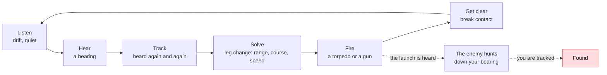

1. **Listen.** Drift with the drive off. A drifting ship is quiet and its own array is at its best.
2. **Hear.** A contact appears as a bearing: a line on the rose and a streak on the waterfall. A bearing gives direction, never distance.
3. **Track.** Keep hearing it. Each new bearing goes into the contacts table.
4. **Solve.** Range comes from geometry. Change course (a *leg change*), and the bearings from your two legs cross. The solution grows from `POOR` to `FAIR` to `GOOD`. See [Range from bearings](#9-range-from-bearings-tma).
5. **Fire.** A torpedo on a `FAIR` solution may miss; on a `GOOD` one it should hit. A spread covers the error.
6. **Get clear.** Inside about 600 km the enemy hears the launch: expect it to come down your bearing. Go quiet and slip away.

The enemy runs the same loop against you, with the same sensors and the same mathematics. It never knows where you really are; it knows only what you gave away.

### What gives you away

| What you do | What it costs | Who notices, and from how far |
|---|---|---|
| Drift, reactor running | almost nothing | a destroyer hears a drifting ghost at about 230 km |
| Fly on autopilot (civilian hulls) | navigation radar and electronics radiating all the time it is on, plus its thrusters | every warship's array: switch it off (`c`) before you need to hide |
| Burn the drive | the loudest thing you do: the drive's plume | a destroyer hears a ghost at full burn at about 23,000 km, a hundred times farther; even a gentle burn carries thousands of km |
| Ping | everyone hears the ping far beyond the range at which its echo finds anything | every ship for a very long way: it knows exactly where you are |
| Fire a torpedo | a launch transient, then the torpedo's own drive | a ghost's cold launch and the torpedo's small motor are heard to about 600 km, no farther than the boat itself; a warship's tubes are far louder; a coasting torpedo is heard at about 20 to 40 km |
| Transmit (datalink, beam weapon) | an EM signal on your true bearing | every EM receiver in range |
| Jam | the loudest emission there is, on your true bearing | everyone, from any side; see [Electronic warfare](#14-electronic-warfare-jamming-and-eccm) |
| Run warm (radiators out, reactor hot) | heat glows in infrared | warships' telescopes; silent running cools you |
| Come close | your hull's magnetic field: the reactor's coils while it runs, and every hard turn | magnetometers feel a running attack boat at about 14 km and a cold one at about 6 to 7 km, from its steel hull alone; turning hard reaches farther |

The two numbers to remember: **drifting, you are heard at a few hundred km; burning, at tens of thousands.** Most of the job lives between them.

### What new captains get wrong

> [!IMPORTANT]
> **"Speed is loud."** It isn't. There is no water in space. A ship coasting at any speed makes only its reactor's hum. The *drive* is loud, and only while it burns. Burn hard, then coast in silence.

> [!IMPORTANT]
> **"Turning changes where I'm going."** It doesn't. Turning points the nose; only burning changes your course. Watch `HDG` and `CSE` part in the own-ship panel. See [Flying a Newtonian ship](#7-flying-a-newtonian-ship).

> [!IMPORTANT]
> **"A ping only gives me away if it finds them."** It gives you away to everyone who hears it, which is everyone, far beyond its echo's reach.

> [!IMPORTANT]
> **"Jamming hides me."** It hides what is behind your jammer from the ships inside its cone, and tells every ship in the sky exactly where you are. It is a defence against guided weapons, not a cloak.

> [!IMPORTANT]
> **"A contact on the rose is a target."** It is a direction. Until you have a solution you don't know how far it is, which way it's going or how fast.

> [!IMPORTANT]
> **"Once I've fired, it's over."** Firing is the loudest thing a ghost does. Escorts hunt the firing point, and many goals ask you to get clear afterwards.

### Two ways to fly

How you fly depends on your hull.

- **A civilian hull flies on autopilot.** A small generalist crew leans on automation. The arrow keys act at once: `←`/`→` steer, and `↑`/`↓` set the speed the autopilot holds along your nose (`AUTOPILOT` in the header). Press `c` to take manual control (`MANUAL`): then `↑`/`↓` step the throttle, still at once. Easy and forgiving, but a ship that holds a steady speed is easy to predict, and easy to hit, and the autopilot radiates EF the whole time it is on. To hide, switch it off.
- **A warship flies by orders.** The navy has no autopilot. The arrow keys **dial** a heading, a pitch or an engine order (`ORDER` in the header), and `Enter` gives it. A specialist crew carries it out: the helm in about 3 seconds and the engine room in about 4, slower when tired or short of air (`ANSWERING` while they work). Plan a moment ahead: a stop ordered late is a stop overshot. In return, the navy has the better weapons, sensors and manoeuvres.

The civilian tutorials teach the autopilot; the naval ones teach orders. See [Controls](#3-controls).

## 2. The console

```text
┌ header: ship · XPDR · zone · drive state · PING · ASSIST · clock · scenario ┐
│ bearing rose            │ passive waterfall (bearing across, time down)    │
├ status                  │ contacts: bearing, elevation, signal, TMA        │
├ log ─────────────────────────────────────────────────────────────────────── ┤
└ key bar ─────────────────────────────────────────────────────────────────── ┘
```

Instruments follow one rule: **labels are dim, values carry the color, and color means something is wrong.** A quiet, green board is a good board. Look for the one reading that has changed color.

### You are the captain

You give orders; the crew carries them out and answers. Every order on the conn is acknowledged by the station that does it (`HELM`, `SENSORS`, `WEAPONS`, `COUNTERMEASURES`, `ENGINEERING`, `COB`, `DAMAGE CONTROL`), and the crew reports on its own: damage control on what it is fixing and how long it will take, the chief of the boat on the air, engineering when the plant acts by itself.

The windows that run a department, **engineering** and **damage control**, open on a **captain's summary**: what you can do and for how long, in words with gauges for the battery, fuel and heat ("Battery 100%, about 35 min left at this draw"). Press `i` on the focused window for the **detail**: every gauge and number. Leave everything on AUTO and the crew runs it sensibly; reach into the detail when you want to run it yourself.

### Windows

The console is a frame that never moves (the header, the goals and the key bar) around six windows: one large **main window** and five smaller ones. Any window can show any instrument, so you can set the console up the way you like to fight.

| Key | Does |
|---|---|
| `Tab` / `Shift-Tab` | Move the focus to the next or previous window. The focused window's frame is bright, with a `◆` in its corner. |
| `v` | Change what the focused window shows: waterfall, rose, nav plan, nav profile, 3-D, chart, engineering, damage, contacts, status, log, comms, survey, vessel, fire control, and on a carrier the flight deck. Only the focused window changes, and it skips instruments already on screen; `show NAME` on the conn puts one in a second window on purpose. |
| `z` | Swap the focused window into the main window. Press `z` again (the focus follows it) to put it back. |
| `L` | Next layout: **Bridge** (main window top left, two beside it, two below), **Tactical** (main window across the top, four below), **Focus** (main window takes most of the screen, four in a column beside it). |
| `n` | Step the focused window through rose, plan, profile and 3-D, if it is one of those. |
| `o` | True or relative bearings on every bearing display at once (rose, waterfalls, contacts). A window you switch to, and each built-in setup, takes up the same frame. For a mixed setup, set windows one by one on the conn: `rose relative`, `waterfall true`, `contacts relative`; a setup you save keeps the mix. |
| `i` | The focused window between the captain's summary and the detail (engineering, damage control). |

The bottom strip holds the log by default. Your windows and layout carry from one engagement to the next.

Two **dynamic windows** open over the main window by themselves, then close:

- **TORPEDO**, top right, while you can hear an enemy torpedo: its bearing, its signal, and `CLOSING` when it is getting louder.
- **DAMAGE**, bottom right, while the master alarm is unacknowledged and the damage report isn't on screen: what is hurt.
- **NOTICE**, bottom left, for a few seconds after an alert, but only when the log is not on screen to show it.

### Header

| Item | Meaning |
|---|---|
| Ship name and class | Yours. |
| `GST 3127.214 06:41:09` | Galactic Standard Time: year, day of the year, time of day. The galaxy's one clock. Each engagement starts on its own date, drawn inside its era in the campaign and anywhere in the war in free play; it never stops in iron mode. |
| `T+00:02:09` | Mission time, with days (`T+2d 04:10:00`) past the first. |
| `T2 ⏱00:42` / `T2 +00:03` / `T2 past 00:20` | A torpedo clock for each of yours running, as WWII boats timed every run with a stopwatch: time to impact while fire control has a solution, else time since launch. Amber `past` means the meeting time has gone by with the torpedo still running: it has probably missed. |
| `COND` | The boat's condition, shown by its lighting (as in *Das Boot*): **RED** combat (a torpedo in the black, yours or theirs, or a master warning; you can set another condition over it with `condition`, and it holds until something new goes wrong; once the alarm is over your setting stays), **BLUE** silent running (`silent` and `ultra` set it over a WHITE or YELLOW you set by hand, though not over RED, and `normal` hands it back to the boat), **YELLOW** caution, raised by the first ping heard or a new vessel that is unidentified or hostile, and held until you stand it down, **WHITE** all clear. Your own group is friendly, and so is a ship broadcasting its transponder unless intelligence says otherwise; neither raises YELLOW. Set the condition yourself with `condition red`, `blue`, `yellow` or `white` (which also stands down a raised YELLOW), and hand it back with `condition auto`. A torpedo turns the boat RED whatever you set. Damage, heat and bad air have their own warnings. With effects on, the console's text and lines take on the light. The condition is also your crew's stance, and it has real effects: **WHITE** answers slower than normal (a quarter again), **YELLOW** is normal, **BLUE** and **RED** answer faster (15% and 25%). Anything but WHITE tires the crew (YELLOW over a day, BLUE in half that, RED in eight hours), and only WHITE rests them (six hours from spent to fresh), so stand down between fights. You may order RED at any time, ahead of an alarm, and pay for it in fatigue. Computer-flown ships follow the same rules by what they have heard: a captain on patrol is at WHITE and slow to answer, one hunting is at YELLOW, one attacking is at RED, and a silent-running one searching with its reactor cold is at BLUE. |
| `HOSTILE` | You are in hostile space. |
| `DRIFT` | Nothing is firing. You are as quiet as your ship can be. |
| `BURN` | The main drive is running. You are loud, and partly deaf. |
| `THRUSTERS` | Flight assist is firing its thrusters to hold your course. Also loud. |
| `PING` | Someone has pinged you with active array. Flashes for ten seconds. |
| `TORPEDO` | An enemy torpedo is in the black and you can hear it. Flashes until it goes quiet. |
| `SILENT` | The reactor is shut down: you are running on the battery, quieter than drifting. |
| `RAD` | Radiators out: shedding heat, and glowing in infrared. |
| `HEAT` | The heat sink is over 90%, or full and the reactor has scrammed itself. |
| `HULL` | **Vitals, in the right-hand column.** In a narrow window `HULL`, `FUEL`, `PROP` and `CREW` stay among the gauges as figures, and the rest fall below them. The bars come first, always in the same order, so a short or red bar stands out: `HULL`, `BATT`, `SINK`, `FUEL`, `PROP`. They run from what ends a patrol soonest to what ends it slowly. `HULL` is hull integrity: amber under 70%, red under 30%, and at 0% the ship is lost. |
| `BATT` | Battery below 15%. |
| `BEAM` | Your beam weapon is firing: you are lit up on EM. |
| `REACTOR START` | The reactor is coming back from cold, with the time left. It makes no power yet, and the start can be heard. |
| `ULTRA` | Rigged for ultra-quiet: the scrubbers are off and CO₂ is climbing. |
| `AIR 2.1%` | The crew is short of air and working worse. |
| `HULL 70%` | You have been hit: hull integrity left. |
| `MASTER CAUTION` / `MASTER WARNING` | The annunciator. Caution: a system has been damaged. Warning: one has failed, or the hull is below 30%. Flashes until you acknowledge it with `a`; a worse alarm relights it. |
| `ASSIST` | Lit when flight assist is engaged. Shown only if you have a compensator. |
| `DUST` `ION` `STORM` | You are inside a nebula of that kind, shown in its color. See [Nebulas](#12-nebulas). |
| `LOST` | Your ship has been sunk. |
| `T+HH:MM:SS  xN` | Mission clock and time compression. `PAUSED` when paused. A challenge starts running at x1. A resumed save opens paused, as may a lesson that asks you to read something first. |

### Goals

When a mission has goals, a **GOALS** line sits under the header: `○` still to do, `●` done, `✕` failed, with `(optional)` on goals that don't decide the result. A goal that means going somewhere shows its bearing and range, `⊕ 045° 1,200 km`, and the same `⊕` appears on the rose's ring and on the nav plot, with a circle showing how close you need to get. When the mission has advice for the current goal, it appears in a second line underneath.

*Stay undetected* means no hostile ship may **track** you: hear you several times within a minute. One lucky faint detection doesn't count, but the hunter may come looking. Civilian ships hearing you don't count.

What each kind of goal asks, and how a patrol is scored: [Goals and scoring](#20-goals-and-scoring).

When the mission ends, a box says **MISSION COMPLETE** or **MISSION FAILED**, with the reason and the time taken. A third ending, **EXERCISE ENDED**, comes when a ship you had to sink gets clean away: unheard for an hour, over 10,000 km off and still opening, with too few left to make the count. It is neither won nor lost, and the records show it as `ended`. `l` reviews the log; `q` returns to the trainer.

### Bearing rose

A compass card centred on you, with its own scale, shown in its title (`±2,000 km`): the wheel over it, or `[` and `]` when it's focused, step the ring in or out, and the inner ring is half that, labelled. Anything you have a position for gets a `•` at its range, and its line stops there; a contact with only a bearing stays a line to the ring, and one off the scale keeps its range in its tag. Bodies and waypoints sit at their range too, and a dotted red ring shows how far off you can be heard (`HEARD AT`). **Mark a bearing:** click inside the focused rose to set your own mark, and hold the button to drag it round the card; the tag reads it as it moves (`MARK 045`). `mark 045` on the conn does the same, and `mark off` clears it. It stays on that true bearing as you turn, and it's yours alone: leave it on a contact, and if the contact stays on your mark while it gets louder, it is on a collision course. Click the title bar to swap the rose into the main window. It has two settings. `o` switches every bearing display together; to set the roses alone, type `rose relative` or `rose true` (which sets every rose on screen):

- **True** (the default): 000 is up. The fleet's 000, its "north", points toward the galactic centre, so `N` on the card is coreward. Bearings match the waterfall and the contacts table, which are always true.
- **Relative:** your bow is up, and the card turns as you turn. Ticks read relative bearings (`0` dead ahead, `90` starboard beam, `180` astern), and the contact and waypoint tags read from the bow the way the contacts table does (`S045`, `P135`); a `✦` on the ring marks the galactic centre. Use it to see at a glance what is ahead, abeam or in your baffles. The helm dial, ordered heading and course tags show both figures in either mode, relative first here as `P050 027°`, and true first on the true card as `027° P050`.

The galactic centre is a fixed direction, but where an engagement lies against it is not: each time you start one (the training lessons aside), its layout is turned a different way. Bearings in the briefing and the goals are the bearings for this patrol.

The waterfall has the same two settings (`o` with the others, or `waterfall relative` / `waterfall true` on their own); see [Passive waterfall](#passive-waterfall). The contacts table can show relative bearings too (`o` with the others, or `contacts relative` / `contacts true`). Each window keeps its own setting, so one waterfall can be true and another relative. Console setups save them.

- **Solid line from the centre:** your heading, where the nose points, with its number at the tip (`045°`).
- **Your own torpedoes** have their own lines, in the threat color, tagged with tube, time to impact and range (`T1 02:32 ~180 km`). They come from fire control, not your sensors: `~` marks dead reckoning from the launch, and a torpedo on a guidance link shows where it really is. Everything else on the rose is what your sensors hold.
- **Dotted line, in its own color (lime in the default theme):** your velocity, where you are actually going. Its length shows your speed, and its tag gives your course and speed (`012° 0.60 km/s`). Under the centre, `z +0 km` is your own height in the fleet's frame. When it parts from the heading line, you are sliding.
- **Short amber tick outside the ring:** the heading you have ordered, with its number, while the helm is still turning.
- **Lines toward the ring, labelled `S1`, `S2`…:** contacts, drawn at their last bearing. They all stop at the ring, because the passive array gives no range. Each line carries a tag: the ID, bearing and elevation (`S1 321° +04°`). Once you know the range, from a `FAIR` or `GOOD` solution or a ping echo in the last minute, the tag adds it with its error, how far above (`↑`) or below (`↓`) you it is, and whether it is closing or opening and how fast in km/s: `S1 321° +04° 550 km ±53 ↑38 km closing 0.40`. Ranges are straight lines in 3-D. Without a solution, a held contact's tag says `louder` or `fainter` when its signal has changed over the last half minute. A small rose shows only the ID and range. When many contacts lie in one direction, their tags spread out along their lines and step up or down a row, so none covers another; the most urgent (torpedoes, then anything closing, then `GOOD` solutions, then the nearest) keep their full tags, and the rest shorten to ID and range, or the bare ID. The contacts table always has every number. Held contacts pulse; lost ones are faint.
- **Hatched wedge astern:** your baffles, the arc your array cannot hear.
- **Hatched sector with a short name:** a charted body, such as a moon, covering that part of the sky.
- **Shimmering band inside the ring:** a nebula, across the bearings it covers, in its kind's color. Inside one, the band runs all the way round.
- **Bright ray that fades:** a ping you just heard, pointing at the ship that sent it.
- **Ring spreading from the centre:** your own ping going out.
- **`HEARD AT ~` in the top corner:** your own estimate of how far off you could be detected now, by channel (`P 1,240 km · I 310 km · M 12 km`). It takes what you are giving off against a typical hunter's sensors (a destroyer's if you are a warship, a pirate raider's if you are a civilian), drifting quietly, as a boat's own-emissions monitor would. It allows for the cloud you are in, as if the hunter shared your weather; a backdrop, or dust between you and a hunter in clear space, it cannot know. The real listener may be better or worse, so treat it as a guide. Burn, ping, transmit or run the autopilot and the numbers jump.
- **Red-shaded sector:** a contact whose known range is inside your heard-at range. It can probably hear you.

### Bearing marks

A bearing mark is a ruler laid across the rose. It stays on its true bearing while everything else moves, so it is how you see a change that is too slow to notice by eye. You can lay three, `A`, `B` and `C`, and each shows both figures, first in the card's own frame: `MARK A 024° P053`.

| Order | Does |
|---|---|
| `mark 045` | Lays the next free mark. A fourth takes the place of the oldest |
| `mark s1` | Lays a mark on a contact's present bearing. It is also on the contact's right-click menu |
| `mark b off` | Clears one mark |
| `mark off` | Clears them all |

With the pointer, click a focused rose to lay a mark. Press within about 8° of one to take hold of it and sweep it round.

**What it is for:**

- **A collision course.** `mark s1`, then watch. If S1 stays on the line and its signal grows, it is coming straight at you. A bearing that holds steady is the oldest warning at sea, and it needs no solution.
- **Which way a contact is drifting.** If it walks off the mark, you see which way and how fast. Bearing rate is the first clue to range: a close contact walks quickly, a distant one hardly moves.
- **Bracketing a convoy.** Lay `A` and `B` on the two ends of the column. If the gap between them opens, you are closing, and if it narrows, you are falling behind.
- **A danger sector.** Lay marks either side of an escort and keep your bow out of the wedge, or either side of a tube's arc to see what it can reach.
- **Remembering a bearing.** The last place you heard a contact, or the line your torpedo took. A hunter will come down that line, so mark it and leave it.
- **Reading a figure.** Sweep a mark onto anything on the card and read the bearing off its tag, then use it in an order.

### Track symbols

Every display marks a contact the way a military plot does, after the MIL-STD-2525 and APP-6 standards. One shape and colour per affiliation, the same on the plot, the chart and the contacts table:

| Symbol | Affiliation | Colour |
|---|---|---|
| `○` circle | **Friendly**: our own group, or a ship broadcasting its transponder that intelligence hasn't marked otherwise | own-ship colour |
| `◇` diamond | **Hostile**: noted hostile by intelligence, or an enemy merchant whose beacon names her side | red |
| `□` square | **Neutral** | value colour |
| `✣` quatrefoil | **Unknown**: everything else, until proven otherwise | amber |

A contact the crew calls a fighter wears the top half of its frame, as air tracks do: `◠` friendly, `⋀` hostile, `⊓` neutral, `⌒` unknown. See [Flight decks](#flight-decks-carriers-and-their-craft).

A mark's label carries what is known: its range and error once a solution or an echo gives one, its course and speed from the solution (`S1 780 km ±60 329°/0.10`), and how long since it was lost. Zoomed out past 5,000 km, labels keep the range only. A lost contact stays on the plot at its dead-reckoned position, faded, with its uncertainty ellipse growing.

### Nav plot

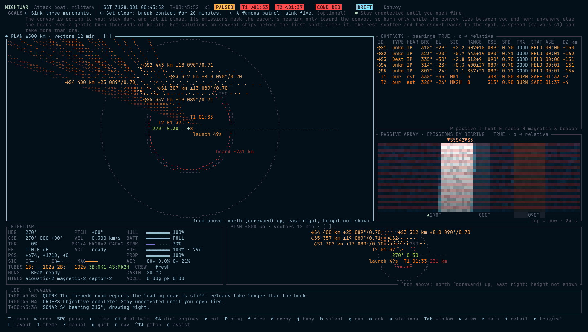

The **nav plot** can go in any window (see [Windows](#windows)); `n` steps a nav display from the rose to the plot, then its side view, then the 3-D view, then back. `[` and `]` zoom in and out; the title shows the scale (half the plot's height).

**The plotting overlay:** think of a sheet of glass over the map, and a grease pencil. **Click** the focused plan to arm a course toward that point: a pulsing arm runs out from your boat with its bearing, as the helm dial's does on the rose, and `ORDER` shows in the header. Click again to move it, `Enter` gives the order and `Esc` drops it. A clicked course lapses after 8 seconds, with the countdown in the `ORDER` pill, so a stray click can't lie in wait for your next `Enter`; touch the arrows and it becomes a dialled order, which stays. Any movement of the mouse makes it a pan, not a click. If `Enter` gave a clicked course when you meant to open the conn, a letter in the next 2 seconds goes to the conn rather than to a hotkey. Only the bearing is used, and the order is a heading: as with any helm order, on a warship it turns the nose and your course changes when you burn. Press **`p`** to take up the pencil, and the plot's title says `PENCIL`: then **click** to write a note, **drag** to draw a line (a track, a boundary, an intended course), and **click a mark** to rub it out. Press `p` again to put it down. With the pencil down, **left-drag** moves a note. The **right button** works as the pencil at any time, if your terminal passes it to the trainer; iTerm keeps it for its menu unless you change that in its settings. On the keyboard, `note TEXT` on the conn writes at the plot's centre, `overlay undo` takes back the last mark, and `overlay clear` wipes the glass. Marks stay where you put them on the map, show on the plots and the chart, and the ship keeps them with the save, the bearing mark too. They are yours alone: they add nothing the boat doesn't know, and nothing in the simulation reads them.

**Move the plot:** drag it with the mouse to look elsewhere. It stays where you put it, on the map, and its title says `off centre`. `centre s1` on the conn follows a contact you have a position for, at the position your solution or fix gives, and holds its last place if you lose it; its title says `on S1`. `centre` alone comes back to your boat, and `C` goes home: the plots on your boat, and the plots and rose at the standard range, ±2,000 km. All the nav plots share one centre. Clicking a focused plot's title bar swaps it into the main window.

- **PLAN** looks down from above: east right, north up. **PROFILE** looks from the side: ahead (along your heading) right, up up. Use PROFILE to see who is above or below you.
- **3-D** is the same plot turned and tilted, so you can see the third dimension. `<` and `>` turn it 15° at a time; `{` and `}` tilt it 10° at a time, from edge-on (0°) to straight down (90°, the plan view again). The range rings lie flat at your level, with `N` marking north. Every contact you have a position for (a TMA estimate or a ping echo) stands on a dotted **drop line** to that level. A drop line going up means the contact is above you, and one going down means it is below; its length is the height difference. Lines of bearing are drawn in 3-D too, so after a turn of the view a bearing that climbs is easy to see. A contact you only have a bearing on has no position yet, so it has no drop line.
- **You** are the `◆` at the centre, with a solid heading line, a dotted vector showing where your velocity carries you, tagged with your course and speed, and a fading trail behind.
- **Vectors** run for a standard time, shown in the plot's title (`vectors 30 min`): 1, 3, 6, 12, 30, 60 minutes and up, chosen by the zoom, as on a ship's radar plot. Every vector on the plot runs for the same time, so a longer line is a faster ship.
- **Charted bodies** are drawn to scale, with their names.
- **Nebulas** are shimmering clouds, to scale, with a name and kind (`the Veil · DUST`).
- **Lines of bearing** run from where you were when you heard each bearing. If you fly straight they stay parallel and never meet. After a leg change they cross, and **the crossing is the target**. This is TMA, drawn.
- **TMA estimates** appear as an ellipse (2σ, so the target is very likely inside) with the contact's ID, and a dotted vector showing where its estimated course takes it. Amber means `FAIR`; threat color means `GOOD`. The ellipse shrinks as the solution improves.
- **Ping echoes** appear as small amber circles.
- **The red dotted ring** is your heard-at range, the farthest of the `HEARD AT` estimates on the rose. Anything inside it can probably hear you.
- **Labels** step aside when they would cover one another; the most urgent (torpedoes, then held contacts, then the nearest) keep their full text.
- **Your torpedoes** are `•` in the threat color (orange in the default theme) with their tube and time to impact (`T1 02:32`), and a dotted line to the `×` where fire control expects them to meet the target. Your gauss gun slugs are grey dots. Enemy torpedoes are red contacts, with red lines of bearing.

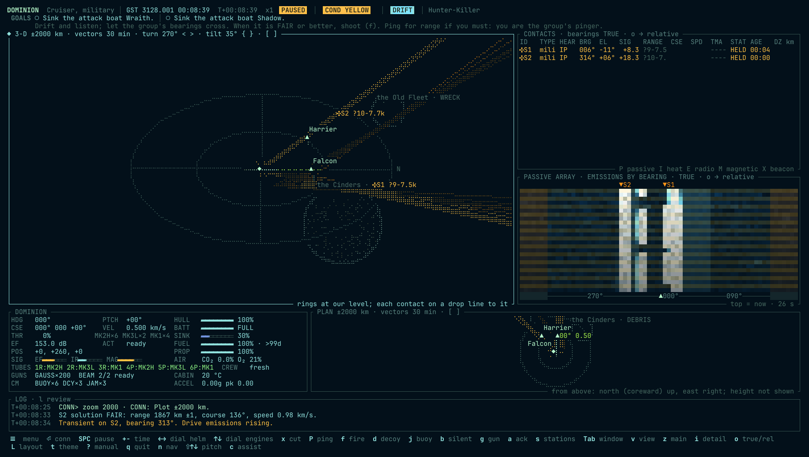

- **A thick amber band on a bearing** is a range band: the near and far limits on a contact you hold on a bearing alone, tagged `?200-900`. See [The range band](#the-range-band).
- **`⊗ launch 12m`** is a loud mark, with its ring. See [Loud marks](#loud-marks).

The plot only shows what you know. Nothing is drawn where you haven't heard anything.

### What the plot draws

Each plot chooses its own layers, and a setup saves them. `layer lob`, `layer ellipses`, `layer vectors`, `layer trail`, `layer rings`, `layer labels`, `layer bands`, `layer loud` and `layer craft` (your own craft's rings home, on a carrier) turn each off or back on; `layer reach` turns on the reach rings, which start off. `layer reset` puts them back. `vectors 30` runs every vector for 30 minutes, and `vectors auto` lets the zoom choose. `W`, or `w` on a focused plot, opens the **plotting menu**: everything in this section, with a tick beside what is on, for pointing at.

### Shadows

`shadow s1` shades the part of the plot that S1 cannot see, behind charted bodies and, more softly, through thick dust. The title reads `SHADOW S1 ±53 km`. Use it to find the way out of a hunter's sight, or to keep a moon between you and an escort.

A shadow is drawn from **where your solution puts the contact**, not from where it is. Its uncertainty blurs the edge: dense hatching is hidden from everywhere the contact may be, and thin hatching only from part of that. A poor solution gives a vague shadow, and a bad solution gives a shadow in the wrong place. It needs a `FAIR` solution or a recent echo; `POOR` gives none. As a solution ages its edge spreads, and if the estimate goes, the title says `no estimate` and the shading stops.

`shadow own` shows what you yourself cannot see. Up to three shadows show at once, each with its own hatching (one in a narrow window). `shadow s1` again takes it off, and `shadow off` clears them. The shading lies on the plane through the plot's centre.

### The range band

A contact on a bearing alone has no range, but it does have a signal. If it is that faint, it can be no nearer than its quietest likely class would be, and no farther than its loudest. The plotter draws those two limits as a thick band on the bearing, and the contacts table reads `?200-900`, in km. A far limit past 10,000 km says only that she may be far off, so it reads `?1.0k+`. `info s1` gives the same limits in full.

**The `?` matters. The band is a limit, never a firing solution.** Fire control takes nothing from it, so it does not replace a leg change and TMA. It is wide because a ship may be drifting silent or burning hard, and the band has to allow for both. It rests on the classes the crew still allows, so it narrows as they make up their minds, and a wrong call gives a wrong band. It allows for jamming and masking in that beam, because your array measures those, but it knows of no dust on the path, which makes a near ship sound far. Use it to ask whether a contact can be a threat yet, and whether it deserves a leg change or a ping.

### Reach rings

`layer reach` draws what your torpedoes can do: a ring at the longest run of what you carry (`reach MK1 1,200 km`, in still space) and the arming circle (`arms 40 km`). Inside the arming circle a hit is a dud.

A contact with a position and a class call gets a dashed ring for each weapon that class carries, tagged `S2 torp ~1,200 km, crew's call`. **These are the crew's estimate.** The ring comes from the class they called, so a bad call gives a bad ring, and a contact they will not name gets none.

`info s1` gives your reach on a solved contact, per torpedo: `MK1 holds ~1,180 km / runs ~640 km`. The first is the farthest you can catch it from if it holds its course. The second is the same if it turns and runs at once, by the class called; with no class call the crew can't say. Shooting between the two means a warned target can outrun the shot.

### Loud marks

The plotter marks each place you were loud: a launch, a ping, a gun burst, a beam shot, a burn (`⊗ launch 12m`). A salvo is one mark, and a long burn is renewed every ten minutes. Around each mark a dotted ring grows at your own speed, so it always reaches the boat. It shows where you might be, to anyone who might have heard you at that spot. The last twelve are kept, fading over an hour; a narrow window shows only the latest.

**A mark says only what you did. It never says whether anyone heard.** Someone might have, and a hunter races to a datum. Use the marks to choose which way to run after a shot, and to see how long a loud moment stays dangerous. `layer loud` hides them and `loud clear` wipes them.

### Zones and tripwires

A zone is a line the crew watches for you. `zone alpha 500` sets a box 1,000 km across at the plot's centre. `zone` on its own takes up the pencil, and the next drag on the plan draws the box; the title says `BOX ALPHA`. A box is fixed to the map (`[f]`) and runs through every height. When a held contact's **estimate** comes inside, the crew calls `ZONE ALPHA: S2 inside, by the estimate.` and time drops to x1, as for any alert. So set an ambush, compress time and wait.

`guard port 270 330` sets a guard arc from 270 to 330 degrees clockwise off the bow. It turns with the boat (`[r]`), and needs only a bearing: the crew calls `GUARD PORT: S2 on the arc.`

A tripwire reads only the sensor picture. It will not call a ship you have not heard, or a box contact you hold on a bearing alone, and an estimate in the wrong place trips in the wrong place. A contact that leaves and comes back within five minutes is not called twice. Mines are not called.

`zones` lists them, `zone off alpha` takes one down, `zones clear` wipes them, and with the pencil up a click on a box's edge rubs it out. Zones go with the save. `overlay clear` wipes them with your other marks.

### Chart

The chart is the plotting table's paper copy: north up, **fixed to space**, and it remembers. It is not on screen at first; put it in a window with `v` (it pairs well with the main window, `z`).

- **Your whole track**, and `◆` where you are now.
- **The charted world:** bodies, nebulas (outlined in their kind's color) and waypoints `⊕ WPT`. A waypoint is a place in your orders, with an exact bearing and range. Nothing is there to hear.
- **A mark `✕` for every contact you have had a position for**, from its latest FAIR or better solution or its latest ping echo, with a ring showing the 2σ uncertainty. The label gives its age in minutes (`S1 12m`), and marks fade as they age. A mark stays where you last knew the contact was, even after you lose it, until something newer moves it. That is how far old knowledge can be trusted.
- The frame grows to take in new marks but never scrolls or shrinks, so the marks stay put on screen while you move.
- **Every label sits beside its mark**, clear of the other labels, the symbols and your track. In a crowd a contact's label shortens to its number (`S4`).

### Passive waterfall

The output of your passive array, the newest second at the top, older seconds scrolling down. It has two settings (`o` with the other bearing displays, or `waterfall true` / `waterfall relative` on their own):

- **True** (the default): `000`, toward the galactic centre, in the middle, with `270` left, `090` right and `180` at both edges, the same layout as relative with north in place of the bow. Turning doesn't move a trace.
- **Relative:** the bow in the middle (`000`), port beam left (`P90`), starboard beam right (`S90`), and the baffles at both edges. A `✦` marks the galactic centre. This is what the hull array actually hears. Each row stays where it was when recorded, so when you turn, every trace shows a kink: old rows at the old heading, new rows at the new one. Real boats offer both; the true display is the array's output corrected for your own heading.

- **Background speckle** is hiss. It is always there.
- **A brighter vertical streak** is a ship. Faint ones come and go; a steady trace is a contact you can follow. You may spot a trace before the tracker calls it a contact.
- **A trace that slants** is a bearing that is changing.
- **A neutral grey band** is your baffles, the arc astern where your own engine deafens the array. It is grey on every theme, so it never reads as a contact. It moves when you turn.
- **Tinted hiss** is a nebula's bearing, in its kind's color. Inside an ion cloud the speckle turns coarse: that is the static. A sharp **white-hot crack** that is gone in a second is a storm's discharge.
- **A white-hot mark** is a ping. **A whole row lighting up** is your own ping: you are deaf for that second.
- **Markers above the data** (`▼S1`) show held contacts. **Below the data**, `▲` is your heading and `△` your ordered heading.

### Sensor waterfalls

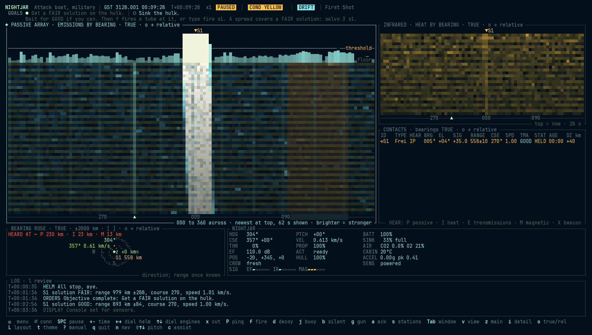

**Real heat.** On engagements built on real physics (so far the *Thermal Range*), infrared is in real units. Your hull radiates whatever heat flows out of the heat sink, so an emptier sink means a colder, dimmer hull; engineering shows it as `hull 191 K (-82 °C) radiating 91 kW`. Radiators shed far more, but they are panels along your sides: from ahead, astern, above or below they are edge-on and hidden, so point your bow at the hunter. A burning drive's plume is seen across a system. A telescope's bearings are extraordinarily precise, thousandths of a degree.

**Real EF.** On the same engagements, the passive array is an **EF array**: it hears radio, in watts. A burning drive's plasma is about 500 W on a warship, the reactor about a watt, a boat on its battery milliwatts, a datalink a kilowatt. Your own vessel is the loudest thing your array hears: light the drive and you go deaf, and the arc astern is deaf. Ion clouds add static; dust doesn't block radio. In the contacts table the array's letter is `F`, and engineering shows your EF in watts (`EF 30 mW`). Each sensor's waterfall has its own colour: infrared warm, EM cyan, magnetic violet.

**Why nobody looks.** There is no lookout and no camera. Hulls are painted a non-reflective black, so a hull reflects almost no starlight, and what it does reflect is lost among every rock and grain of dust doing the same. A glint could be anything at any range, and light is the easiest thing to fake. So a ship is found by what it cannot help giving off: its heat, its EF and its magnetism. The telescopes see heat, not light.

**Magnetism.** Every engagement uses real magnetism. Warships carry magnetometers that feel a ship's magnetic field (shown in magenta), and civilian hulls carry crude ones. A ship's field comes from its reactor's coils and its steel hull: with the reactor running, a destroyer feels an attack boat at about 14 km; with it shut down, the coils' field all but goes, the hull's own field stays, and the destroyer must come within about 6 to 7 km. A navigational shield adds its own coils, and every hard turn or pitch adds up to as much again. It is the point-blank channel, and silence does not hide you from it.

**Searching the sky.** A telescope sees far only where it is pointed. It points at what you already hold: the few contacts most recently heard on any channel (yours, or shared by the group), and any sector it has been set to watch. The rest of the sky is covered by a wide survey a tenth as far. So being heard, on any channel, brings the telescope onto you; and a ship nobody is looking for can pass where it would be seen easily. The survey window shows what your telescope is on.

**Hiding in front of something bigger.** A moon or planet between you and a hunter blocks everything. A planet *behind* you, as the hunter sees it, hides you too: its warm disk drowns the few watts of a hull. A magnetised planet's field drowns magnetometers near it. Burning gives you away regardless.

**Pings and mines, for real.** On the same engagements a ping is a radar pulse. Its echo fades with the fourth power of range, so a destroyer's radar finds an attack boat only out to about 10,000 to 20,000 km; the pulse itself is heard across the whole system. Echoes and pulses travel at light speed. Mines trip on real signatures: EF mines on a loud ship (an idling boat slips past). Magnetic mines trip on a hull's field on every engagement (see [Mines](#mines)).

**Transponders.** Civilian ships carry a beacon. A trader broadcasts it, and it is a dead giveaway: a warship hears it from millions of km, and it gives your name, class, position, course and speed every 30 seconds. Yours starts off; `transponder on` or `off` on the conn. The header shows `XPDR ON` while it broadcasts. Going dark where a beacon was is suspicious in itself.

**The rules of war.** A transponder says two things: "I'm here", and "I'm on this side". In friendly space every merchant broadcasts, as the law of the lanes requires. In a war zone a merchant sailing under escort may lawfully run dark, and many do. An unescorted merchant is bound to broadcast, but many run dark anyway, against the rules, and a dark merchant alone in a war zone is a lawful target. A merchant's beacon follows her situation: one that loses her escort may light up, and one that gains an escort may go dark. Your crew reports a change on any contact you hold (`COMMS  Beacon on S3.`, `COMMS  S3's beacon has gone dark.`). An enemy merchant's beacon names her side, so she reads as hostile (`◇`), and the crew remembers it after she goes dark. The debrief records whether each merchant you sank was broadcasting at the time. An enemy merchant is a lawful target whether she broadcasts or not. Sinking a friendly or neutral merchant who broadcasts honestly is a breach of the rules of war: the fleet reprimands you, your reputation suffers, and the breach costs you rank. A ship flying a false beacon has given up that protection, so sinking her is no breach. A pirate keeps no rules of war, so a captain sailing as one is never charged.

**Collisions.** Hitting a moon destroys you. Hitting another hull costs each ship by its mass: the lighter one takes the worse of it, in the ratio of their masses, so a ghost that touches a freighter comes off far the worse. Damage rises with the square of the closing speed. A ghost is wrecked by a closing speed around 100 m/s against a heavy hull, and at a km/s or more both ships are gone. The hits knock systems as a weapon's do. A hull that survives a crash may still tear: a breach in a pressure hull can run along the frames until the ship snaps in two. Any real crash carries at least a one-in-four chance of that, rising to certain at about a 38% loss of hull, so ramming is a last resort. It also earns nothing: a hull lost in a crash counts as neither sunk nor tonnage, and computer captains burn clear of any hull their solutions show coming close. The helm looks ahead. It calls a charted body on your present course 30 minutes and 5 minutes out (`HELM  Collision course: Mere in about 28 min, at 1.0 km/s.`), and a contact whose solution passes within 5 km of you. Each call drops time compression to x1. A call on a contact is only as good as your solution, and a ship you haven't worked out gets no call. A burn in progress isn't counted: the helm calls the course as it stands.

**Weapon arcs.** Every torpedo tube fires in a cone. An attack boat's tubes are fixed, three in the bow and one in the stern, each 30° either side of its axis, and heading and pitch both count. A destroyer or cruiser has trainable mounts on each side, 120° either way, and a raider or hunter faces forward. The `TUBES` line marks each tube `B`, `S`, `P` or `R`. Fire control picks the ready tube that bears best. You may fire outside the arc, as a WWII gyro angle allowed: the torpedo turns at 1° a second before its motor lights, so each degree costs a second of time and of burn, and the launch is 6 dB louder. At long range that can put the target out of reach, so aim the boat when you have time. Close in, a snap shot off the arc often beats a two-minute turn. `bear s1` turns the boat to bring the nearest tube on, which may be the lone stern tube, so use `steer s1` when a salvo wants the bow. Computer captains keep to the same arcs: they swing up to two minutes, then fire off the arc anyway.

**Warmth.** The cabin must stay warm. While there is power the heaters hold it at 20 °C; without it the cabin cools, and below about 10 °C the crew starts to slip. A flat battery is not a quiet win.

**Every window says what it shows.** The title names the sensor and what it senses (`PASSIVE ARRAY · EMISSIONS BY BEARING`, `INFRARED · HEAT BY BEARING`), and a legend on the bottom border says how to read it: which way the bearings run, that the newest second is at the top and how much history the window holds, and that brighter means stronger. The rose, plot, chart and contacts table carry legends too. A small window shows a short form, so bigger windows (or a bigger terminal) show more: a waterfall holds two seconds per row, so a short window holds only seconds of history.

**Layers** (`w` on a focused waterfall, again for the next) lay more over the picture, as a ham radio's panadapter sits over its waterfall:

1. **Spectrum and guides.** A strip on top shows the last few seconds as bars across bearing, with two reference lines: the **floor** (the background) and the **threshold** (the level at which the tracker can call a contact). A peak poking above the threshold is something you can hold. Guide lines run down the waterfall every 30°, your own heading is traced over time (a turn shows as a step), and time ticks run down the right edge.
2. **The other sensors** (warships): infrared, EM and magnetic returns tinted over the picture in their own colors, so one window shows which sensor sees what.
3. **The tracker's picks:** a dot at every bearing the tracker measured, over the raw trace.

**Estimated courses.** With a `FAIR` or `GOOD` solution on a moving contact, a small arrow at the end of its line points along the estimated course: dim on `FAIR`, bright on `GOOD`, fading once the contact is lost. It shows direction only, and it is the boat's estimate, so a wrong solution draws a wrong arrow.

**On the rose,** `w` hides or shows your own torpedoes in that window, for a crowded picture. `filter held`, `filter weapons`, `filter solved` (`FAIR` or better, or an echo) and `filter hostile` narrow what else that rose shows; give the order again to lift one, or `filter off` for them all. The title says `only held`. A filter hides a line and nothing more: the sensors keep working, the alarms still sound, and a contact called a torpedo stays on every rose. `W` opens the same choices as a menu. The title says when they are hidden, a setup remembers it, and enemy torpedoes always show.

**Tuning:** like tuning a receiver to one frequency and listening, put a cursor on one bearing and hear everything from that direction. Click inside a focused waterfall, nudge with `,` and `.` (2° a press), or type `tune 045`, `tune s1`, `tune t2` (along your own torpedo's track) or `tune off`. Every waterfall draws the cursor, and the bottom border reads out each sensor's level on that bearing and any contact within 4° of it, with its track symbol and its range once known: `TUNED 034° · array +33 dB · IR — · EM — · ✣S1 at 034° 1082 km ±3`. Bearings follow the window's mode (`S034` when relative). A narrow window trims the readout from the right.

What you get depends on the ship.

- **A civilian ship** has one display, **SENSORS · FUSED**: everything its sensors pick up, emissions and transmissions alike, in one waterfall. Its sensors are less sensitive, and it can't tell you which sensor heard what.
- **A warship** has a separate, more sensitive waterfall for each sensor it carries, each in its own window:
  - **PASSIVE:** the passive array, as above.
  - **INFRARED:** heat. Sharp bearings (about 1°). A boat glows when its radiators are out or its drive burns.
  - **EM INTERCEPT:** transmissions: a group's datalink, and the flash of guns and beams. Silent ships show nothing.
  - **MAGNETIC:** the magnetometer: hulls, powered or not, mines included. Broad, blurry bearings, and only at very short range.

  Each marks only the contacts its own sensor has heard in the last minute, so comparing them tells you how a contact gives itself away. The **sensors** station (`F3`) puts them side by side.

A station built for a warship, opened on a ship without those sensors, fills the spare windows with other instruments.

### Comms

The comms station's window: who can hear us, and who we are talking to.

- **TRANSPONDER:** off in hostile space; nothing announces you.
- **DATALINK:** your group, the link's health, and whether you are **TRANSMITTING** this second. Sharing a contact with the group is an EM transmission, and EM intercept hears it.
- **The group:** each ship with its class, bearing and range, from the datalink.
- **TRAFFIC:** your orders, and every report about the group or the link, newest at the bottom.

### Fire control

The weapons station's window answers one question: can I shoot, and if not, what must change? `setup weapons` opens it, `v` reaches it in any window, and `show fire` puts it in the focused one.

The top line gives the exploder setting, the tubes and the magazine. Below that is a grid. Each row is a contact you hold, with the crew's call and the solution's quality. Each column is a weapon kind aboard. A cell reads `OK`, with the time to the meeting or the range, or it names what blocks the shot.

| Cell | Means |
|---|---|
| `OK 04:12` | Clear to fire. The torpedo meets the target in 4 min 12 s. |
| `OK 04:12 spr 3` | Clear, and a spread of three covers the solution's range error. It says nothing about how many hits the target takes. |
| `OK 48km` | Clear to fire a gun, at fire control's range. |
| `arming 38km` | The order will go, but the run is inside arming distance. It will not arm. |
| `hits Mere` | The order will go, but the run crosses a body on the way and the torpedo will strike it. `Enter` never offers this shot. |
| `solution` | No `FAIR` solution, or for a gun no fresh echo either. |
| `reach` | The torpedo can't catch it on this run. |
| `arc 41°` | Tube is 41° off, and it can't turn in time. |
| `reload 42s`, `charging 42s` | Ready soon. |
| `not loaded` | This kind is aboard, but no tube holds it. |
| `none left`, `damaged` | As it says. |
| `range 900` | Beyond the gun's reach, at fire control's range. |

The chosen contact's row opens below the grid: one line per weapon, saying what would clear the block, such as `load 2 mk2h` or `Close 840 km`. On a contact whose class the crew has called, a clear line also gives their count of good hits to sink it, as an estimate. `,` and `.` change the row while this window has the focus, and `info s1` and `check s1` choose it too. `Enter` puts the first clear shot on the conn line, and you still give the order. If nothing is clear, it offers the first order that would clear a block. Clicking a row in the focused window chooses it, and clicking a cell puts its order on the conn line: the shot, or the order that clears the block, such as `load 2 mk2h` or `bear s1`.

The grid uses the same checks as your orders, and only fire control's own figures, so a cell can be wrong exactly when your solution is. **A moon in the way.** When you fire, fire control checks the run to the aim point against the chart. If it passes through a charted body, the launch line says so: `The run crosses Mere: it will strike it.` The grid does not show this, so read the log after a shot near a moon. A window too narrow for the grid shows the chosen contact alone, one line per weapon.

### Survey

The science station's window: how each thing gives itself away.

- **Each contact,** with what each sensor (passive array, infrared, EM, magnetic) last heard of it: the signal in dB and how long ago. Grey means more than a minute old; `·` means never.
- **SURROUNDINGS:** each cloud (inside it, or its bearing and the distance to its edge) and each body (bearing and distance to its surface). These are charted, so their true positions are fair to show.
- **WE SHOW:** your own signature on each channel: EF, infrared (amber when the radiators are out), your magnetic field (`MAG 6.0 kA·m²`, with `×1.8 manoeuvring` in amber while a turn adds to it), and whether you are transmitting.

### Status (your vessel)

**Naming your vessel.** The title screen draws a name for your vessel from its class's naming tradition: ghosts after night birds and spirits, haulers after small birds, freighters after virtues, warships after hawks and resolve. Press `r` for another, or `n` to type your own (Enter keeps it, Esc cancels). Choosing a different engagement draws a fresh name.

The window titled with your vessel's own name (`NIGHTJAR`, `MUDLARK`).

| Gauge | Meaning |
|---|---|
| `HDG` / `PTCH` | Heading and pitch of the nose, with the ordered values in amber while turning. |
| `CSE` / `VEL` | Course (direction of travel: true bearing, bearing off the bow, and climb) and speed. `CSE 043° P019 +02°` means she is sliding 19° to port of where she points. |
| `THR` | Main drive output, with the ordered value while it spools. With flight assist on, `SPD` shows the speed assist is holding instead. |
| `EF` | How much you are radiating right now: watts on the real-physics engagements, a level in dB on the others. An amber `TX` beside it means you are transmitting this second: a datalink report, or a linked torpedo's guidance. On the engagements that read in dB the link is a radio signal of its own, which the level leaves out, and the enemy's ESM hears it on your true bearing. |
| `ACT` | Active array: `ready`, seconds to recharge, or `none`. |
| `ALT` | Altitude above the nearest body and how fast it is changing. Amber if you would hit within ten minutes, red within two. |
| `TUBES` | Each tube and what is in it (`1:MK1`), and any kind ordered next (`1:MK1>MK2H`). Green when ready (the plain value colour in a single-hue theme). The tube its room's crew is loading is amber, with the turning wheel and the time left (`2B:-- ⠋8:40`); a tube waiting its turn reads `wait`. Dim when empty. What is left in the magazine (`MK1×6`) shows beside `THR`, or on its own `STOCK` row in a narrow panel. Shown only if you have tubes. |
| `DECK` | **On a carrier, in place of the tubes,** and above `SIG`, so a short window keeps it. Each kind of craft and how many are ready (`F×6` fighters, `S×4` strike fighters, green), with those being refuelled and rearmed after a `+` in amber; `Q2` launches waiting; and `AIR 3`, craft aloft. Below it, as the window has room, a row for each craft: its short name (`Picket 1`, red when it can no longer make the deck in time), its mission, its Δv and endurance bars, and its range from you. `show deck` opens the full window. |
| `MINES` | Mines left to lay, by kind. |
| `GUNS` | Gauss gun slugs left (`GAUSS×200`) and seconds to recharge; the beam, `ready` or `charging 42s` (with several, `1/2 42s`: charged, and the wait for the next). |
| `CM` | Countermeasures left: static buoys (`BUOY`), decoys (`DCY`) and jammer drones (`JAM`), with the launcher's reload in seconds. |
| `EW` | Electronic warfare: your jammer (`ON 045` or `off`) if fitted, and the strongest jamming you hear (`JAMMED 012 +48 dB`). Amber while jammed; red once the displays break up. |
| `POS` | Your position in the fleet frame, in km. |
| `SIG` | **Stealth:** what you're giving away on each channel, as a bar from the quietest your boat can be to the loudest, green, amber, red. `EF` (electric field: what the passive array hears), `IR` heat, `MAG` magnetism. Every real manoeuvre costs magnetism: turning, pitching or flight-assist corrections beyond 10% of the boat's ability drive the attitude motors, up to double the field at full rate. Small movements are free. |
| `BATT` | **Vitals, in the right-hand column** (below the other gauges in a narrow window). The battery's charge, and which way it is going. Draining, an amber `▼` and how long until it is flat (`62% ▼ 41m`). Charging, a green `▲ charging`. Topped up, it reads `FULL`. Holding steady, a dim time: how long the charge would carry the present load alone. The bar is amber under 30% and red under 15%. |
| `SINK` | How full the heat sink is, as a gauge running blue to red and a percent. Amber over 70%, red over 90% or overheating. |
| `FUEL` | Reactor fuel left, to a tenth of a percent, and, while the reactor burns it, an amber `▼` and how long it lasts at this burn, in days, hours or minutes (`99.8% ▼ 41d`). Amber under 10%, red under 2%, `DRY` at zero. With Nerd Font icons on, the label carries a fuel cell. Propellant moves the boat; fuel runs the reactor and generator. Engineering shows how long it lasts at this burn. |
| `PROP` | Propellant left. Amber under 25%, red under 10%. At zero the engineer calls it, and the helm answers any burn order with `Tanks dry`. |
| `AIR` | Carbon dioxide and oxygen, and while the air is getting worse, how long the crew has before it kills them (`· 57m`). Each gas has its own colour. `CO₂` turns amber over 1% and red over 4%; `O₂` turns amber under 19% and red under 16%. |
| `CABIN` | Cabin temperature. Amber under 16 °C, red under 10 °C. |
| `CREW` | How tired the crew is: `fresh`, a percentage worn, then `tired` (amber, from half) and `spent` (red). A tired crew hears, reloads, repairs and answers worse, down to half as well when spent, on top of bad air (the worse of the two counts). The log says once when they are tired and once when they are spent. |
| `ACCEL` | What the crew feels, in g, and the peak this voyage (`pk`). Thrust and flight assist count; gravity doesn't, because a ship in free fall floats in it. Turning under assist adds g as the thrusters bend your course. Amber over 80% of the crew's limit (1.5 g where the class sets none), red over it. |
| `TURN` | How fast the nose turns, in degrees a second, heading or pitch, whichever is faster. Amber once the turn is fast enough to show on MAG (a tenth of the boat's top rate); white below that, where turning is quiet. `CSE` after it is how fast your course itself swings, in degrees a minute: what thrust and gravity are doing to your track. `turn status` reads both, and the quiet limit. |
| `SENS` | Whether the sensors have power. `OFF: deaf` means you hear nothing. |

**A gauge can break.** Damage, or a quirk of the hull, can break the instrument behind a gauge. A dead gauge says so: its label is struck through and the reading says `× NO DATA`. A stuck gauge keeps showing its last reading, and a wrong one drifts further from the truth. Neither gives any sign. Cross-check them against the crew and against the engineering window, which has its own meters. See [Broken gauges](#broken-gauges).

### Contacts

| Column | Meaning |
|---|---|
| `ID` | Contact designation, `S1`, `S2`…, after its track symbol (`○` friendly, `◇` hostile, `□` neutral, `✣` unknown; a fighter's is the top half: `◠ ⋀ ⊓ ⌒`). |
| `TYPE` | The crew's best guess: `unknown`, then `civilian?` or `military?`, then a class (see [Identifying a contact](#identifying-a-contact)). |
| `HEAR` | Which sensors heard it in the last minute. `P`: the passive array, hearing what a ship's drive and machinery radiate (there is no sound in space; on most engagements this is a stand-in for the EF a ship gives off, measured in dB). `F`: on the real-physics engagements, the same array as an EF array, hearing radio, in place of `P`. `I`: infrared, its heat. `E`: EM, its transmissions. `M`: magnetic. `X`: its transponder beacon is broadcasting, so it is announcing itself; a contact without `X` is one you found. The window's bottom border is the key. |
| `BRG` / `EL` | Last bearing and elevation. With relative bearings on (`o`), the column reads `REL`: `S045` is 45° to starboard of the bow, `P135` is 135° to port, `000` dead ahead, `180` dead astern. The letters keep a relative bearing from being mistaken for a true one: helm orders and `CSE` are always true. |
| `SIG` | How far above your detection threshold the last signal was, in dB. Near zero is faint. |
| `RANGE km` | Estimated range and uncertainty, from TMA or a ping echo, worked forward to now. `?200-900` is a [range band](#the-range-band): limits from a faint signal and the crew's class calls, never a solution. Blank when unknown. `~` means carried forward by dead reckoning from an older solution, its uncertainty growing. |
| `CSE` / `SPD` | Estimated course and speed, from TMA. |
| `TMA` | Solution quality: `----` none, `POOR`, `FAIR`, `GOOD`, or `FIX` for a recent ping echo. |
| `STAT` | `HELD` while heard recently; `LOST` after a minute of silence; `SUNK?` when the crew calls it sunk; `TORP` for a torpedo, in red; `MINE` for a mine. |
| `AGE` | Time since last heard. |
| `DZ km` | Height above (`+`) or below (`-`) you, once range is known. Every range on the console is a straight line in 3-D, so a contact far above you is farther than its plan-view distance. |

The fire-control computer keeps working after a contact goes quiet: range, and a lost contact's bearing, come from its last solution carried forward to now. Their colour says how old that solution is: the track's own colour within a minute, amber up to ten minutes, faint after that.

**Your own torpedoes** are listed below the contacts as `T1`, `T2`… (by tube), in your own color. Torpedoes are fire-and-forget: a guidance link is a transmitter, and a quiet boat will not run one. So these numbers are fire control's **dead reckoning** from the launch (`est` in the `HEAR` column), not truth: a homing torpedo that turns on its own is not where they say. A **linked** torpedo (`link`, the cruiser's Mk 3) reports its true position and takes course corrections, at the price of the launcher transmitting for the whole run, on a beam that points at the target. The columns: bearing, range in km, course, speed relative to you, `BURN` or `COAST`, `SAFE` or `ARMD` (armed), and in the last column the time to the meeting point fire control aimed it at.

### Log

Timestamped reports in plain language: new contacts, transients, solutions, pings, and anything else the boat wants you to know. Time compression drops to x1 whenever something important happens.

**Crew reports.** The crew says what the gauges show, each station in its own voice, so you can run the boat from the console. Engineering calls the battery as it passes 50%, 30%, 15% and 5%, the heat sink at 50%, 70% and 90%, fuel at 50% and 25%, and a channel turning loud on the `SIG` bars. The helm calls propellant at 50%, 25% and 10%, `Steady on 045°` when a turn is done, the drive answering an order, and acceleration near or past the crew's limit. Navigation calls your height as you sink into a well. Damage control calls the hull after a hit. The chief of the boat calls the cabin cooling. Weapons calls a tube loaded, the gauss and the beam ready, and a torpedo's last minute and last ten seconds to run. Sensors call a contact's bearing once it has moved 10°, a torpedo's bearing every 30 seconds while it runs, the pinger ready, and jamming. A reading is called once as it crosses a line, and again only once it has come well back, and no report repeats within 30 seconds. Choose how much you hear with `reports`: `reports normal` (the default) gives what needs a decision and what is urgent; `reports quiet` keeps only the urgent; `reports all` adds the routine. The choice is kept for the next exercise.

Every gauge also has an answer at the console. Type its name: `battery`, `heat`, `fuel`, `prop`, `hull`, `air`, `cabin`, `crew`, `helm` (heading, course, speed and drive), `pos`, `alt`, `accel`, `tubes`, `guns`, `pinger`, `cm` or `sig`. The station answers from its own instruments, not from the gauge.

The panel shows the newest entries, and the wheel scrolls it back. In a window at least 44 columns wide and 7 rows high, a row of toggles runs along its top: `ORD` orders, `CON` contacts, `FC` fire control, `ENG` engineering, `DC` damage, `NAV` navigation, `COM` comms and `SYS` the trainer's own notes. Click one to hide or show that kind, or give the order `filter eng`. With `filter s1`, a wide log window gives S1 a column of its own beside all traffic. `filter off` takes the contact away.

**Press `l` to review the whole log**: it opens full screen and pauses the exercise.

| Key | Does |
|---|---|
| `↑` `↓` | Move the cursor one line |
| `PgUp` `PgDn`, `Shift+↑` `↓`, `b` `space` | Move a page |
| `Home` `End`, `g` `G` | The oldest and newest entries |
| `1` to `8` | Hide or show a kind |
| `f` | Show only one contact: type `s3`, or nothing for all |
| `c` | Show only the contact on this line, or all again |
| `/` | Search as you type. `Enter` keeps it and `Esc` drops it |
| `0` | Clear every filter |
| `Enter` | Open the line: where you were, which sensor held the contact, its signal, its range and solution, and the crew's call at that moment |
| `p` | Close the log and centre the plot on where you were, with a brief `✕` mark. `C` brings the plot home |
| `l` `Esc` | Close |

The mouse works here too: click a toggle or a word along the foot, click a line to put the cursor on it, and click it again to open it. A line that names a contact counts as being about it, so `Ping. Echoes: S1...; S2...` shows under both.

Entries are colored by what they say: your orders, your own `log` lines (bold), contacts, pings, transients and system notes. Lines that night orders keep off the running log show here, faint.

**After the fight.** Press `l` in the replay for the same log over the whole encounter, and every filter works. It opens at the replay's moment. `p` closes it and moves the replay to the moment of that line, so you can read what the boat knew and then see what was true. The filter stays for the next time you open it.

### Night orders

Night orders say what wakes you. Press `N`, choose it from the menu, or give the order `night`. The page lists each kind of event with four levels:

| Level | What happens |
|---|---|
| `record` | The line goes in the record for later review, and stays off the running log |
| `log` | A line in the log. Time runs on |
| `x1` | Time compression drops to x1, and a notice shows if the log is not on screen |
| `pause` | Time compression drops to x1 and the clock stops. In iron mode a pause reads as x1 and spends none of your pauses |

The trainer starts on the **Standing** orders. If you never open this page, nothing changes. `↑` `↓` choose a row, `←` `→` change it, and `Enter` steps round. A click on a level sets it. Keys `1` to `4` choose a preset, and the header shows it beside the time rate unless it is Standing:

| Preset | For |
|---|---|
| **Standing** | The trainer's defaults |
| **Transit** | Long legs through traffic. New contacts log without slowing time. What you already hold stays off the running log. A ping still drops to x1 |
| **Patrol** | The first report of anything drops to x1. Regained contacts, transients and clouds only log |
| **Ambush** | A long wait. A new contact, a transient or a ping stops the clock |

Lower alarms save real time, and they delay your answer to a new contact. That is the trade.

**Three kinds always reach you.** A torpedo or detonation, a hit on your boat and the end of the engagement always drop to x1. You can raise them to `pause`, but you can't lower them. Night orders change only what reaches you. Your crew's work and your alarm bell stay the same.

**Your own calls** sit at the foot of the page. The crew calls you once when each comes due:

| Order | Calls you |
|---|---|
| `call me battery 30` | When the battery falls under 30% (again once it has recovered 5%) |
| `call me at 02:00` | At that time on the `T+` clock |
| `call me waypoint`, `call me waypoint 20000` | Within 5,000 km, or the distance you give, of a charted waypoint |
| `call me off` | Drops all three (`x` on the page) |

### Standing orders

Standing orders say what the crew does before you can answer. Press `S`, choose it from the menu, or give the order `standing`. Every row starts on `hold`, and a boat on `hold` does nothing by itself. If you never open this page, nothing changes.

| Row | Choices | What you trade |
|---|---|---|
| Torpedo called: lure | `hold`, `noisemaker`, `decoy` | One from the rack at the first call. A far torpedo can outlast it |
| Torpedo called: helm | `hold`, `burn` | The helm puts the torpedo on the beam and burns for 45 seconds. Everyone sees the drive, and your own plan is gone |
| Torpedo called: array | `hold`, `ping` | One ping ranges the torpedo. It tells everyone where you are |
| Torpedo called: jammer | `hold`, `jam` | Jamming starts on the torpedo, and everyone can hear exactly where you are until you order `jam off` |
| Ping heard | `hold`, `coast`, `silent` | A ping may not have found you. `coast` cuts the burn. `silent` shuts the reactor down too, and a restart takes time and is heard |
| Battery low, plant held | `hold`, `normal` | Under 20% with the reactor held or capped, the plant goes back on automatic. The start is heard. On `hold` you stay hidden and may go flat |

`↑` `↓` choose a row, `←` `→` change it, and `Enter` steps round. A click on a choice sets it. `x` puts every row back on `hold`. The order `standing lure decoy` sets a row, and `standing off` clears the sheet. The header shows `STANDING 2` while two rows are off `hold`. A row reads `not fitted` if your boat lacks the gear.

**The crew is a drill, not a tactician.** It answers about 20 seconds after the call on an average crew, sooner at Red and later on a slow one. It answers one torpedo call or one ping in two minutes, so the second torpedo of a salvo is yours. It does not know how far off the torpedo is, or whether that ping found you. It can't weigh any of that, and you can.

### The captain's own call

The `TYPE` column is the crew's opinion, and the crew can be wrong. These orders record yours beside it. They change nothing the crew or fire control does.

| Order | Does |
|---|---|
| `call s3 hostile`, `neutral`, `friendly`, `off` | Your own reading of the contact |
| `name s3 fat one`, `name s3` | Your own name for it, or none |
| `ignore s3`, `ignore s3 off` | Set it aside: it dims in the table and on the plot, and `f` and `g` pass over it |
| `pin s3` | A note on the overlay where the contact is now, with its name and the time |

Your view shows in a `CAPT` column when the contacts table is wide, and after the `TYPE` when it is not. The vessel window shows it too. **An ignored contact's alarms still sound.** Setting something aside is a real risk, so a torpedo from it reaches you as any other does. A torpedo itself never dims.

### Signing in

The trainer signs you in each time you power up the console. It opens a secure line, checks your clearance and greets you, with your hours on the trainer as an officer's record. This takes under two seconds, and any key or click skips it. The sequence does not run for a replay. Over a metered link it is one still frame, held for a second.

**Your first time.** Type your last name, `Enter`, then your first name, `Enter`. The first name may be left blank. The record keeps both, as `Hale, Anthony`. The trainer and the crew address you by your last name alone: the first name appears only on the captains page and your signature. From then on the trainer greets you by the time on your own clock (good morning, good afternoon, good evening, and less formally in the small hours) and asks nothing. `Esc` on an empty name goes straight to the title screen, with nobody signed in, and the trainer asks again next time.

**Form FP-1138.** After the name, the Fleet Personnel Office offers its application. `↑`/`↓` move between fields, `←`/`→` change an answer, and `Enter` moves on. Any field may stay "Not stated". `Esc` skips the rest of the form, and your name stands alone. Choose a career stream, then answer four questions. Page 2 is the declaration: `Enter` signs it with your name, and the form comes back stamped ACCEPTED, with a score slip.

**The score slip.** The Navy Aptitude Assessment Test (NAAT) gives a line score out of 99 for sensors, navigation, engineering and tactics, a percentile, and a recommended career path. The recommendation is advice: the career you stated stands, and `c` on the captains page changes it. Your answers lean the scores and chance moves them. The office then reports what you tested as, from those scores and more chance, so the result may surprise you. It is rolled once and stays on your record. A form you skipped can be filed later with `f` on the captains page. The form also leans the four attributes of a captain's sheet: nerve, cunning, aggression and seamanship. All of this is a service record. None of it changes how a boat handles or how an exercise is scored.

**Captains.** Several captains can share one trainer. Each has a name, a career, a level of difficulty, hours, records and saved exercises of their own. With one captain on the roster, the trainer signs that captain in. With several, you choose. `C` on the title screen opens the captains page at any time:

| Key | Does |
|---|---|
| `↑` `↓` | Choose a captain. The service record is shown below the list |
| `Enter` | Sign in as that captain |
| `a` | Always log in as this captain. Sign-in then skips the choice and goes straight to the greeting. Press it again to turn it off, or on another captain to move it |
| `n` | A new captain |
| `r` | Rename this captain: the last name, `Enter`, the first name, `Enter`. The roster, the records and the saves take the new name, so rank, hours and record carry over; replays keep the name they were made under. A name another captain holds is refused |
| `c` | Change this captain's career |
| `f` | File Form FP-1138, if this captain has not |
| `s` | Turn the sign-in sequence on or off |
| `Esc` | Back, with no change of captain |

The list and these keys can be clicked as well. To skip sign-in for one run, start the trainer with `--no-signin`: it keeps the last captain and asks nothing.

**Rank.** Every captain starts at the foot of their career's ladder and is promoted for missions completed. Lessons don't count. Each breach of the rules of war takes three missions off the count, so a captain can be reduced in rank, and the service record shows a reputation, from clean through noted and questioned to notorious. The navy runs from Ensign to Commodore, the merchant service from Third Mate to Commodore Master, and a privateer from Prize Crew to Commodore of the Free Company. Rank is a record of experience and conduct: it changes nothing in an exercise. The trainer shows it beside your name and announces a promotion when you next reach the console. The enemy wears the same ranks, and theirs say roughly how experienced they are.

**Awards.** The fleet also notices outstanding work, once for each award, and lists them on your service record. Like rank, an award changes nothing in an exercise. Some are plain about what earns them and some are not; you will find out.

**Careers.** Captains are listed by career: Military, Civilian or Pirate. A career is a label on your record for now, and every career sails the war campaign. Your progress through it is your own.

**Time on the trainer.** Hours count the time spent in exercises, by the clock on the wall, including time paused. Replays and the title screen do not count. **Your first captain inherits** everything the trainer held before it had captains: past records and saved exercises. Replays are shared by all captains. Your roster is kept in `roster.ron`, beside your records.

### Title screen

The **Fleet Tactical Trainer** opens on its main menu when you power up the console, after the sign-in. `↑`/`↓` (or `k`/`j`) choose an item, `Enter` opens it, `Esc` comes back from any page to the menu, `?` opens this manual and `q` quits. The menu holds, in order:

- **New Game:** a career in a generated galaxy. It is not built yet, so it is shown faint and does nothing.
- **Continue:** your newest saved exercise, paused where you left off. It is listed only when there is a save. Its details show beside it; `x` opens the saves and replays page at its delete question (below).
- **Training:** the lessons, under CIVILIAN, NAVAL and GHOST, in teaching order. See [Tutorials](#tutorials).
- **Scenarios:** the challenges, under the kind of boat you sail: CIVILIAN, NAVAL or PRIVATEER.
- **War Campaign:** the war in order: nine engagements in three eras, each opened by winning the one before. See [The war campaign](#21-the-war-campaign).
- **Saved Exercises:** every save and kept replay (below).
- **Options:** the theme, colors (24-bit or 256), effects, sound, CRT scanlines, Nerd Font icons, how much the crew reports, and the captain and sign-in. `↑`/`↓` choose a row and `Enter` changes it. The keys `t` theme, `c` colors, `e` effects, `m` sound, `s` scanlines and `f` icons work on every page, and `C` opens the captains page. Settings carry into the exercise and back.
- **Manual** and **Quit.**

Started with `--dev`, the menu also has a **Dev** item, just above Quit, that lists the test bench (see [Scenarios](#22-scenarios)).

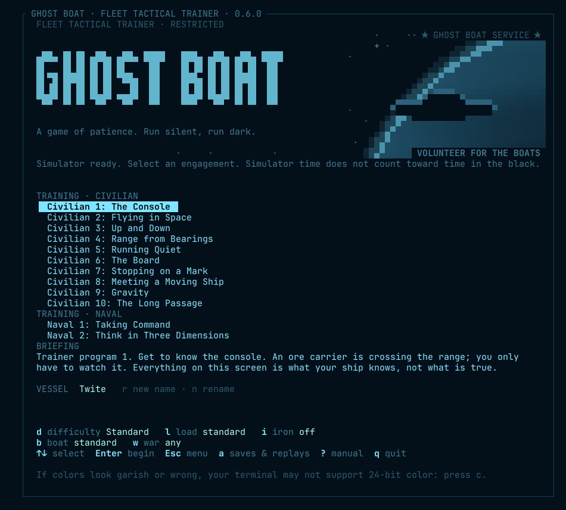

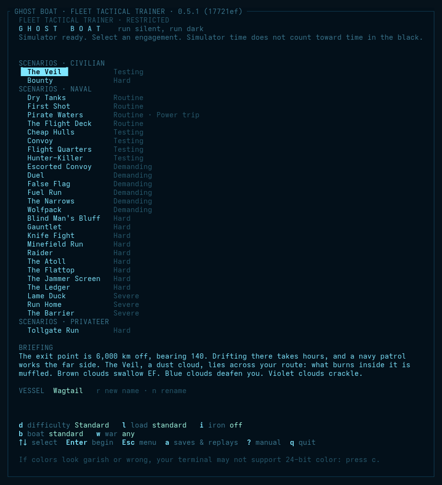

**Training, Scenarios and War Campaign** each list their exercises with the chosen one's briefing and best result. `↑`/`↓` choose one, and `Enter` begins it (or, for an exercise that offers a choice of ships, opens its setup page). A locked campaign step says which win opens it. Under the list are the choices for the next launch: `d` difficulty, `l` [the load to sail with](#choosing-the-load-before-sailing), `i` iron mode, `b` the boat and `w` the war.

**Saves and replays.** Saved Exercises, or `a` on any page of the title screen, opens a page listing every saved exercise and kept replay together, newest first: its name, scenario, date (UTC), level, outcome and, for a replay, the verdict band. (`m` is the sound setting, so the page is on `a`.) `↑`/`↓` choose, `Enter` continues a save or watches a replay, and `Esc` goes back.

- `r` renames a save you named, or a replay. A replay keeps its date and outcome in its file name, so it still lists and plays; an autosave or the iron save can't be renamed.
- `k` keeps a replay, so it is never pruned (the trainer keeps the newest 50 otherwise, and a kept one isn't counted among them); `k` again lets it go.
- `d` deletes, and always asks first: only `y` does it. It removes only the trainer's own save and replay files. An iron-mode save can't be deleted while its engagement is still running: continue it and finish the fight. One that won't read can't be finished, so it can be deleted.
- `/` filters the list by scenario (`Enter` keeps the filter, `Esc` clears it).
- A save or replay file that won't read (a corrupt file, half of a save, or a save from an older version) is listed as unreadable, and can still be deleted. Continuing one from the title says "Can't read that save."

- **Without iron mode** an exercise keeps several saves: an autosave for each engagement, written every 5 minutes and when you leave, and any number you name yourself with `save` or `save before the attack` on the conn.
- **In iron mode** there is one save, written only when you leave. There is no autosave and no `save` order, and continuing from the save uses it up. An exercise keeps the iron mode it was started in.

**Choosing ships.** Some engagements, such as *Duel*, let you pick your ship, the opponent's ship and its captain. On the setup page, `↑`/`↓` move between the choices, `←`/`→` change one, `Enter` begins and `Esc` goes back. Under each ship is a one-line summary: acceleration, EF drifting and burning, how quiet its array is ("ears", lower is better), whether it pings, and its tubes.

**Themes** live in `data/themes.ron`: sixteen come with the trainer (Deep Signal, Phosphor Plus, Neon Tactical, Solar Punk Solarized, Amber Terminal, Red Light, the red lighting of a control room at night, Polaris, the cool Nord palette on a darker ground, Graveyard Watch, the Dracula palette on a darker ground, Field Service, in the blue of an old PC, Boldly Go, orange and lilac panels on black, and Letter of Marque, a sea chart in tar and gold, which comes up by itself when a privateer signs in, and Cold Steel, gunmetal and frost for a flight deck, and Imperial Bridge, grey deck plate with red and green panel lights, and Full Dress, the Pride flag's colours, after the rainbow of signal flags a ship strings bow to stern on a day of celebration, Yamamoto, deep indigo with soft blue text and pastel signals, and Breadbin, the light blue on blue of an old home computer). Copy one, change its colors and restart to make your own. If the file has a mistake, the trainer says so and uses its built-in themes.

**Scanlines** (`s`) darken every other row a little, like an old CRT.

**Difficulty** (`d`) steps the level of your next launch through Standard, Hard and Nightmare, for free play and the campaign alike. It belongs to the signed-in captain, so it is kept between sessions and each captain has their own. With nobody signed in, it starts at Standard. The first time you choose Nightmare it shows a warning: `y` sails anyway, and any other key backs out. Once you've accepted, it doesn't ask again on this machine; the yellow label under the list says what you've chosen. See [Difficulty](#difficulty).

**Iron mode** (`i` on a list of exercises) takes the pause away, as a real watch would:

- **off:** pause whenever you like;
- **limited:** three pauses per engagement, each lasting at most 30 seconds, then the trainer resumes by itself. The header shows `IRON 2` for the pauses left;
- **iron:** no pausing at all (`IRON` in the header). The manual and the log viewer open over an exercise that keeps running.

**Records.** Each finished engagement is saved: won or lost, the time, the mode, ships sunk, hull left, the level, the [verdict band](#verdict-bands) and the tons sunk. A Nightmare run is marked as one. The title screen shows each engagement's best (a win in a stricter mode beats a faster one in a gentler mode, and at the same mode a harder level beats a faster easier one), and at its head your heaviest bag and your running total of tons. Records live in `~/.local/share/ghostboat/records.tsv` (or under `$XDG_DATA_HOME`).

If the colors look garish or wrong, press `c` for 256-color mode. Terminals reached over SSH often can't say whether they support 24-bit color, so the trainer may start in 256-color mode; press `c` to try 24-bit.

## 3. Controls

| Key | Action |
|---|---|
| `Enter` or `:` | Open the `CONN>` line to type an order (see below) |
| `s` | Stations: pick a console setup from a menu |
| `Space` | Pause, and resume at x1. In iron mode it first brings time back to x1, and pauses (where iron allows it) only at x1 |
| `=` | Back to x1 at once |
| `+` / `-` | Time compression, x1 to x100k: x1, x2, x5, x10, x30, x100, x300, x1k, x3k, x10k, x30k, x100k. It drops back to x1 by itself whenever something happens. Engagements at real distances take hours or days; compression is how you cross the empty ones. If the machine can't keep up, the header shows the rate actually reached: `x100k (x17.4k max)`. |
| Click the plan | Arm a course toward that point, on any hull; `Enter` gives it and `Esc` drops it |
| `←` / `→` | Warship: dial in a heading 5° left or right; nothing turns until you press `Enter` (or `Shift+Enter`) to give the order, and `Esc` drops it. Civilian hull: steer 5° at once. Hold `Shift` for 1° steps |
| `Shift+↑` / `Shift+↓` (or `PgUp` / `PgDn`) | Dial in pitch 5° up or down; `Enter` gives the order |
| `↑` / `↓` | Dial the engine telegraph: all stop, ahead one third (25%), two thirds (50%), standard (75%), full (100%), flank (full, pushed). With flight assist on, dial a speed 0.1 km/s up or down. `Enter` gives the order |
| `x` | All stop, without `Enter`: cut the drive and release flight assist, and the engine room answers in its own time. On a civilian hull's autopilot, it stays on and brings the ship to rest; `c` is what hands you manual control |
| `c` | Civilian hull: autopilot on or off (off is manual control). Any hull with a compensator: flight assist on or off. The log records the order and the helm's answer, as for `assist on` |
| `P` | Ping with active array. It takes a Shift, because a ping tells everyone where you are |
| `f` | Fire the next ready tube at the contact with the best solution |
| `d` | Launch a decoy along your course |
| `j` | Drop a static buoy astern |
| `J` | Begin jamming: jam the loudest incoming torpedo, steady, at your jammer's highest setting |
| `b` | Rig for silent running (reactor shut down, radiators in), or back to normal |
| `g` | Gauss gun burst at the contact with the best fix or solution |
| `a` | Acknowledge the master alarm |
| `i` | The focused window: captain's summary or detail |
| `n` | Step the focused nav display: rose, plan, profile, 3-D |
| `<` / `>` | Turn the 3-D view |
| `{` / `}` | Tilt the 3-D view: toward edge-on, toward overhead |
| `o` | True or relative bearings: every bearing display at once |
| `C` | Home: centre the nav plots on your boat, and put the plots and rose back at the standard range (±2,000 km) |
| `p` | Take up the grease pencil, or put it down |
| `W` | The plotting menu: filters, layers, shadows, zones. `w` on a focused plot opens it too |
| `Tab` / `Shift-Tab` | Focus the next or previous window |
| `v` | Change what the focused window shows |
| `z` | Swap the focused window into the main window |
| `L` | Next window layout |
| `F2`–`F10` | Console setups: bridge, sensors, nav, engineering, comms, science, damage, stealth, travel. See [Setting up the console](#4-setting-up-the-console). |
| `[` / `]` | Nav plot zoom in / out |
| `t`, `T` | Next color theme, or the one before |
| `e` | Color effects on or off |
| `m` | Sound on or off |
| `r` | Reload the data files into the running scenario |
| `l` | The full ship's log, for review (pauses the trainer) |
| `N` | Night orders: what wakes you (stops the clock) |
| `?` / `F1` | This manual (pauses the trainer) |
| `q` | Leave the exercise for the title screen (on the title screen: quit). `Esc` never quits |

The key bar at the foot of the screen lists the keys used most in play. The rest (`t`, `e`, `m`, `r`, zoom) are in the table above.

### Mouse, touch and menus

Every action has a key, and every action can also be reached by pointing, so the trainer works without function keys, and on a tablet or phone over SSH.

- **`☰` menu** (first on the key bar): every command, with its key beside it.
- **`s` stations:** every console setup, built in or saved. The function keys are shortcuts to the same list.
- **The key bar is buttons.** Click an entry to press its key. On a pair such as `←→`, click the arrow you want.
- **Windows:** click a window to focus it; click the focused window's title bar to swap it into the main window, and again to put it back. Inside a focused waterfall, a click tunes to that bearing.
- **The rose:** click inside it when focused to lay a bearing mark. Press near a mark to take hold of it, and sweep it round. See [Bearing marks](#bearing-marks). Press on the bow's arm or the helm's order and sweep it to dial a heading, then `Enter` gives the order and `Esc` drops it.
- **The plotting menu:** the `☰` menu's `plotting` entry, or `W`, lists every filter, layer, shadow and zone order for the window, to click.
- **The overlay:** press `p` for the pencil, then click a plot to write a note or rub out a mark, and drag to draw a line. With the pencil down, drag a note to move it. See [Nav plot](#nav-plot).
- **Plots:** drag a plan, profile or 3-D plot to pan it. It stays where you put it, and `C` brings it home at the standard range. See [Nav plot](#nav-plot).
- **The wheel** works on what the pointer is over: it zooms a nav plot or the bearing rose, moves a menu's selection, and scrolls the manual and log, the log window included. Scrolled back, the log window's title says how far (`12 lines back`).
- **Menus** take `↑`/`↓` and `Enter`, the number shown, or a click; `Esc` or a click outside closes them.
- **The title screen:** click a menu item, an option or an exercise to select it, and again to choose it. The launch choices and the key bar are buttons too.

**Running remotely.** Locally, or over **mosh**, run as normal: mosh sends only the newest screen and never falls behind. Over **plain SSH**, start with `--metered`. Plain SSH sends every frame, so a busy screen such as the waterfalls queues up behind the link and the console seems to crawl. Metered, the trainer keeps its output to 32 KB/s (or `--metered 16`, or `GHOSTBOAT_METERED=16`) by skipping frames, and starts with effects off. The simulation keeps real time either way; only the screen updates less often. Sensor waterfalls redraw at most twice a second in every mode, and at once after a key or click.

With the mouse on, most terminals need a modifier to select text (in iTerm, hold `⌥ Option`). Start with `--no-mouse` to keep the terminal's own selection.

### The conn

Press `Enter` (or `:`) and the bottom line becomes `CONN>`. Type an order and press `Enter`; the boat answers in the log. `Esc` cancels, and `↑`/`↓` bring back earlier orders. The exercise keeps running while you type, but time compression drops to x1. Every important action also has a single key, so you never have to type a sentence while something is closing on you.

Orders are not case-sensitive. Contacts are named `s1`, `s2`, and so on.

| Order | Does |
|---|---|
| `helm 045`, `come to 045` | Come to a heading |
| `helm s090`, `helm p045`, `come to s090` | Turn by a bearing off the bow, starboard or port, as the rose writes it |
| `helm 045 +10`, `helm 045 mark 10` | Point along a bearing and elevation at once |
| `helm cse`, `come to cse` | Point the nose along your own course, the bearing and elevation CSE shows: back onto your track after a turn, or lined up with your drift before you go quiet |
| `burn to 2.5`, `burn 30`, `burn off` | A controlled burn: to a speed along the nose (km/s) or for a time (s), then coast; or stop it |
| `reverse` | Helm only: come to the reciprocal of your heading. The drive stays as it is |
| `clear baffles`, `clear the baffles` | The same turn as `reverse`, by its drill name. `clear baffles right` (or `left`) turns 90° instead: the shorter drill, which keeps you closer to your track |
| `helm quiet`, `helm full` | The quiet helm holds every turn and pitch just under the rate that shows on MAG, so a turn costs time and nothing else. The TURN gauge shows `QUIET` while it is set. `helm full` turns at the boat's full rate again |
| `match s1` | **In testing.** The helm points the nose along the burn that would match s1's velocity, by your solution, and reports how much velocity there is to take up and roughly how long at full drive. You give the throttle (`burn 30`, `thr 50`). The helm never burns for you, and a match is only as good as your solution: on FAIR expect to correct, on POOR it is a guess. Every burn to match is heard |
| `reverse half`, `reverse 50` | End for end, then drive. The drive is cut while she comes round, so no thrust goes sideways, and once she is round the drive runs at half (or `full`, `standard`, `slow`, or a percentage) and stays there. Steering by hand during the turn cancels it |
| `full stop`, `slow to 0.5` | Turn end for end and burn against your velocity until you stop, or slow to a speed |
| `point 100,-50,20` | Point the bow at a chart position, in km as `POS` shows it |
| `right 20`, `left 15` | Turn by that many degrees |
| `pitch 10`, `pitch +10`, `up 10`, `down 5` | Set or change pitch |
| `ahead one third`, `ahead two thirds`, `ahead standard`, `ahead full`, `ahead flank`, `thr 40` | Drive output: 25%, 50%, 75% and 100%. Flank is full with the drive pushed past its rating (see `push`); any other step brings it back. `all ahead ...` works too, and `slow` and `half` are the older names for one third and two thirds |
| `all stop` | Cut the drive and release assist: drift. A civilian hull's autopilot stays on and brings the ship to rest |
| `speed 1.5`, `assist on`, `assist off` | Flight assist (needs a compensator) |
| `ping` | Active array |
| `steer s1` | Turn bow on to a contact |
| `beam s1` | Turn to put a contact abeam: the classic leg change for TMA, and it stays out of your baffles |
| `away s1` | Turn your stern to a contact (it goes into your baffles) |
| `x8`, `pause`, `resume`, `step 5m`, `step tti` | Time. `step` runs that long at the current rate, or to your next torpedo's time to impact, then pauses (`30s`, `5m` or `2h`). An alert cuts it short. Full iron mode has no steps, and each one costs a pause in limited iron mode. |
| `radio silence`, `datalink on` | Hold radio silence (no datalink sharing, nothing to hear) or lift it. A pack you lead holds cold while you keep silence; lifting it is their signal to attack. |
| `condition red`, `condition blue`, `condition yellow`, `condition white`, `condition auto` | Set the boat's condition, or let it set itself. The colour alone does the same: `red`, `blue`, `yellow`, `white` |
| `nav rose`, `nav plan`, `nav profile`, `nav 3d`, `zoom 2000`, `rose relative`, `rose true`, `waterfall relative`, `waterfall true`, `contacts relative`, `contacts true` | Displays |
| `fire s1`, `fire 2 s1`, `fire s1 homing`, `fire s1 burn 30` | Fire at a contact through fire control: any ready tube, or tube 2; a homing or `straight` torpedo; burn 30 s, then coast silently |
| `fire 045` | Fire straight down a bearing, with no solution |
| `salvo 3 s1`, `salvo 3 s1 1.5` | A spread of three across the target's track. Fire control sizes the spread so the kill zones just touch. On a GOOD solution it trusts the aim and closes a straight runners' fan, so two or three can meet the target. Or give the degrees between torpedoes, and a tight one puts more hits on a big hull |
| `info s1` | The vessel window: what the crew has worked out about S1, with its range band or your reach on it |
| `shadow s1`, `shadow own`, `shadow off` | Shade what a contact cannot see, by your estimate of it, or what you cannot; or clear them |
| `filter held`, `filter weapons`, `filter solved`, `filter hostile`, `filter torpedoes`, `filter courses`, `filter off` | What a rose shows. `courses` and `torpedoes` hide those marks |
| `layer lob`, `layer ellipses`, `layer vectors`, `layer trail`, `layer rings`, `layer labels`, `layer bands`, `layer loud`, `layer reach`, `layer reset` | What a plot draws |
| `vectors 30`, `vectors auto` | The plot's vector time, minutes, or by the zoom |
| `zone`, `zone alpha 500`, `zone off alpha`, `zones`, `zones clear` | Tripwire boxes: drawn with the pencil, or set at the plot's centre; take one down; list or wipe them |
| `guard port 270 330`, `guard off port` | A guard arc, degrees clockwise off the bow |
| `loud clear` | Wipe the loud marks |
| `gauss s1` | Gauss gun burst at S1 |
| `check s1` | Fire control's answer on S1 for each weapon, in the log, without firing |
| `fire s1 mk2h`, `fire s1 contact`, `exploder contact`, `exploder prox` | Fire a named kind; set one salvo's exploder, or the standing setting |
| `load 2 mk2h`, `load 2 empty`, `load 2 rack` | Change what is in tube 2 now: a reload's time, and it is heard |
| `reload 2 mk1`, `reload 2 same`, `reload 2 empty` | Choose what tube 2 takes next |
| `ultra`, `rig for ultra-quiet`, `rig for silent running`, `rig for normal` | Rig the boat: ultra-quiet, silent, or back to normal |
| `scrubbers off`, `electrolysis off`, `candle`, `air auto` | The air, by hand; `air auto` gives it back to the chief |
| `repair drive`, `repair auto`, `ack` | Damage control: put the parties on a system, or back on automatic; acknowledge the master alarm |
| `dc quiet`, `dc work` | Stand the damage parties down for quiet, or send them back. Rigging for silent stands them down, and `dc work` overrides that |
| `push`, `push off` | Push the drive past its rating, or bring it back |
| `overload on`, `overload off` | Fire the guns over their rating, or bring them back |
| `carrier s1 40m`, `carrier s1 2h` | Send a cold carrier at S1, to release its torpedoes after that long |
| `launch picket`, `launch picket 2`, `launch screen`, `launch strike s3`, `launch strike 4 s3` | Launch craft from your flight deck. One unless you say, and two for a strike. A strike needs a contact with a solution. See [Commanding a carrier](#commanding-a-carrier) |
| `recall`, `recall picket`, `recall screen`, `recall strike`, `recall all` | Call craft home: those on one mission, or all. Launches still waiting are struck off |
| `deck`, `sorties` | The deck officer's report: the hangar, the launch queue and how many are aloft; or each craft's mission, range and bearing from you, Δv, time left, and whether it is coming home. `craft` is the same as `sorties`. Each also takes `status` |
| `lay`, `lay captor` | Lay a mine here: the first kind left, or the kind named |
| `lase s1` | One beam shot at S1 |
| `reactor auto`, `reactor cap 30`, `reactor 40`, `scram` | Run the reactor: automatic, automatic but never past 30% and a little quieter for it, held at 40% whatever the boat needs, or shut down |
| `radiators out`, `radiators in`, `radiators auto` | Radiators: out to shed heat fast (and glow in infrared), in to hide, or automatic |
| `sensors off`, `sensors on` | Passive sensors: off saves a little power and leaves you deaf |
| `silent`, `normal` | Rig for silent running, or back to automatic |
| `buoy`, `decoy`, `decoy 090` | Countermeasures: a static buoy astern; a decoy along your course, or on bearing 090° |
| `jam 045`, `jam s1 half`, `jam s1 60%`, `jam off` | Aim your jammer at a bearing, or at a contact it then follows, at low, half, full or a share of full power (civilian sets: a quarter at most); or switch it off |
| `jam +`, `jam -` | A quarter more or less power to the jammer |
| `jam look`, `jam steady` | Look-through (the default): the jammer falls silent 5 s in every 25 so you can listen in its cone. Steady: no pauses, and no hearing in the cone, but a seeker gets no gap to reacquire in. `J` jams steady. |
| `eccm on`, `eccm off`, `eccm 60%`, `eccm +`, `eccm -` | ECCM: reject jamming, at the cost of a little more EF and some power. A share of full power, or a quarter more or less |
| `shield status`, `reactor status`, and the same for the transponder, assist, radiators, sensors, generator, scrubbers, electrolysis and jammer | The watch reports that system's setting. All but the jammer also answer to their bare name |
| `battery`, `heat`, `fuel`, `prop`, `hull`, `air`, `cabin`, `crew`, `helm`, `pos`, `alt`, `accel`, `turn`, `tubes`, `guns`, `pinger`, `cm`, `sig` | The station reads that gauge from its own instruments, and says if damage control knows the gauge on the conn is broken. Each also takes `status` |
| `gauges` | Damage control lists the gauges it knows are broken |
| `reports all`, `reports normal`, `reports quiet`, `reports` | How much the crew reports on its own, or the present setting |
| `mag status` (or `mag`, `magnetics`) | The boat's magnetic field now, what is making it (reactor, shield, manoeuvring), and how close a hunter's magnetometer would have to come to feel it |
| `shield up`, `shield down` | The navigational shield: stops strikes up to its rated speed, and shows on EF and magnetics (`h`) |
| `jury` | Jury rig what has failed on an old boat: back now, and the next failure sooner (`u`) |
| `jammer`, `jammer 090` | Launch a jammer drone along your course, or on bearing 090° |
| `log <text>` | Write your own line in the log |
| `filter s1`, `filter eng`, `filter off` | Narrow the log window to a contact, hide or show a kind, or clear the contact |
| `night`, `night transit` | Open the night orders, or set a preset: `standing`, `transit`, `patrol`, `ambush` |
| `call me on ping`, `call me pause on contact`, `call me log on transient`, `call me never on lost` | How far a kind of event reaches you: x1, pause, log or record. The words are `contact`, `regained`, `lost`, `called`, `solution`, `transient`, `manoeuvre`, `ping`, `cloud`, `objective`, `mine`, `air`, `collision`, `calls`, `torpedo`, `hit`, `end` |
| `call me at 02:00`, `call me battery 30`, `call me waypoint`, `call me off` | Your own calls, or none |
| `call s3 hostile`, `name s3 fat one`, `ignore s3`, `pin s3` | The captain's own call on a contact |
| `save`, `save before the attack` | Save the exercise, under a name or the exercise clock (not in iron mode) |
| `all stop; silent; helm 090` | Several orders on one line, separated by `;`. Each goes out and is answered in turn, as if typed alone. A `log` entry keeps its semicolons |
| `help` | List the orders in the log |
| `help fire`, `help clear baffles` | Only the orders that start with those words, and what the manual says about each. `help baffles` finds the orders that mention a word |

**Nerd Font icons.** Ghost Boat needs no special font. If your terminal uses a [Nerd Font](https://www.nerdfonts.com/), press `f` on the title screen for icons in the window titles, the goals, the bars (`HULL`, `BATT`, `SINK`, `FUEL`, `PROP`), the torpedo stopwatch, and on waypoints (` WPT`), mines, notes and the plots' countermeasures. The `SIG` bars become joined capsule gauges, and a small spinner turns on the `TUBES` line while a tube reloads and beside a system under repair, if effects are on. These need Nerd Fonts 3.0 or later. A symbol means the same either way, and contact symbols (`○ ◇ □ ✣`, and a fighter's `◠ ⋀ ⊓ ⌒`) always stay as they are: they follow the military standard. If icons show as boxes, your terminal isn't using a Nerd Font: press `f` again, or choose one, preferably a `Nerd Font Mono`, in your terminal's settings. iTerm can keep your usual font and use a Nerd Font just for symbols, under **Profiles > Text > Non-ASCII Font**. The replay viewer stays plain.

**Sound.** The trainer uses your terminal's bell, once, when you are pinged or hear a torpedo. Every sound has an on-screen twin (the `PING` and `TORPEDO` pills, the rose flash, the log line), so you lose nothing with sound off. In iTerm you can choose the bell's sound under *Settings → Profiles → Terminal*; a sonar ping works well.

## 4. Setting up the console

The console is yours to arrange, and different jobs want different arrangements. Set it up once for each job and switch with one key.

### Windows, layouts and detail

There are six windows: a large **main window** and five smaller ones. Any window can show any instrument: waterfall, rose, nav plan, nav profile, 3-D, chart, engineering, damage control, contacts, status, log, comms or survey, and on a warship the infrared, EM and magnetic waterfalls.

| Key | Does |
|---|---|
| `Tab` / `Shift-Tab` | Focus the next or previous window (bright frame, `◆` in the corner) |
| `v` | Change what the focused window shows. Nothing else changes, and it skips instruments already on screen, so ten instruments rotate through six windows |
| `show NAME` | (on the conn) Put an instrument in the focused window even if another window has it: two waterfalls, one true and one relative, say |
| `z` | Swap the focused window into the main window; `z` again puts it back. The quick way to blow up the waterfall for fine tuning, then return to the rose |
| `L` | Next layout |
| `i` | The focused window between the captain's summary and the detail (engineering, damage control) |
| `o` | True or relative bearings on every bearing display at once (the conn sets them one by one) |
| `n` | Step the focused window through rose, plan, profile and 3-D |
| `[` / `]` | Zoom the nav plot |

| Layout | Shape | Good for |
|---|---|---|
| **Bridge** | main window top left, two beside it, two below, the log along the bottom | an all-round watch |
| **Tactical** | main window across the top, four below it, the log along the bottom | one instrument to stare at, four to glance at |
| **Focus** | main window takes most of the screen, four stacked beside it, the log along the bottom | a big waterfall or chart |

The console is built for a big terminal (160×45 and up): every window gets more room, and the waterfalls more history. It works down to 80×24; a lean layout for small screens is planned.

### Setups

A **setup** is a whole arrangement under a name: the layout, what every window shows, and each window's view (summary or detail; true or relative bearings). Think of a working ship: each station has its own view of the same boat. Nine setups come built in, on the function keys: seven stations and two situations.

| Key | Setup | Main window | Around it | For |
|---|---|---|---|---|
| `F2` | **bridge** | rose | contacts and waterfall, status, plot, log | the fight: what is around you (`o` for bearings off the bow); `z` on the waterfall to fine tune a trace |
| `F3` | **sensors** | passive array waterfall, with its spectrum layer | infrared waterfall, contacts, rose, status, log | the sensor watch: two waterfalls big enough to read, `w` for more layers, tune to listen |
| `F4` | **nav** | nav plot | profile, chart, rose, status, log | pilotage, traffic in friendly space, and finding your way in three dimensions |
| `F5` | **engineering** | engineering (detail) | damage control, status, contacts, rose, log | the plant: power, heat, signatures, air |
| `F6` | **comms** | comms window | chart, log, status, rose, contacts | the datalink, the group, and the traffic |
| `F7` | **science** | survey | chart, waterfall, infrared, profile, contacts | how each contact gives itself away, the surroundings, your own signature |
| `F8` | **damage** | damage control (detail) | engineering (detail), contacts, rose, status, log | after a hit |
| `F9` | **stealth** | waterfall, true | engineering, survey (what we show the world on each channel), status, contacts, log | running quiet: the waterfall, and what your plant is giving away |
| `F10` | **travel** | chart | plot, engineering (detail), rose, status, log | long passages: where you are going, and how long the plant and air last |
| none | **weapons** | fire control | contacts, rose, status, plot, log | the attack: which weapon can reach what, and what is stopping the rest. `setup weapons`, or `s` and pick it |

The trainer starts on a console like **bridge** but with true bearings: the rose large, the sensors beside it.

**Make your own.** Arrange the console the way you like it and type `setup save NAME` on the conn (for example `setup save attack`). `setup attack` brings it back; `setups` lists every setup with its key. Your own setups are recalled by name (`setup attack`); the function keys are all taken by the built-ins. Saving under a built-in's name (`setup save combat`) replaces that built-in with yours. Setups are kept between sessions in `~/.config/ghostboat/setups.tsv` (or under `$XDG_CONFIG_HOME`).

**Some arrangements worth trying:**

- **TMA work:** the nav plot in the main window, with contacts beside it: watch the lines of bearing cross as the `TMA` grade firms up.
- **Torpedo attack:** contacts in the main window (your torpedoes count down there) with the plot beside it.
- **Escort or hunting group:** the chart in the main window, to see your group's `▲` marks and every contact's last known position at once.
- **Minefield:** the chart for the charted field, the waterfall for captor torpedoes, engineering in the summary for the battery.

### Look and feel

These are under Options on the main menu, and their keys work on every page of the title screen. In an exercise, `t` steps through the themes, and `theme NAME` on the conn picks one (`theme red` for Red Light; `theme` alone takes the next):

| Key | Setting |
|---|---|
| `t`, `T` | Next theme, or the one before |
| `c` | Colors: 24-bit, or 256 if 24-bit looks wrong |
| `e` | Effects: the living color (shimmer, pulse, glow) on or off |
| `m` | Sound: the terminal bell for pings and torpedoes |
| `s` | CRT scanlines |
| `f` | Nerd Font icons, remembered between exercises |
| `i` | Iron mode: off, limited or iron |

**Your own theme.** Themes are in `data/themes.ron`. Copy a block, give it a new name, change the colors (`#rrggbb`), and restart. Every role needs a color; keep the roles' meanings (threats stand out, faint things recede, warnings are unmistakable), because color means the same thing in every theme. If the file has a mistake, the trainer says which theme and which color, and uses its built-in themes.

## 5. Reading the instruments

Section 1 says what each instrument shows. This section says how to read it: the patterns an operator learns to spot, and what they mean for you.

### The waterfall: reading traces

The waterfall is signal strength by bearing (across) against time (down, newest at the top). On the true display, turning your own boat doesn't move a trace; moving it does, slowly. On the relative display, a turn kinks every trace by the amount you turned, so a kink that every trace shares is you, and a bend in only one trace is the contact.

| You see | It means | What to do |
|---|---|---|
| Speckle everywhere, no pattern | Background hiss. Nothing there, or nothing you can hear yet. | Wait, drift, keep your own emissions down. |
| A faint streak that comes and goes on one bearing | A quiet ship at the edge of hearing. The tracker may not call it yet. | Stay quiet and keep listening; it firms up as range closes or as you go quieter. |
| A trace that stays on one bearing and gets **brighter** | **Constant bearing, closing.** Something is coming straight at you, or you at it. The classic warning. | Treat it as a threat. Change course to make the bearing move, or get ready. |
| A trace that stays on one bearing and fades | Constant bearing, opening. Going away, or going quiet. | If you want it, close or ping. If not, let it go. |
| A trace that **slants** | The bearing is changing: a crossing target. Steeper slant means faster across your bow, or closer. | Good for TMA: a moving bearing gives range. |
| A trace that **suddenly brightens** | A transient: a drive lighting up, or a launch thump. The log calls it. | It may have heard you. Listen for a ping or a torpedo. |
| A white-hot mark that is gone in a second | A ping (theirs), or a storm discharge (`Static discharges` in the log). | A ping means they may have you: see the drills. |
| The **whole row** lights up for a moment | Your own ping. You are deaf for that second. | Expected. |
| A neutral grey band | Your baffles, the deaf arc astern. It turns with your nose. | Clear your baffles now and then (drills). |
| A tinted band | A nebula's bearings, in its kind's color. Inside an ion cloud the speckle turns coarse: that is the static. | See Nebulas. |
| Static blocks and `NO SIGNAL` | Your array is damaged or failed. | Damage control; `repair array`. |

### The bearing rose

Each line points along a contact's latest bearing. All lines stop at the ring, because passive array gives no range: a long line is not a near ship. A line that **pulses** is held now; a faint one is lost. A line that **stays put while you move** is either far away or coming straight for you; one that **swings** is crossing or close. Your heading is the solid line from the centre, your actual course the dotted one, and when they part you are sliding. A shimmering band inside the ring is a nebula; a hatched sector, a moon.

### Identifying a contact

Nothing comes with a name. A contact is `unknown` until your crew has heard enough of it, and the `TYPE` column gives their best guess so far: first `civilian?` or `military?`, then a class. The array reads the character of its machinery and, when it burns, its drive and how hard it pushes; a ping reads the size of its echo. A faint contact takes far longer than a loud one, a quiet ghost may never be called, and similar classes stay confused. Ships in your own group are known. Infrared, EF and magnetic readings don't count yet.

**Crews can be wrong.** Each new call has a chance of naming the runner-up, higher with a green or tired crew, and it stands until the evidence is overwhelming. The call in the table is the crew's opinion, not a fact.

**A transponder is a claim.** It gives a name, a class and a position at once, but only what the ship says of itself. A position report gives you a range and a solution without a sound, and the tracker treats it like an echo. If the signature doesn't fit the class, or three reports running don't fit the bearings your own array measures, the crew marks it `suspect` and it stops reading friendly. A false position also leaves the track, which goes on from your bearings alone. A lie along your line of sight doesn't show on the bearing until one of you moves, so a solution from a beacon is only as good as the beacon. Some lessons use older beacons that give no position.

**The vessel window** (`info s1`, or `info` for the latest heard) shows the call, the classes it could be with their odds, the beacon's claim and reported position (and when it was last heard, once it falls silent), how long you have listened, and, once a class is called, what that class carries.

**Torpedoes are identified too.** The contact is only a `TORP`, and the alarm only sounds, once it is called, and the enemy plays by the same rule. A burning torpedo is called as soon as it is heard, because nothing else pushes that hard, but its motor is small: you hear it only inside about 600 km. Once it coasts it is a faint hum: the array alone won't hear it until about 20 km out, some five seconds away. To find one in time you must ping, which tells everyone where you are.

### Reading a contact

The contacts table holds one row per contact. Read it left to right:

- **`HEAR`:** which sensors have it. `P` (passive array) is the usual, and it means you found the ship, not that it announced itself. `X` means it is broadcasting a transponder beacon, and clears a minute after it goes dark. A small `x` then marks a held contact whose beacon has gone silent in the last ten minutes: switched off, or out of hearing. `I` (infrared) on a quiet boat usually means its radiators are out or it is burning. `E` (EM) means it is **transmitting**: a hunting group sharing a contact, or a gun or beam firing. `M` (magnetic) means it is **close**: a magnetometer feels a running warship at about 15 to 20 km and a cold one at about 6 to 7 km.
- **`SIG`:** how far above your threshold the signal is, in dB. Near 0: faint, it will flicker. **Rising** SIG: it is closing, or getting louder (burning). **Falling**: opening, or going quiet. A sudden jump of 6 dB or more is a transient.
- **`TMA`:** how far to trust the range, course and speed:

  | Grade | Range is good to | Use it for |
  |---|---|---|
  | `----` or `POOR` | nothing shown: don't trust it | keep listening; make a leg change |
  | `FAIR` | within about 30% | a spread of torpedoes; steering toward or away |
  | `GOOD` | within about 10% | a single torpedo, a gauss gun burst, the beam |
  | `FIX` | a ping echo in the last minute: range to within a few km (about 10 from a civilian active array) | guns; a quick solution |

  A solution assumes the target flies straight. One that is turning or still burning can fool it, so fire control checks several things. If the fit misses the bearings by more than their usual scatter, it widens its doubt. If a new solution would mean the target changed speed faster than any ship can burn, it is graded `POOR`. A target that has made a transient is held at `FAIR` or below for five minutes, in case she is still burning, unless an echo gives her range. After a convoy scatters, expect solutions to drop back to `POOR` until the ships settle on their new courses.

- **`RANGE km`:** the estimate and its uncertainty, one standard deviation (`720±212`: likely between about 510 and 930, and almost certainly between 300 and 1,150). The plot's ellipse is drawn at two.
- **`STAT`:** `HELD` (heard in the last minute), `LOST`, `TORP` (a torpedo, in red), `MINE`. `SUNK?` is the crew's call after breaking-up noises on that bearing (see [Torpedoes](#13-torpedoes) for what they are in space). They go by the bearing and can be wrong, and a contact heard again goes back to `HELD`. `drop s1` takes a silent contact off the table and the plots until it is heard again. A right click on a contact's row in the table offers these orders and more.
- **`AGE`:** how long since last heard. An old `HELD` contact is a guess about the past.
- **`DZ km`:** how far above (`+`) or below (`-`) you it is, once you know its range.

Your own torpedoes are listed below as `T1`, `T2`…: dead-reckoned estimates (`est`) unless linked (`link`), with the time to impact counting down in the last column.

### The nav plot and the chart

On the **nav plot**, lines of bearing run from where you were when you heard each bearing. **Parallel lines mean no range**: you have been flying straight. **Lines that cross mean a leg change worked**, and the target is where they cross. The ellipse is where the target probably is (2σ); a long thin ellipse lying along the bearing means range is the doubt, not bearing. The dotted line from it is where its estimated course takes it in ten minutes. If that line points at you, it is closing; if it runs across your bow, it is crossing, and a torpedo needs to lead it.

On the **chart**, a `✕` is where a contact *was*, not where it is: read the age (`S1 12m`). A coasting ship has moved by its speed times that age. Marks fade over an hour; trust a fresh one, treat an old one as a place to start looking. `✱` marks mines, which don't move.

### The captain's summaries

**Engineering** in words:

| Line | Says | Watch for |
|---|---|---|
| `RUNNING` | Normal, silent running, or ultra-quiet | silent and ultra-quiet run down the battery and the air |
| `POWER` | Who is carrying the load, and how long the battery lasts at this draw | under 15 minutes: plan to go back to normal; "drive starved" means you are asking for more than the plant can give |
| `HEAT` | Cool, warming (with the time until the radiators come out), radiators out, overheat | radiators out = **glowing in infrared**; if you must stay hidden, stop burning or charging |
| `COB` | The Chief of the Boat's reckoning: days left in the black, what goes first of the tanks and the food, and his advice. He is cautious, and when he says you are on the reserve there is still a little left | fuel is at this burn, so a hard burn shortens it |
| `AIR` | Fresh, the time until the crew starts to slip, or the crew's performance | under 90%: sensor operators miss faint contacts, reloads and the helm slow |
| `SHOWING` | What the world sees: EF in dB, infrared, the magnetic field in A·m² (and `×1.8 manoeuvring` while a turn adds to it), transmitting | compare with the hunters' hearing ranges in the ship registry; `mag status` says how close a magnetometer must come |

**Damage control** in words: the hull, what the parties are on and how long ("working again in about 4 min"), and what you can and can't do by job: `MOVE`, `POWER`, `HEAR`, `FIGHT`, `TALK`. A job that says `OK` is fine; anything else names the system and how bad.

### The pills, and what to do

| Pill | Means | First move |
|---|---|---|
| `COND RED` / `BLUE` / `YELLOW` / `WHITE` | Combat, silent running, caution, all clear: the boat's lighting | red: fight or evade; blue: keep it quiet; yellow: find out why |
| `DRIFT` | Nothing firing: as quiet as normal running gets | — |
| `BURN` / `THRUSTERS` | You are loud | cut it (`x`) as soon as you can |
| `SILENT` / `ULTRA` | Running on the battery / and the scrubbers off | watch the battery and the air |
| `PING` | You have been pinged: they may have your range | assume they know where you are; move |
| `TORPEDO` | An enemy torpedo is in the black | the torpedo drill |
| `RAD` | Radiators out: glowing in infrared | if hiding, stop making heat |
| `HEAT` / `BATT` / `AIR` | The plant or the crew is near a limit | engineering summary |
| `MASTER CAUTION` / `WARNING` | Damage | `a` to acknowledge, then the damage summary |
| `HULL 40%` | Hull integrity | one more mine or a few slugs could finish you |
| `DUST` `ION` `STORM` | You are inside a nebula | see Nebulas |

## 6. Drills

Standard ways to do the common jobs. The keys are in brackets; any of it can also be ordered on the conn.

**Get a solution (TMA).**
1. Drift and listen until the contact is `HELD` with a steady `SIG`.
2. Turn about 90° to its bearing (`beam s1`), burn briefly (`↑` and `Enter`, a few seconds to half a minute), then cut (`x`). The engine room takes a few seconds to answer, so cut a little early.
3. Drift and wait. Within a few minutes `TMA` goes `FAIR`, then `GOOD`. On the plot the lines of bearing start to cross.
4. Faster but loud: ping (`P`) for a `FIX`.

**Attack with torpedoes.**
1. Get a solution: `GOOD` for one torpedo, `FAIR` for a spread. A big hull wants several hits, whatever the solution.
2. Close to well inside a few hundred km, but stay beyond 40 km: inside that the warhead won't arm.
3. Fire (`f`, or `salvo 2 s1`). Watch `T1` count down in the contacts table and on the plot.
4. A detonation with breaking-up noises is a kill. A detonation on a hull with no breaking-up noises means she is hurt and still there, so fire again or leave her. "Run ended, no hit" means a miss: refine the solution and fire again.

**Evade a torpedo.**
1. `TORPEDO IN THE BLACK`: note its bearing.
2. Drop a static buoy (`j`) and slide off its line: turn so the torpedo is on your beam or astern and burn briefly.
3. Cut the drive and go quiet (`b`). A homing torpedo chases the loudest thing it hears; make that the static buoy.
4. A decoy (`d`) running on along your old course draws hunters off while you turn away.

**Slip past a hunter.**
1. Find it by ear while it is far off. Note its bearing drift.
2. Make any course change early and gently, while it can't hear you (`thr 1` or less).
3. As it passes, rig for silent running (`b`), or ultra-quiet (`ultra`) if the battery and air allow.
4. A `PING` or a transient means it suspects you. Stay quiet unless it is clearly coming for you.

**Clear your baffles.** Every few minutes, turn 60 to 90° (`right 60`, or `clear baffles right`), listen for a minute, and turn back. `clear baffles` alone turns you end for end. Anything that was hiding astern shows up.

**Run a minefield.** Rig for silent running before you enter (`b`): quiet beats acoustic and captor mines, and a cold reactor shrinks magnetic ones. Don't burn inside. Drop a static buoy on any torpedo. Pinging finds mines, but tells everyone where you are.

**Take damage.** `a` to acknowledge, then read the damage summary. Damage control is already on the worst of it. Change its priority only for a reason ("I need the tubes before the drive": `repair tubes`). Avoid relying on a system marked `FAILED`.

## 7. Flying a Newtonian ship

Your ship obeys Newton, not the sea.

**Your crew answers your orders.** You are the captain: you give orders, and the crew carry them out after a moment. An average crew answers the helm in about 3 seconds and the engine room answers the telegraph in about 4. A tired crew, or one short of air, is slower. The header shows `ANSWERING HELM 2s ENGINES 3s` while they work, and the rose shows the ordered heading at once. A small correction to a standing order (under 5°, or 5% of throttle) is taken at once, as a helmsman follows a corrected course. Enemy crews work the same way: a green crew is slower than yours, a seasoned one a little quicker. `x` (all stop) goes through the engine room too, so cut early.

**Controlled burns.** The telegraph sets the drive's output, not a speed: "ahead full" burns until you order otherwise, and in space you keep speeding up. For a precise change, give a manoeuvre and the helm and engine room fly it together, easing off as they near the mark, then cut and coast:

- `burn to 2.5`: burn along the nose until you make 2.5 km/s that way.
- `burn 30`: burn at full for 30 seconds.
- `full stop` (or `slow to 0.5`): turn end for end, against your velocity, and burn until you stop (or slow to 0.5 km/s). Space has no brakes; this is how you slow down.
- `burn off`: stop the burn and cut the drive. Any engine order, `x` included, also takes over from a burn.

The header shows the burn as it runs (`BURN TO 2.50 · 1.83 km/s`), and the log says when it is done. Civilian hulls also have **flight assist** (`c`), which holds a speed for you; warships don't, because a ship that holds one steady speed is easy to predict and easy to hit.

- **You keep your velocity until you burn.** Turning the nose does not change where you are going. Only thrust does. That is why the console shows heading and course separately.
- **The main drive pushes along the nose.** To change course, point the nose where you want the change to go and burn. To stop, turn around and burn against your motion.
- **Everything is slow.** Turns build up and ease off; the drive takes time to spool. Plan ahead.
- **Speed is silent; the drive is loud.** There is no water in space. A ship coasting at any speed makes only its reactor hum. Burning can be twenty decibels louder. **Drifting is free and quiet.**
- **Propellant is limited.** Every burn spends it. The registry lists each class's total.

**Flight assist.** If your ship has a compensator, `c` engages flight assist: it fires thrusters to keep your velocity along the nose at a set speed, so the ship flies the way you point it. It is real thrust. It costs propellant, it can be heard, and near a moon it has to fight gravity the whole time. Use it to get somewhere; switch it off to hide.

## 8. Passive array

Your passive array listens. It gives you a **bearing** and a **signal strength**, and nothing else. It never tells you how far away something is.

**What decides whether you hear a ship:**

```text
signal excess = target's emissions − loss over distance − your background − threshold
```

- **The target's emissions:** louder ships are heard farther. Burning ships are much louder.
- **Loss over distance:** about 6 dB every time the range doubles.
- **Your background:** your array's own floor, plus your own vessel's emissions leaking in. **Burning makes you deaf** as well as loud.
- **Threshold:** how good your array is.

Near zero excess a contact fades in and out. Well above zero it is held steadily, with a sharper bearing.

**Baffles.** Every array is deaf in a cone astern, where its own drive is. A ship behind you can be close and silent. To check, turn: this is called *clearing your baffles*.

**Transients.** When a ship you can hear suddenly gets louder, the log calls a **transient**. Usually it is a drive lighting up, and often that means you have been heard and something is coming.

**Moons block everything.** No sensor works through a planet or moon.

## 9. Range from bearings: TMA

Target motion analysis turns a series of bearings into a range, course and speed. Each bearing says "it was somewhere on this line, at this moment". If the target holds a steady velocity, only one track fits all the lines. In space a coasting ship really does hold a steady velocity, so TMA here is very good, if you give it what it needs.

> [!IMPORTANT]
> **You must maneuver.** If you fly a straight line, range cannot be worked out, however long you listen. Change course (a *leg change*), burn briefly, drift again, and the solution firms up. Watch it happen on the nav plot: the lines of bearing start to cross.

**Quality** is the uncertainty compared with the range: `GOOD` under 10%, `FAIR` under 30%, otherwise `POOR`. `POOR` solutions show no numbers, because they mean nothing yet. If the target maneuvers (a transient), its solution starts over, and it cannot be `GOOD` again until she has run steady for five minutes (a ping echo skips the wait). Before it calls a solution `GOOD`, fire control also works the bearings again from a nearer and a farther start. If another track at a different range fits them about as well, the range is not known, and the grade drops to match.

**A solution is an estimate, never the truth.** Fire control works from bearings, and every bearing carries a little error, so even a GOOD solution can be off, and now and then badly off. That is how tracking by ear works, and the trainer keeps it so on purpose: the debrief's true picture shows how far off you were. Another leg sharpens a solution. A straight runner trusts it completely, so it pays to wait for GOOD; a homing torpedo corrects its own aim on the way.

**Better sensors make better solutions.** Sharp bearings from a strong signal give a fast, tight solution. A civilian array on a faint warship may never get one.

### Doppler

The passive array also reads the **Doppler shift** on a target's narrowband lines: how fast it is opening or closing along the line of sight, relative to you. It is as sharp as the bearing in proportion, about 10 m/s for an attack boat's array at the threshold, and sharper on a strong signal. What it does for you:

- **It speeds up TMA.** Bearings alone can't give range from one straight leg; bearings with Doppler can (a test leg: 2,037 ± 34 km against a true 2,042). The solver allows for a target that may have changed course or speed: every bearing and Doppler reading counts for less the older it is, by how far a target could have strayed since, so fresh data leads and a manoeuvre doesn't drag the solution off.
- **It catches manoeuvres, even silent ones.** Once a contact has a FAIR or better solution, every Doppler reading is checked against what the solution predicts. When they drift apart by more than 50 m/s, the log calls it (`S1 manoeuvring, bearing 040°: its Doppler is off the solution. Starting over.`) and TMA starts over from there, as it does after a transient. A target that turns on its thrusters without lighting its drive can no longer hide the turn.

## 10. Active array

A ping finds things. It sends out a pulse and listens for the echo, which gives **range and bearing at once**. Two echoes a few seconds apart give a `GOOD` solution almost immediately.

**The catch.** The echo has to travel out and back; the ping only has to travel out. So **a ping is heard far beyond the range at which it finds anything.** The registry's active array table shows the gap: a destroyer's ping finds a hauler at about 2,400 km, and that hauler hears the ping from more than 45,000 km.

- **When you are pinged:** the `PING` pill flashes, the rose shows the pinger's bearing, and the log says so. The pinger now knows roughly where you are, if the echo reached it, and you can't tell whether it did. Assume it did.
- **When you ping:** your own waterfall whites out for a second, and every ship within a very long range now knows exactly where you are.
- **Recharge:** after a ping, active array needs time to recharge (`ACT` on the own-ship panel).
- **Target strength, by hull shape:** a fat cargo hull returns a big echo; a lean warship less; a ghost's long, skinny hull hardly any. That is why a ghost is built like an old WWII submarine. A destroyer's ping finds a silent ghost at only about 150 km, inside the ghost's torpedo reach, so a ghost can close on a convoy without being pinged out first.

## 11. Gravity wells

Moons and planets pull on every ship, by the real inverse-square law.

- **Coasting near a moon puts you in an orbit.** Holding a straight line means fighting gravity, which costs propellant and, with flight assist, emissions.
- **Bodies block every sensor.** A moon between you and a hunter is perfect cover, for both of you.
- **Hitting one destroys the ship.** Watch `ALT`.

## 12. Nebulas

Nebulas are charted clouds. They are on every chart, like moons. Each kind does one thing to your sensors, and its color tells you which:

| Color | Kind | Effect | Use it to |
|---|---|---|---|
| Brown | **Dust** | Swallows signal. Anything heard through the cloud loses about 20 dB for every 1,000 km of the path inside it. Pings pay twice, out and back. | Burn inside it unheard, or put it between you and a hunter. |
| Electric blue | **Ion** | Static. A sensor *inside* the cloud hears a much louder background, so it goes deaf. Signals pass through it freely. | Avoid it, unless you want a hunter to follow you in and go deaf too. Quiet military arrays suffer most. |
| Violet | **Storm** | Electric discharges: loud cracks from random points inside it, heard far away. Each one masks every array near it for a second. They are never contacts. | Move while the hunter's ears are full of crackle. Expect your own contacts to flicker near one. |

- The rules are the same for every ship. A hunter in dust can't hear you, and a hunter in an ion cloud is deaf.
- Entering a nebula drops time compression back to x1 and lights a pill in the header.
- The log reports storm discharges at most once every two minutes per storm. Each report gives a bearing; it is weather, not a ship.
- **A burn heard outside the dust gives you away.** The drive takes time to spool down, and the near half of a cloud hides you better than its far edge. Cut the drive well inside.
- **A scenario may thicken a cloud, or make it glow.** A cloud's static, its dust and an infrared glow (a warm cloud is a bright backdrop, as a planet is) can each be set, so one cloud can blind the array, pings and heat together. `HEARD AT` allows for the cloud you are in.

**Rock fields** are asteroid fields and debris clouds, charted as one area because no one can chart every stone. They block signals as dust does, so a boat can hide in one or behind it. Anything moving inside gets struck. Strikes come more often the faster you go, and each one hurts with the square of your speed: at 0.1 km/s you can creep through, and at 3 km/s the field will break you. The enemy takes the same risk, and its captains read the chart: they keep off moons, go around a field at speed, and creep through only below about 0.3 km/s. To practise, the test bench's *The Asteroid Field* (`data/testbench/asteroid_field.ron`, listed with `--dev`) puts three rows of rock across your way to a beacon, each with one gap.

**Debris fields** are finer than rocks. They hide you less, and strikes come three times as often at a third of the damage, so a fast pass bleeds you rather than breaks you. **Wreck fields** are graveyards of dead hulls: small, thick with cover, and full of old steel that swamps magnetic sensors around anything inside.

**Belts.** A field can be a ring, not a sphere. A belt is a wall from the side and thin from above, and it has a clear hole in the middle. The plot draws it as it lies: a ring from above, a thin line in profile, tilted in the 3-D view. The way past a belt is often over the rim, and a tilted belt stands high on one side and low on the other. Check the profile before you trust the plan.

**Warm points.** Debris and wreck fields hold still, warm sources about as bright as a boat at rest. They show on the infrared waterfall as straight lines, and nothing marks them. A hull inside the field keeps that clutter as cover while it holds still: up to 12 dB in a wreck field. All of it is gone at 0.3 km/s, because a hunter sorts the lines for the one that moves. This holds for you and for the enemy: if a line on your waterfall is creeping, it is not scrap.

**The navigational shield.** `h`, or `shield up` and `shield down`, stops strikes up to its rated speed, 0.6 km/s on a boat and 0.8 km/s on a warship. Above that they come through. It draws on the weapons load and shows: it radiates about as loud as the autopilot, and it adds a big field to your hull. So it is a trade. With it up you can cross a field at twice the safe speed and be heard doing it. With it down you creep, or you take the strikes. Enemy captains raise theirs to pass a field at speed, except silent captains, who would rather be struck than heard.

**The helm calls fields too.** If your course runs into a field faster than is safe, the helm calls a collision course, as for a moon. A tired crew takes more strikes, because nobody calls the big ones in time.

## 13. Torpedoes

Torpedoes are the main weapon, yours and the enemy's. A torpedo is a small, fast ship with a warhead: it is heard like a ship, it hides in dust like a ship, and its seeker goes deaf in an ion cloud like any array.

**Two kinds.**

| | Straight runner (`MK1`) | Homing (`MK2H`) |
|---|---|---|
| Goes | to the point in space fire control aimed it at | after the loudest enemy its seeker hears, once armed |
| Against a coasting target | exact, if your solution is good | good |
| Against a target that burns after launch | misses | follows it |
| Against a quiet target | fine, if you had a track before it went quiet | hears it only close in |
| After its burn | coasts, almost silent | keeps burning while it steers |

**Fire control** aims a shot at a contact from *your* TMA solution, the way a WWII attack team set up a torpedo data computer. It needs at least a `FAIR` solution. A `GOOD` one is usually a hit; a `FAIR` one wants a spread (`salvo 3 s1`). The log reports each shot's course, run and time to impact, and the contacts table counts it down.

**Arming distance.** Like American WWII torpedoes, a warhead arms only after the torpedo is 40 km from the boat that fired it, so the blast can't reach the launcher. **Inside that distance a hit is a dud.** Torpedoes are useless at close range; fire control warns you when the meeting point is too close. It also warns when the run to the meeting point passes through a charted moon or planet: "The run crosses Mere: it will strike it."

- **Boost, then coast.** `fire s1 burn 30` burns for 30 seconds and then coasts silently: a straight runner coasting is heard only from a few tens of km. Fire control allows for the shorter burn.
- **A launch has an edge.** A ghost launches cold, and a torpedo's motor is small: both are heard to about 600 km, no farther than the boat itself. Fire from beyond that and nobody hears you shoot, but a straight runner reaches only about 1,200 km flat out and a homing torpedo about 1,000, so the band is narrow, and a solution is worse the farther off you are. Inside it, the launch is a transient anyone listening can hear, with its bearing. A warship's tubes are far louder.
- **Tubes reload** from the magazine, with the same kind if any is left, or the kind you ordered. Reloading takes minutes, and each torpedo room's crew loads one tube at a time: fire all three bow tubes and the last is ready three reloads later. The stern tube has a room and a crew of its own. See [Choosing what's in the tubes](#choosing-whats-in-the-tubes).
- **A hit is heard:** a detonation, and breaking-up noises if it sank her. There is no sound in space: the crew keeps the old name for the burst of EF and heat as her reactor and power fail and her air vents. With none, the torpedo reached a hull that stayed afloat. See [What a hit does](#what-a-hit-does). A torpedo that runs out its time without a hit scuttles itself, and the log says so.
- **Gravity is not in fire control's sums.** Near a moon, a straight runner curves and misses.

### What a hit does

A torpedo does damage in **hull points**, set by its warhead and how close it passed. Every hull has its own figure, listed in [Hits to sink](#hits-to-sink). The damage goes through the same path as a gauss slug, so it lands by direction, knocks systems, can start a fault, and can leave a captain crippled and running. See [Damage](#17-damage) and [Breaking off](#breaking-off).

- **The pass decides.** A warhead does the most at the hull and falls off across the kill zone. At the edge a proximity burst does a quarter of its best. A near miss hurts, and a direct hit hurts far more.
- **Small hulls still die to one good hit.** A ghost, a hauler, a raider or a freighter goes with one. A near miss can leave any of them afloat, hurt and angry.
- **Big hulls do not.** A destroyer takes one good hit and is usually crippled by it. A cruiser takes three or four, and a fleet tanker four or five. Bring the salvo the target needs, and count what is left in the racks before you start.
- **A hull that lives knows.** Its captain knows which way the torpedo came from and goes back down that line. Its mates go to the blast as they would to a sinking, and merchants run. Only a sinking counts for tonnage and goals, so a crippled ship left behind pays nothing.

**Sizing a salvo.** Fire control's default spread covers your solution's error, so that one torpedo in the fan reaches the hull. Against a ship you can sink in one, that is what you want. Against a cruiser or a tanker, a tight salvo on a `GOOD` solution puts more warheads on one hull: give the degrees yourself (`salvo 4 s1 0.2`). Once the crew has called a class, the fire control window's chosen row and `check s1` give the crew's count of good hits to sink it. It is an estimate, and only as good as the call.

### Torpedo flaws

Torpedoes fail, as WWII's did. Each one is rolled at launch for one flaw, at most:

| Flaw | What happens | Mk 1 | Mk 2H | Mk 3L |
|---|---|---|---|---|
| **Dud** | It strikes the hull and doesn't explode. The target lives, and knows. | 12% | 8% | 5% |
| **Premature** | It explodes on its own, short of the target, and the blast warns everyone. | 5% | 5% | 3% |
| **Wide** | Its gyro is off by 3°: about 10 km wide at 200 km. Straight runners only; a seeker corrects itself. | 8% | none | none |
| **Circular** | Once armed it comes back, flat out, for the boat that fired it. The log warns you. Run, drop a decoy, or both. | 1% | 2% | 1% |

The log reports a dud, a premature and a circular run on your own torpedoes. Fire a spread when it matters, and never wait in the path of your own shot.

### Carriers

A **carrier** is a cold shell with two homing torpedoes aboard. The attack boat carries two, in place of two Mk 1s. `carrier s1 40m` sends one at S1, to release its torpedoes in 40 minutes. It needs a `FAIR` solution. A carrier holds for 10 minutes to 6 hours.

A kick motor throws it from a tube, and then it coasts, about as quiet as a mine. When its time comes it lets its torpedoes go, 300 km short of where fire control reckons the target will be. The enemy hears torpedoes on a bearing that leads nowhere near you, and it may run down that bearing. By then you can be somewhere else.

- **It knows only what it was told.** It hears nothing, and no link reaches it. A target that turns or burns after launch is not where the carrier thinks. The seekers may still find it, and they may not.
- **A longer hold is a longer gamble.** The longer it coasts, the more an error in your solution grows.
- **A short hold may be out of reach.** The kick is small: about 2 km/s. If fire control can't get it there in time, it says so.
- **It takes a tube.** The order takes the next ready tube. That tube's torpedo goes back to the magazine, and the tube then reloads as usual.
- **It is never a reload.** A carrier leaves a tube only when you send it.
- **It is not invisible.** A pinger can find it, and a crew that hears it may call it a torpedo.

Computer captains don't use carriers yet.

**What a failure tells the enemy.** Each one tells a different story. A premature is a blast on the way from your boat, heard for 1,500 km, and enemy captains go to it. A dud that strikes tells its target which way it came from, and the captain goes back along that line. A wide run tells nobody.

**The war.** Torpedoes improve as the war goes on. In the war campaign, early war's dud, premature and wide odds are half as high again as this table, and late war's are 0.6 of it, for both sides. A boat keeps the odds it sailed with.

### The exploder setting

You choose how each salvo's warheads go off.

| | Proximity (`prox`), the standard | Contact |
|---|---|---|
| Goes off | passing within 8 km of a hull | only much closer in: 3.2 km |
| At the hull | 85% of the warhead: it bursts clear of the plates | all of it |
| At the edge of its zone | about a fifth of the warhead | four fifths: a contact hit is a true hit |
| Duds | as the table | half as many again |
| Prematures | as the table | a tenth as many |
| Choose it for | a shot you can't afford to miss, at the cost of more near misses | a good solution on a big hull, or when an early blast would give you away |

`fire s1 contact` or `salvo 3 s1 contact` sets one salvo. `exploder contact` and `exploder prox` set fire control's standing setting, and the `FIRE CONTROL` window shows it. Fire control sizes a spread for the setting, so a contact spread is tighter. The computer captains use proximity.

### Choosing what's in the tubes

A tube fires what is in it, and it reloads with the same kind. You can change either.

| Order | Does |
|---|---|
| `load 2 mk2h` | Swaps tube 2's torpedo for an MK2H now. The old one goes back to the magazine. It takes a full reload, and the handling gear radiates while it moves the weapon: 105 dB of EF for 10 seconds on an attack boat. |
| `reload 2 mk1` | Tube 2 takes an MK1 next time, whatever it holds now. This is silent and costs nothing. `reload 2 same` undoes it. |
| `load 2 empty`, `reload 2 empty` | Tube 2 stays empty, now or after it next fires. Use it to stop the last homers going to a tube that won't bear. |

An order given while a tube is already reloading changes what arrives, at no cost. If the kind you ordered runs out, the tube takes whatever is left. The `TUBES` line and the fire control window mark an order as `1:MK1>MK2H`, and `>--` for a tube held empty.

The mine bay does not use the tubes, so an empty tube holds nothing back for a mine.

### Choosing the load before sailing

On the title screen, `l` steps through the loads a boat may sail with, and shows what each one trades. The choice holds for every launch from that screen. Today the attack boat has four besides the standard. A hull without that load sails with its standard one.

| Load | Carries | What it trades |
|---|---|---|
| `standard` | 6 MK1, 4 MK2H, 2 carriers | |
| `fast` | 8 MK4F, 4 MK2H | The fast runner arrives in about three-quarters of the time, but its motor is heard far beyond the boat. |
| `quiet` | 8 MK5Q, 4 MK2H | The cold runner is barely louder than a drifting boat, but it is slow and has less reach. |
| `escape` | 8 MK1, 2 MK2H, 2 MK6D | The defensive homer arms at 15 km and runs about 300 km. It is for a hunter already on top of you, at the cost of two ship-killers. |
| `racks` | 8 MK1, 4 MK2H, and 4 MK1 on external racks | Four more shots, at a price. |

**External racks.** `load 2 rack` brings a torpedo in from outside the hull. It takes three reloads' time, it is 10 dB louder than a swap, and it can't be done inside a cloud. A rack torpedo's dud, premature and wide odds grow by a tenth for every hour since sailing. The racks never fill a tube by themselves.

### Countermeasures

Two things to throw at a torpedo, or at a hunter:

- **Static buoy** (`j`, or `buoy` on the conn): drops astern and roars for 90 seconds, louder than any hull at rest. Anyone listening toward it hears its static on top of everything near its bearing, so targets there fade. A homing torpedo chases the loudest thing in its cone, so it goes for the static buoy.
- **Decoy** (`d`, or `decoy`, or `decoy 090` for a course): a drone that sounds and echoes like your ship did at the moment you launched it, and runs on along your course (or the one you give it) for ten minutes. A tracker or a seeker can't tell it from you.

The `CM` gauge shows what you have left and the launcher's reload. Your countermeasures are on the nav plot as `○` (static buoy) and `◎` (decoy) with their seconds left.

**Straight runners ignore both.** A straight runner goes to a point in space, and its fuze answers only to a real hull. Countermeasures beat homing torpedoes and confuse hunters; against a straight runner, only moving off its point works.

### Gauss guns and beams

Destroyers carry a **gauss gun**; cruisers carry a gauss gun and two **beams**; a ghost carries one weak beam, its deck gun. Both wear down a hull a little at a time: watch `HULL`.

**Armour** depends on the hull and what it is made of. A ghost's hull is built to damp its emissions, the opposite of armour, so it takes every hit in full. Merchants carry commercial plate, raiders and hunters light steel, destroyers heavy steel, and cruisers ceramic laminate, which shrugs off a beam's heat best. Armour stops slugs and beams. A torpedo or mine blast is too big for plate, and the hull's frames answer for it: see [What a hit does](#what-a-hit-does).

| Hull | Material | Slug damage taken | Beam damage taken |
|---|---|---|---|
| Ghost | damped skin | all of it | all of it |
| Hauler, freighter | commercial plate | about 3/4 | about 5/6 |
| Raider, hunter | light steel | about 3/4 | about 5/6 |
| Destroyer | heavy steel | about half | about 5/8 |
| Cruiser | ceramic laminate | half | about 2/5 |

- **Gauss gun** (`g`, or `gauss s1`; `rail s1` still works): a coilgun. A row of coils pulls an iron slug down the barrel and fires a burst at 10 km/s, aimed where the target will be and spread across its uncertainty. Slugs are silent in flight, but the coils leave them magnetised: a ship with a magnetometer feels a burst passing within a few tens of km. It gets a log line (`MAG  Gauss slugs passing, bearing 045°, 18 km`), short marks on the rose's ring and `∴` marks on the plot in the magnetic color. That is a second or two before they pass, too late to dodge, but it tells you someone has a solution on you and roughly where from. The burst itself thumps on sound and flashes on EM. Fire control needs a ping echo from the last 30 seconds or a FAIR solution, and won't shoot beyond 60 km: very short range, but rapid fire with no long charge, and it chews through a ghost's bare hull in a single burst. Ping, then fire.
- **Beam** (`lase s1`): one shot from a capacitor, which then takes a long time and a lot of power to charge: a cruiser's two each take 60 s and between them the whole reactor; a ghost's one takes 90 s and most of its reactor. Light arrives at once, so nothing dodges it. It hits if your aim is good, which takes a sharp bearing and a fresh echo: easy close in, hopeless at the limit of its reach (200 km for a cruiser, 60 km for a ghost). A miss wastes the charge. Its damage falls with the square of range. Every shot lights you up on every ESM receiver for thousands of km, and the `BEAM` pill shows while a capacitor charges. A hit also heats the target's hull: a ship under a beam glows on infrared for minutes afterwards, which makes it easier to find again. A beam is light, so the ship it hits sees where it comes from: `BEAM ON US from bearing 180`, with a flash on the rose. Fire it again and again and the shooter's bearings pile up.
- **Beam against a torpedo:** a beam can shoot down a torpedo, and any hit kills it. The sum is how late you find it against how long a shot takes to come round: hold your fire until it is close, because a shot at long range is usually wasted. A cruiser that does stops most single torpedoes, but it has two shots, so a spread of three gets through. A ghost's deck gun is a lucky shot, no more. A torpedo that coasts in from far off may not be found in time at all.

**Why a ghost uses torpedoes.** Guns and beams give the shooter away: the thump, the EM flash and the beam's own light all point back at you. A torpedo, used well, hides where it came from, is hard to see on its way, and does more damage at a stroke than either. Warships are big, loud and heavy; they rush in and use the beam at medium range and the gauss gun close in. That is why a destroyer that has found you wants to get close. A ghost should never let them get that close.

**Overloading the guns** (`overload on`, `overload off`): damage and charging power rise to 130%. Each burst or shot has a 10% chance that something gives. About a third of those hurt the guns. The rest trip the weapons breaker for a few seconds. Use it to finish something, not as a habit.

### Mines

Mines wait. They are nearly silent, cold, small and still, and they never go off for their own side. A mine's blast is in hull points, like a torpedo's, but a mine has no aim to be true or wide: it does the same at any distance inside its zone.

| Mine | Goes off | Beat it by |
|---|---|---|
| **Acoustic** | when something loud passes within 15 km | going quiet: a drifting boat passes close and lives. A static buoy within 15 km sweeps it |
| **Magnetic** | when a hull's field is strong enough at the mine, within 15 km | a shut-down reactor: a running attack boat trips one at about 4 km, a cold one only within about 2 km. Hard turns near one widen its reach |
| **Captor** | when it hears anything over 80 dB within 100 km: it launches a homing torpedo that arms almost at once | silent running (it must then be within about 13 km to hear you), and a static buoy for its torpedo. One that fires at you has detected you, as a hunter would |

**Finding them is hard, but not impossible.** Passive array and infrared won't find a mine. A ping will, out to about 120 km from an attack boat, but a ping tells everyone where you are. A magnetometer feels one within about 2 km. Found mines show as `✱` in the contacts table (`MINE`), on the plot and on the chart, where they stay. Charted minefields are drawn as boxes.

**Laying mines** (`lay`, `lay acoustic`, `lay magnetic`, `lay captor`): an attack boat carries two of each. A mine stops dead where it is laid; yours are drawn as `✱` in your own color and never go off for you. The `MINES` line shows what is left.

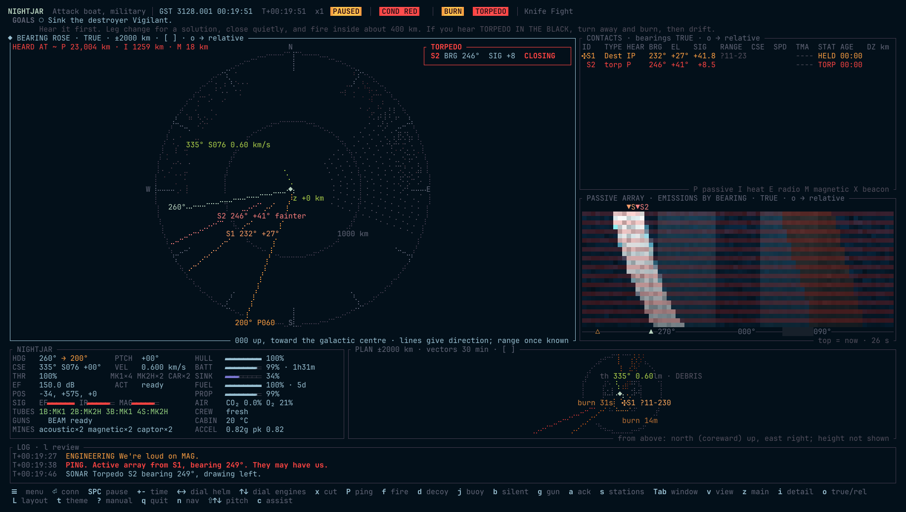

**When one is coming.** The log calls `TORPEDO IN THE BLACK` with its bearing, the `TORPEDO` pill flashes, and time compression drops to x1. A homing torpedo follows emissions. Burning away makes you louder, so the classic answer is to drop a static buoy, slide off the torpedo's line, then go quiet and let it take the static buoy. A seasoned captain does the same to you. Against a straight runner, any burn takes you off the point it is running to.

## 14. Electronic warfare: jamming and ECCM

A jammer is a transmitter that spams static on every band. Anyone inside its cone hears that static on top of everything near its bearing, so contacts there fade and new ones hide behind it.

> [!NOTE]
> **The misconception:** that jamming hides the jammer. It does the opposite. A jammer is the loudest thing in the sky, on its true bearing. It hides *what lies behind it* from the ships *inside its cone*, and it breaks the lock of guided torpedoes. That is all it does.

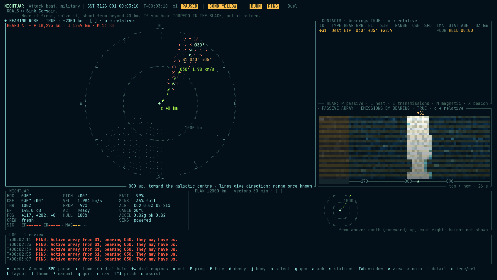

### Who a jammer affects

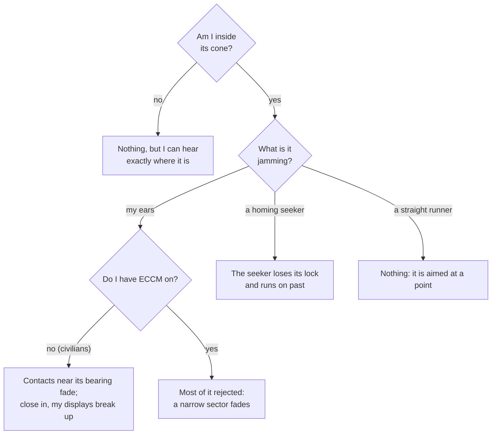

| Against | Jamming is | Why |
|---|---|---|
| Pirates and traders | effective | civilian arrays have no ECCM |
| Warships | iffy | ECCM rejects 12 to 15 dB |
| Ghosts | weak | the best ECCM in the fleet: 25 dB |
| Homing torpedoes | effective | a swamped seeker loses its lock |
| Straight runners | useless | nothing to jam |

### Using a jammer

There are two kinds:

- **A ship's jammer** (`jam 045`, `jam s1` to follow a contact, `jam off`; add `low`, `half` or `full`): very directional. It jams only what is inside its cone (20° on a destroyer, 25° on a cruiser, 30° on a civilian set); outside the cone it does nothing. Warships run it at any setting; a **civilian set runs at low only**. A destroyer captain jams the ship it is attacking; an **escort** jams any raider it hears at once and moves between it and the traders it guards; and a **trader jams the pirate it is running from**: the common way for a merchant to break a pirate's lock.
- **A jammer drone** (`jammer`, or `jammer 090` for a course): runs off on a bearing and jams all round for five minutes. The ghost carries two.

**It costs.** A jammer draws power while it is on (10 MW on a destroyer: heat and battery), and a lower setting draws less and jams less (a quarter of the power is 6 dB less). It weakens with range, like any emission. **It blinds you that way**: its static floods your own array, so you can't hear anything inside your own cone (the IR telescope still sees heat). And **it is a confession**: inside the cone it is the loudest thing in the sky, on its true bearing; EM intercept hears it from any side. Use it when you have been found anyway.

**What it does to whom.** Against pirates and traders, whose civilian arrays can't fight it, jamming works. Against warships it is iffy: their arrays carry **ECCM**, which steers a null onto the jammer's bearing, rejecting part of it and shrinking what it hides. Against a ghost it is weak: a ghost's ECCM is the best in the fleet.

**Choosing the power.** The jammer and ECCM each take a share of their full power, not just on or off. `jam s1 60%` sets a share, `low` and `half` are a quarter and a half, and `jam +` and `jam -` move it a quarter at a time. The `EW` gauge shows both settings. The lowest setting is 10%. Less power jams less, draws less and shows less: half the power is 3 dB less. So you can jam just hard enough to beat a seeker, or keep the plant cool on a long run.

**ECCM takes power too.** At full it draws 0.1 MW for each dB it rejects: 2.5 MW on a ghost. `eccm 60%` rejects 60% of its rated dB for 60% of the power and EF, and `eccm +` and `eccm -` step it. ECCM shares the jammer's breaker, so a board setting that sheds the jammer sheds ECCM as well. Computer captains run ECCM at full whenever they are jammed.

**ECCM** (`eccm on`, `eccm off`): if your array has it, switching it on rejects jamming (25 dB on a ghost, 12 to 15 on a warship) and narrows the masked sector. It isn't free: nulling is active electronics, so with it on you radiate a little more EF. Computer captains switch it on only while jammed. On a ghost it is a real trade: see past the jammer, or stay quiet.

**Torpedoes: jamming's best use.** Jamming is mostly a defence against guided weapons. The drill: *torpedo in the black!* *Begin jamming!* (`J`, or `jam steady` then `jam s5`). Jam it steady: in a look-through pause the seeker can reacquire. A homing seeker inside your cone is swamped, loses its lock and runs on past, so jam toward it and get off its line. That is why a ghost keeps its torpedoes quiet until the last moment. A linked torpedo's datalink is cut when a jammer's cone covers it and outshouts the launcher's link (close to the launcher, the link burns through); it then runs on its last course. A straight runner, aimed by hand, has nothing to jam.

### Look-through

A jammer deafens its own ship inside its cone. To listen, a jammer pauses: **silent for 5 seconds in every 25**, a practice called *look-through*. In the pause it jams nothing, and your array hears the cone again. Each ship's cycle is offset, so a group of jammers never pauses together.

- `jam look` (the default): pause to listen. Use it when you are screening, or running from a ship that might shoot.
- `jam steady`: no pauses, and no hearing in the cone. Use it against an incoming homing torpedo: in a pause, its seeker can reacquire you. `J` always jams steady.

Computer captains follow the same doctrine: look-through while screening, steady at an incoming weapon. Jammer drones have no receiver and always run steady.

### Being jammed

A jammer over your floor shows as a strobe: a flickering wedge on the rose across the sector it masks, a line out from you on the nav plot, and a wall of static on the waterfall. The `EW` gauge gives its bearing and how far it stands over your floor. Close in, past about 40 dB, your displays break up: false strobes jump about the rose and plot, and static covers the array's windows. Jamming raises condition YELLOW. To see past a jammer, switch on ECCM if you have it, or move so the target and the jammer part, or slip out of its cone.

## 15. Power, heat and signatures

Every ship runs on a reactor and a battery, makes heat, and shows up on more than one sensor. **AUTO** runs all of it like a sensible engineer, so you can ignore this section and play as before. Or open the **engineering** window (`v`) and run the plant yourself: power against emissions, against speed, against sensors, against heat.

**Power.** The reactor's output can only change slowly, and it gets louder as it works harder. A reactor that has gone cold must also run through a start before it makes any power: about 90 seconds on a warship, and longer on a merchant. The start can be heard. The battery covers what the reactor can't yet supply and charges from any surplus. On AUTO the reactor tops the battery up whenever it is under 95%, but once the heat sink is over half full it charges only as fast as the hull sheds the heat, so a warm boat recharges slowly. `reactor 100` charges faster and heats the boat. It hums a little while it discharges hard. The drive is by far the biggest load; if supply can't meet demand, the drive browns out first (engineering shows how far).

**The board.** Every load has a breaker and a place on a priority list: life support, sensors, tubes, pinger, weapons, jammer, drive. When power runs short, the board feeds that list from the top. The drive and the weapon capacitors can run on part of what they ask for. Any other load gets all of it or trips, and a tripped breaker stays open for 10 seconds. A dark load's work stands still: tubes stop reloading and the pinger stops recharging. The attitude motors that turn and pitch the boat ride the drive's breaker: a turn under the quiet-helm rate costs nothing, and a hard one draws up to a tenth of the drive's power, from the battery when the reactor is down. A hard turn also shows a little on EF, and how much a hunter makes of it grows through the war: nothing early, a little mid war, a noticeable tell close in by late war. A turn under the quiet-helm rate shows nothing in any era. Set your course before you go dark.

- `board` lists the board's named settings, and `board patrol` sets one. You never need to touch them: a ship sails on **Standard Running**, and the crew minds it. A capped reactor also runs its pumps slower, so the hull hums a little quieter: the tighter the cap, the more. **Long Patrol** caps the reactor at 30% to save fuel, but has no pinger or jammer and answers slowly when the shooting starts. **Rig for Quiet** saves battery and EF but has no pinger, jammer or reloads, and the drive starves first. **Battle Stations** puts the weapons first with the plant at full, at a cost in fuel and EF. Engineering's `SETTING` line names the one you're on, and says `By hand` once you change something yourself.
- `S` shows what each setting would do on your boat, from her own plant figures at their rating. `REACTOR` is the most the setting lets the reactor make. `DRIVE` is the share of full drive it can hold with the battery flat. `FUEL` is fuel for each second of drive against Standard Running: a reactor burns less per MW at low output, so a gentle burn goes further. `SHOWS` is how much more the whole boat shows at this throttle. `ANSWER` is how long the reactor takes to reach full. Choose a row to read its cost, and `Enter` sets it. `board preview patrol` gives the same on the conn.
- **The chief engineer may mention the board.** He speaks in the log, when nothing is happening, and only to a captain still on Standard Running. He raises each subject once, and at most once an hour: tanks under a quarter, or a defect the crew has found that the board can answer. A word from him never slows the clock, and you can ignore it.
- `shed tubes` opens a breaker, and `restore tubes` closes it. `restore all` closes every breaker. Shedding `life` secures the scrubbers and electrolysis.
- `priority tubes` puts a load first, `priority tubes 3` puts it third, and `priority auto` restores the list.
- What you power is what you show. Dark sensors make the boat a little quieter and cut its EF, and tubes, pinger and guns show while they draw, even on the battery.

**Buses.** Two buses carry the loads. Bus A carries the drive, tubes and weapons. Bus B carries the sensors, pinger, jammer and life support. A damaged bus carries less. A failed bus drops its loads until the crew cross-ties them to the other bus, about 30 seconds later. One bus then carries the whole boat at 60% of its rating, so the priority list decides what stays lit.

**Generator.** A small auxiliary generator (`aux on`, `aux off`, `aux auto`) starts in about 15 seconds. It carries the hotel load and charges the battery slowly, but it is loud and burns four times the fuel for the same energy. On AUTO it runs when the reactor is lost, or when the reactor is down and the battery is under 15%. Silent running turns it off.

**Battery banks.** The battery is two banks, A behind bus A and B behind bus B. They share the work. `bank a off` isolates a bank and holds its charge in reserve, at half the discharge rate. A bank that fails loses its charge, and a bank behind a dead bus can't be reached until the buses are tied.

**Fuel.** The reactor and generator burn fuel, and tanks do not fill at sea. A reactor has an economical speed: it burns about twice as much per MW at full output as at idle, so a gentle burn reaches the same speed on less fuel, but takes longer. With none left, the reactor goes out and the battery is all you have. A friendly tanker or base fills your fuel and propellant together. Lie within 20 km of it, moving under 50 m/s against it, and order `refuel`. Drift off and the hoses part; `refuel stop` lets go. A tanker's cargo is finite, and a sunk tanker's fuel goes with it.

Outside the tutorials, a fight finds every ship part way through a patrol: each starts with 40% to 100% of its fuel and standard rations, drawn at launch, unless the scenario sets them.

**Bases.** A base is huge and doesn't move. It has six sections, each with its own hull. A hit lands on one section, and twenty direct hits take a section. A lost section takes its share of the fuel store, and the rest of the base stands. Armour turns gauss slugs. A base falls only when its last section goes.

**Silent running** (`b`, or `silent`): shut the reactor down and live on the battery. The coolant pumps stop, so the hull hum drops: an attack boat goes from 110 to 102 dB, which cuts a destroyer's hearing range on it by more than half. The reactor's coils go cold too, and the boat's magnetic field falls to about a tenth, the steel hull's own: a magnetometer that felt it at 14 km must now come within about 6 to 7 km. The battery lasts about half an hour at hotel load, much less if you burn. Restarting the reactor is a rise in emissions a listener may call as a transient. `normal` puts everything back on automatic.

**Pushing the drive** (`push`, `push off`): the drive runs at 125% of its rating. You get a quarter more thrust for a quarter more power and propellant, and it is 3 dB louder. The battery covers what the reactor can't, and the heat follows. Each second at full throttle has a 0.4% chance that something gives, so expect about four minutes. About a third of those failures damage the drive. The rest trip its breaker, and the drive is dead for a few seconds. Either way the push ends, and you must order it again. A boat that has pushed but is coasting risks nothing. Use it to outrun a torpedo, not to save time. Veteran enemy captains push too, when they run from a torpedo.

**Heat.** All the reactor's power ends up as heat in a heat sink. The hull sheds some; drifting, that is enough. Burning or charging hard fills the sink. **Radiators** shed heat fast, but they glow: radiators out show in infrared from thousands of km. On AUTO they come out at 85% and go in below 60%. If the sink fills, the reactor scrams itself to save the ship.

**The channels.**

| Channel | What shows | Who reads it |
|---|---|---|
| EF | drive, hum, reactor, battery | every passive array |
| Infrared | hull warmth (more as it heats), radiators, drive plume | military IR sensors, out to a few tens of km on a cool hull; thousands on radiators or a plume |
| EM | transmissions, such as a hunting group's datalink | ESM receivers. A group transmits whenever it shares a contact, so a group that has found something is suddenly loud on EM |
| Magnetic | the reactor's coils and the hull's own field; a shield's coils; every hard turn | magnetometers: a destroyer's feels an attack boat at about 14 km with the reactor running and about 6 to 7 km with it shut down, a big hull at about 20 km. Silence doesn't hide it; a cold reactor and gentle turns shrink it |

All sensors feed the same tracker, so a contact may be held on EF, refined by infrared, and found again by its magnetic field. The `HEAR` column says which.

EF is the electric field a ship gives off. Space carries no sound, so nothing here is sound. Crews say *hear*, *loud* and *quiet* out of submarine habit, and they mean EF.

**What engineering shows:** reactor mode and output; battery charge and flow, bank by bank; the generator; fuel and how long it lasts at this burn; heat and the radiators; the load (demand, supply, any brownout); what you are showing the world on every channel, including whether you are transmitting; and the board, when the window is tall enough. A short window lists only what is shed, cut or dark.

## 16. Life support

Your crew breathes. As on a real submarine, **CO₂ is the clock on running quiet**: the scrubbers that remove it are pumps and fans, and they radiate.

- **Rig for ultra-quiet** (`ultra`, or `rig for ultra-quiet`): silent running, and the scrubbers secured too. An attack boat drops another 3 dB, to about 99 dB. CO₂ starts to climb, about 0.08% an hour on an attack boat: a full point every 12 hours.
- **Blue saves air.** On condition Blue, the crew off watch lie still on personal air, and the boat uses 15% less: CO₂ builds more slowly and oxygen lasts longer. WWII crews did the same, sent to their bunks to save what they had. White and Yellow are normal stations, and at war nobody is resting.
- **The crew feels it.** Past 1% CO₂, or under 19% oxygen, they start to slip; by 4% they are badly impaired. A crew short of air makes **worse sensor operators** (faint contacts are missed), **slower reloads**, a **slower helm** and **slower repairs**.
- **Oxygen** comes from electrolysis (it needs power) or from candles (`candle`, a few carried). With no power at all, the chief burns candles to keep oxygen up, but nothing removes the CO₂.
- **The chief of the boat runs the air on AUTO** (`air auto`): scrubbers and electrolysis on. Only an order (`scrubbers off`, `electrolysis off`) or a dead plant changes that. `normal` puts everything back on automatic.
- The COB reports each step of CO₂ past 1% in the log (`COB  CO₂ at 2.1%: headaches, mistakes creeping in.`). The `ULTRA` pill shows while the scrubbers are off, and `AIR 2.1%` once the crew is slipping.
- **Bad air kills.** At 10% CO₂, or 10% oxygen, the crew is lost and the ship with them, in every scenario, at every difficulty, on either side. With the scrubbers off that is about five days on a ghost, so it only reaches a boat that stays down by choice. The COB warns you 12 hours out and again at 2 hours, says what is off (or that the plant can't keep up), and each warning drops time compression to x1; the air gauge shows it coming. With healthy scrubbers running it never comes.
- **Two clocks.** To hide you shut the reactor down and live on the battery. A ghost running silent has about 40 hours. Then you must bring the reactor back, and its EF and heat tell anyone listening where you went. Refuse, and the air gets you instead.
- **Life support can be hit.** It is a damage system like any other. Its health scales how well the scrubbers and the oxygen plant work, so a boat can be quiet, safe and slowly suffocating, and repairing it may mean making noise. See [Damage](#17-damage).

**Food.** A ship carries rations for a set number of days: a ghost 60 standard and 15 emergency, a destroyer 30 and 7.5. Standard rations are sealed meals that keep indefinitely. Emergency rations feed the same in a quarter of the space, and crews hate them. The crew eats standard rations first. The engineering detail shows one bar with each kind in its own colour. For now these are only figures: they run down, and nothing happens when they reach zero.

## 17. Damage

A hit does more than wear the hull: it knocks one or more of your systems, more for a heavier hit. A damaged system works in proportion to its health; below 25% it **fails** and stops working altogether.

**Facing matters.** A hit reaches the systems nearest its side first. From astern it finds the drive, the generator and the reactor. From ahead it finds the array, the pinger and the tubes. On the beam it finds what lies amidships: the buses, life support and the batteries. The nearest system is up to four times as likely to be knocked as the farthest. The crew calls where each hit came from. So a boat running from a gun gives it the drive, and one that turns to fight gives it the ears. This applies to gauss, beams, mines, collisions and torpedoes, so a salvo from astern is the one that stops a ship.

| System | Damaged | Failed |
|---|---|---|
| Drive | less thrust, and it rattles when it burns | no thrust |
| Reactor | less output | no output |
| Battery | holds less | holds nothing |
| Radiators | shed less heat | shed nothing |
| Array | higher floor, wider bearings | deaf |
| Pinger | wider range and bearing errors | can't ping |
| Sensors | IR, ESM and magnetometer less sensitive | off |
| Tubes | slower reloads | can't fire |
| Guns | a weaker beam | can't fire |
| Datalink | works | can't share with your group |
| Life support | scrubbers and oxygen plant work less well | the air goes bad until it is repaired |

**Damage control** repairs one system at a time, about 3% a minute, so a badly damaged system takes tens of minutes, and only back to 90%: a full repair needs a dockyard. On AUTO the parties take failed systems first, then damaged ones, most important first (drive, reactor, array, radiators, battery, tubes, pinger, sensors, guns, datalink). `repair array` puts them on the array instead; `repair auto` hands the choice back. The log reports each system brought back to working.

**Faults that grow.** A knock on the reactor, a battery bank, the radiators, life support or the drive may start a fault: a coolant leak, a cell going bad, a bearing running hot. About three knocks in ten do. A fault eats that system's health, about 2% a minute, until a party has given it five minutes of work. That work stops the fault and mends nothing, so a mend comes after it. On AUTO the parties take faults first. The report marks them `GROWING`. A bad cell also fouls the air.

**Parties show on EF.** Repair is electronic work: a party runs test sets, arc welders, powered tools and the equipment it is mending, and all of it radiates EF; an arc welder is the worst, a broadband spark across the radio bands. On a running boat that is 3 dB under the plant's own EF, which covers it. On a silent boat a party at work can be the strongest emitter aboard, and it can give you away. `dc quiet` stands them down, and `dc work` sends them back. Rigging for silent stands them down by itself. So the choice is yours: keep quiet and watch a fault grow, or stop it and be heard.

**The damage report** (put it in a window with `v`) opens on the captain's summary: the hull, what damage control is doing and how long it will take ("On the array (AUTO): working again in about 40 s"), and what you can and can't do, by job: MOVE, POWER, HEAR, FIGHT, TALK. Press `i` for the detail: every system with a bar, its health and its state (`OK`, `DAMAGED`, `FAILED`); `◀` marks the system being repaired and `★` your priority. Damage control also reports in the log each time it starts on a system, with its estimate.

**The annunciator.** A damaged system lights `MASTER CAUTION`; a failed one, or the hull below 30%, lights `MASTER WARNING`. It flashes until you acknowledge it with `a`, and the dynamic DAMAGE window shows what is hurt until you do.

**Screens fail too.** A window fed by a damaged system breaks up into static: the waterfall, rose, contacts and nav plot as the array fails, engineering as the reactor does. A failed system's window reads `NO SIGNAL`. The chart is paper and never fails.

Enemy ships take damage the same way, and their crews repair the same way.

### Broken gauges

A knock on a system can break a gauge it feeds. About four knocks in ten do. The gauges and the systems they hang on:

| Gauge | Instrument | System |
|---|---|---|
| `HDG`, `PTCH` | gyro repeater | sensors |
| `CSE`, `VEL` | velocity log | sensors |
| `ALT` | altimeter | sensors |
| `ACCEL` | accelerometer | drive |
| `PROP` | propellant gauge | drive |
| `FUEL` | fuel gauge | reactor |
| `BATT` | battery meter | bank a |
| `SINK` | heat-sink gauge | radiators |
| `AIR` | air sensors | life support |
| `CABIN` | cabin thermometer | life support |

A gauge breaks in one of three ways:

- **Dead.** The label is struck through and the reading says `× NO DATA`. Damage control says so in the log. A pill the gauge lights, such as `BATT` or `HEAT`, stays dark.
- **Stuck.** The gauge keeps its last reading, colour and all. Nothing marks it.
- **Wrong.** The gauge reads live but drifts further off, up to about a third of its scale.

The crew reads its own instruments: the chief counts the battery's cells and the helm reads the inertial platform. So a crew report, a gauge's name at the console (`battery`, `helm`) and the engineering window's own meters all read true. When a gauge and the crew disagree, believe the crew.

Damage control replaces a gauge as part of the work on its system, in about four minutes. The parties know of a dead gauge at once. They know of a stuck or wrong one only when you put them on its system: `repair battery`, and they look the system over and find it. `gauges` lists what they know, and the damage report shows it as `GAUGES`. The test bench's *Broken Gauges* (`data/testbench/broken_gauges.ron`) starts with four broken.

### Quirks and wear

No two hulls are quite alike. At the start every ship, yours and the enemy's, rolls its quirks from `data/quirks.ron`. These include:

- an array that reads a couple of degrees off;
- a reactor that runs loud, or a sweet pump train that runs quiet;
- a drive or battery that never makes its rating;
- a pinger or datalink that drops out now and then;
- a gauge that sticks or drifts (see [Broken gauges](#broken-gauges)).

You don't know your boat's quirks at the start. The crew reports each one when it bites, or once its system has run long enough for someone to notice. Each report lands in the log as `QUIRK`, and damage control lists every quirk found so far. A worn system can't be repaired past its quirk; that needs a dockyard. An enemy's quirks are real too, and only its behaviour gives them away.

- a yard that did good work on the lagging, or rushed it: the hull sheds heat a quarter faster, or a fifth slower, than the book.

Damage control's detail view also shows how long each system has been in use: its wear. On most hulls wear is a record only.

### Breakdowns on an old boat

A hull from the last war breaks down by age: about once an hour of running, something in use fails for two minutes. You may wait, or jury rig it (`u`, or `jury`). A rig brings it back now, and every rig makes the next failure come sooner, for the rest of the exercise. So the question each time is whether you need that system in the next two minutes more than you need a quiet hour later.


## 18. How the enemy thinks

Computer captains play by your rules. Each has its own sensor picture, built from what its own ship hears; none of them knows where you really are. They fly with the same controls, through crews that take the same time to answer. What differs is **doctrine**: how a captain decides what to do with what it hears. Doctrine is in `data/captains.ron`, and the spec sheet lists every captain under [Captains](#23-ship-registry-and-specifications).

> [!NOTE]
> **The misconception:** that the enemy knows where you are once it is coming for you. It knows a bearing, perhaps a rough range. A destroyer charging down your bearing is guessing, and a ghost that moves off that line, quietly, is often lost to it.

### Alert states

Every captain is in one of three states. The state decides how it moves, how often it pings and whether it shoots.

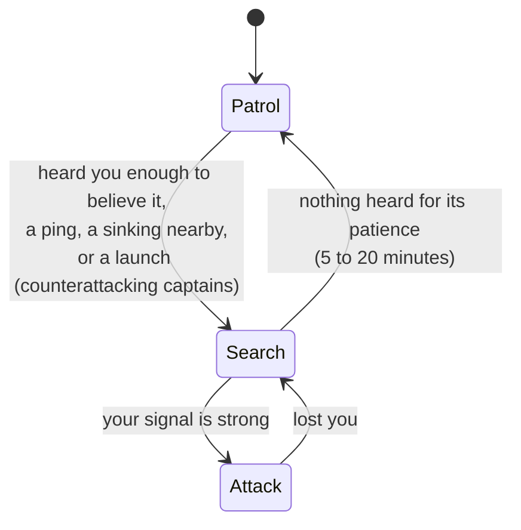

| State | What it does | What you see |
|---|---|---|
| **Patrol** | Holds its course, listens, pings now and then (some never do) | a steady contact; occasional `PING` |
| **Search** | Heads for where it last heard you, by **sprint and drift**: burns, then cuts the drive to listen; looks above and below the track as well as beside it | transients as it lights its drive; pings while it drifts |
| **Attack** | Closes at speed, pings often, fires when its solution is good enough | `COND RED`; frequent pings; `TORPEDO IN THE BLACK` |

**Sprint and drift.** A ship burning its drive is half deaf, so a careful hunter alternates: sprint toward you, then drift and listen. A green captain sprints and never drifts. A seasoned one sprints 90 seconds and drifts 60. A silent attack boat creeps and drifts for minutes at a time. **The drift is your chance to move**: its ears are open, but it isn't closing.

**Pings.** A captain in Search pings only while drifting: a ping sent with the drive burning comes back to a receiver deafened by its own drive's EF. In Attack it pings freely; close in, the echo is strong enough.

### Lying in wait

Every captain knows space has an up and a down. A contact it had solved close by, or had loud and then lost, is near and quiet, and whoever moves first loses. So it comes up on a lost contact slowly, because a ship at speed coasts out of the fight, and when it is close it makes a short burn out of that contact's plane, up or down as its own coin falls, cuts the drive, puts its nose on the track and listens: for a minute (a green crew) to ten (an attack-boat captain), from the moment it is cold. Only green crews ping while they wait. Hearing the contact again, it attacks; its patience run out, it searches on. It never hides from a contact it still holds, however faint: that one it fights. Expect it: the ship that came down your bearing and went quiet may be coasting cold fifty kilometres off it, waiting for you to show yourself.

### After a sinking: the datum

When a ship is sunk, or takes a torpedo and lives, every captain on its side nearby races to the spot, the **flaming datum**, and searches there. A green captain stops at the wreck. The torpedo came from hundreds of km away, so a green escort searching the wreck is searching the wrong water.

### The counterattack

Seasoned and escort captains have learned better. When one hears a **launch**, a transient together with a torpedo in the water, it:

1. wakes at once, even from Patrol;
2. takes the bearing of the launch, from where it heard it;
3. leaves its station, even an escort's, and sweeps outward along that bearing line, pinging as it drifts, for up to 15 minutes.

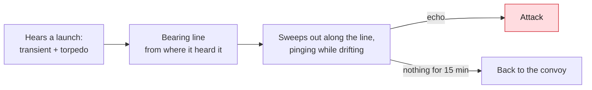

**What it means for you:** after you fire, your firing point is on a line the escort knows. Don't stay on it. Move off the bearing, quietly, before she arrives; a ping finds a drifting ghost only within about 150 km.

**Shooting back.** A drilled captain may answer a launch at once, before she turns. If she hears the transient and the torpedo, and the launch lies within about 10° to 15° of her own level, she fires one or two straight runners back down its bearing from the tubes that bear on it. A boat that came to her height to line up a straight shot sits on that line. Green, silent, pirate and hunter captains never answer this way. Fire from well above or below her, or get off the line as soon as the torpedoes are away.

### Torpedo defence

A captain who hears a torpedo first asks whether it is coming **at it**: a steady bearing and a rising signal mean a collision course. A torpedo aimed at someone else is ignored. For one coming at it:

- **Most captains turn away and burn.** All but green ones drop a static buoy and a decoy, and jam the torpedo if they have a jammer.
- **Counterattacking captains comb the tracks**: they turn *toward* the torpedo, the narrowest target, which is also toward you, and keep pinging.

### Escorts and convoys

An **escort** captain guards the merchants near it:

- **On station.** With nothing heard, it stays within about 200 km of its convoy.
- **Screening.** When it holds a threat, it jams it at once and moves between the threat and the merchants, up to 120 km out, so the convoy sits inside its jamming cone from the threat's side. It may go up to 600 km from the convoy, and 900 while attacking.
- **The leash breaks for a counterattack.** Hunting a launch bearing, it may go as far as an attack takes it.

**Merchants listen too.** A convoy that hears a warship or a torpedo makes an emergency turn away and runs. When one of them goes up, the rest scatter flat out from the blast: loud, fast, and hard to catch.

**Merchants run; they don't weave.** At condition green they sail straight and true. Evasive patterns were built and tried, five of them, over 60 convoys each. None beat turning directly away and running flat out, which cuts a straight runner's hits from about 41 in 100 to about 20. A weave is worse, or at best a tie. So a skipper who hears you puts their stern to you and goes, and a stern chase is what you must plan for. A towed hulk or a tanker in orbit can't run, and stands fast.

In late war, convoys sail with an **escort group**: two escorts sharing every bearing. See [The war campaign](#21-the-war-campaign).

### Flight decks: carriers and their craft

A **carrier** is the heart of a battle group: the biggest, loudest hull in the fleet, with a flight deck and a hangar of **craft**, small fast ships flown by two pilots. It can hardly fight on its own. Its craft are its eyes and its reach, and its escorts are its safety. It is the best prize a ghost can take.

**Launches.** A deck launches one craft at a time, under a minute apart. The catapult and a small drive lighting off beside the hull make a loud transient, and the crew calls it: `Launch transients on S1, bearing 312°. Craft leaving a flight deck.` A launch tells you where the deck is, and that craft are coming.

**Three missions.**

- **Pickets** fly far out, often more than 1,000 km, coast on station and listen. What a picket hears goes over the group's datalink, so the destroyers have it at once. A carrier keeps a standing patrol of pickets up, and sends more once it is alerted.
- **Strikes** carry two homing torpedoes out along the carrier's track on a target, fire from stand-off range and turn for home.
- **Screens** stay close to the carrier and shoot at torpedoes and enemy craft that come in.

**What a craft is like.** It burns nearly all the time, so you hear it a very long way off. The same burn deafens it: its small array sits beside its drive. Burning, it hears a quiet boat only alongside. Coasting on station, it hears a drifting ghost at about 50 km, and one running silent at about 20. A destroyer hears the same drifting ghost at over 200 km. A craft's gauss gun is deadly to a boat it catches close. It is almost impossible to torpedo: it out-accelerates and out-turns a torpedo, and a proximity fuze sees its small hull only at a tenth of the usual distance. A homing torpedo chases the loudest thing in its cone, and a craft is loud, so a carrier's craft can draw off a homing spread. Straight runners take no notice of them.

**Short legs.** A craft must keep the Δv to get back to its deck, and its pilots last about two hours. It ranges only within a radius of its carrier, and the radius moves with the carrier. A craft that chases hard burns its reserve and turns for home soon after. A boat outside the radius is safe from craft: know where the deck is, and you know where they can reach.

**How they show.** The crew calls a craft `fighter?`, then by class, `Fighter` or `Strike fighter`. On the plot, the chart, the rose and the contacts table, a craft wears the top half of its affiliation's frame, as air tracks do on a military plot: `⋀` hostile, `◠` friendly, `⊓` neutral, `⌒` unknown. The carrier's own signature is unmistakable once the crew has it: they call it `Carrier`, and the vessel window lists its flight deck.

**How to live through them.** When craft come near, go dark: rig for silent running (`b`), keep radio silence (`radio silence`), and drift. A craft that passes far off goes on by, and one that passes close may hear you. The real danger is not the craft but the destroyers they call in. A craft finds what is loud; a destroyer finds what is careless. A boat that hunts loud under air cover is found.

**When the deck is gone.** Sink the carrier and its craft have nowhere to land. They fight on until their fuel or their pilots give out.

**In the record.** The end screen counts craft shot down (`Craft down`). Craft are not hulls: they count for neither the ships sunk nor the tonnage. The replay draws them as `⋀`, and the debrief says how many flew, how many heard you and how close the nearest came. A craft that lands, or runs out of fuel far from its deck, is nobody's kill.

### Commanding a carrier

A carrier's captain fights with the deck. Her own hull is the loudest in the fleet and hears a quiet boat only a few hundred km off, so her craft are her ears and her reach. Choose a carrier in the Duel, learn the deck in the guided exercise *The Flight Deck*, and take a carrier group against a ghost in *Flight Quarters*. The console takes on the carrier's colours, Cold Steel, when you sail one; `t` changes them, and your own come back afterwards.

**The deck.** `deck` gives the hangar: each kind of craft, what it flies, how many are ready, and how many are being refuelled and rearmed with the time to the next. It also gives what is waiting to launch and how many are aloft. The `DECK` row in your status window says the same in short, where a torpedo boat shows its tubes.

**Launching.** `launch picket`, `launch screen` and `launch strike s3` put craft in the launch queue. Add a number for more: `launch picket 2`. A strike flies two unless you say, and it needs a contact with a solution: its pilots are handed your track on it. The deck launches one craft every 45 seconds, from those ready that fly the mission. Every launch is loud, and anyone listening hears where the deck is.

- **Pickets** fly about 1,500 km out ahead of you, or toward the loudest threat you hold, then coast on station and listen. What a picket hears comes home over the datalink, so you and your escorts have it at once, and two bearings from two places make a cross-fix. When one finds something new, the deck says so: `Picket 1, picket, reports a new contact, S4: the craft is 1,480 km out on 012°.`
- **Screens** stay within a few tens of km and fly at any torpedo they hear coming for you, with their gauss guns. Launch one when you hear `TORPEDO IN THE BLACK`, or before, if you expect one.
- **Strikes** fly out along your track on the target, fire their torpedoes from stand-off range and turn for home.

**Reading the craft.** `sorties` (or `craft`) lists each craft aloft: its mission, its range and bearing from you, its Δv and the share of its propellant left, its pilots' time left, and whether it is coming home and why. `show deck` opens the **flight deck window**: the bays, the launch queue, and every craft with a Δv bar and an endurance bar, green, then amber under a quarter, red under a tenth. Your craft fly on the rose and the plot in the friendly air frame, `◠`, by their short names. On the plot each has a faint ring round you, tagged `Picket 1 home 6,200 km`: how far out that craft can be and still make the deck in time, on the Δv and endurance it has left. A craft near its own ring is near bingo. `layer craft` hides the rings.

**Bringing them home.** A craft turns for home by itself on bingo fuel, when its pilots near the end of their two hours, or when a strike has fired everything. `recall` calls them all home now; `recall picket` only the pickets. Launches still waiting are struck off. Craft wait 12 km off the deck and land one a minute; one that came back empty takes 15 minutes to refuel and rearm. A craft still out 25% past its pilots' endurance is posted lost.

**What the deck says.** The deck reports through the crew's reports (`reports all`, `normal` or `quiet`). Launches, landings and craft you recalled are routine, said only at `all`. A craft turning home on bingo fuel or with empty racks, and a picket's new contact, are said at `normal`. A craft lost, shot down or overdue, is said even at `quiet`.

**Tactics.** Pickets first: a strike needs a solution, and your own array will rarely give one on a quiet boat. Pickets that burn are half deaf, and one that rushes what it hears empties its tanks within minutes, so keep a reserve in the hangar to replace them. Keep a screen ready, since a ghost that has you will fire from far off. Watch the rings: a craft caught outside its reach is lost. And a carrier that runs from a torpedo pulls her craft's radius with her.

### Breaking off

A captain badly hurt gives up the fight for good. At a hull figure that depends on its crew (about 55% for a green crew, 30% for a veteran one, and nerve moves it), it turns away, stops pinging and shooting, and runs. It leaves its station, its convoy and its friends. A hunter with nothing left to fire and no mates does the same. A captain who sailed already hurt breaks only at a new wound.

You won't be told. What you have is what the crew hears: the pings stop, the bearing steadies and the contact opens. They may say it looks like a break-off, and they may be wrong. A ship that has broken off no longer counts as tracking you. Some engagements, such as the Duel, count it as finishing the fight. It is still out there, and you can still sink it.

### Reading the escort

A hunter's quality is hidden. It shows in how the hunter behaves, and the crew reports what they notice. These lines appear in the log as `SENSORS`, and in the vessel window as `READS AS`. Every one is an estimate.

- **Habits.** After a few pings they call its style. A fast beat with no stopping to listen reads as a green crew. Sprint and drift reads as a drilled one. A slow beat reads as a careful one. A good crew in a hurry can look like a green one.
- **Counting.** The crew counts the torpedoes they hear and the gauss bursts they feel. Once they have called a class, they set that count against what the book says it carries. A hunter that has fired most of its load may be running short.
- **Magazines are counted.** Every shot comes out of a real magazine. Early in the war escorts sail short. A hunter that runs dry with no friends breaks off. One with friends stays and keeps the contact for them, so sitting it out can bring them down on you.

### Pirates and traders

**Pirates prey on traders.** A raider hunts what it hears, civilian or not, fires on a FAIR solution from too far, and runs a long way from a torpedo.

**Traders run.** A trader that hears a pirate or a torpedo turns away at full burn. A civilian trader with a jammer jams the pirate it is fleeing, at the low setting civilian sets allow, pausing every 25 seconds to listen (look-through). A wartime merchant sails dark and jams only a torpedo coming at it, steadily. See [Electronic warfare](#14-electronic-warfare-jamming-and-eccm).

### Crews

Every ship's crew takes time to answer: about 3 seconds at the helm and 4 in the engine room for an average navy crew. Merchant crews take half again as long (your own civilian hull is the exception: its autopilot answers at once), pirates a fifth longer; a civilian hunter's hand-picked crew is a little quicker than the navy's. A green captain's crew is as slow as a merchant's; a seasoned, escort or silent captain's is a fifth quicker. **A slow crew turns late**: lead a green escort, and it overshoots.

### Captains at a glance

| Captain | Flies | Hunts | Shoots | Counterattacks | Lies in wait |
|---|---|---|---|---|---|
| green | early-war escorts, raw crews | charges your bearing, pings constantly, never drifts | on a FAIR solution | no: goes to the wreck | barely: 10 km out, a minute, pinging |
| seasoned | the navy's regulars | sprint and drift, plans an intercept | on a GOOD solution inside 300 km; jams what it attacks | yes | 40 km out, five minutes |
| escort | convoy escorts under doctrine | screens its convoy, jams any threat at once | as seasoned | yes, off the leash | 25 km out, two minutes, on its leash |
| silent | enemy attack boats | creeps, never pings, long drifts | on a GOOD solution inside 500 km | no | 60 km out, ten minutes |
| pirate | raiders | hunts anything it hears | on a FAIR solution, from too far | no | 20 km out, ninety seconds |
| hunter | civilian hunters | patient, quiet, orders and manoeuvres | on a GOOD solution | no | 40 km out, four minutes |

These are the templates. `regular` and `veteran` fill out the navy's ladder between and above `green` and `seasoned`, and their figures are in the [spec sheet](#captains). Who actually turns up is rolled.

### Who is in the chair

Every computer-flown captain, and every merchant skipper, is a person, rolled fresh each play. The scenario says what sort of captain to expect; the dice say who you get. A captain of a grade is as strong as any other of that grade by points, but built differently: one is patient and slow to answer, another quick and reckless. **You don't get to see any of this during the fight.** You feel it in how they hunt, and find out who it was afterwards.

A **sheet** holds:

- **Attributes**, 1 to 10, who they are. **Nerve:** patience, closing the range before firing, how long they wait in ambush and how long before they give you up. **Cunning:** leading a target, and how far and from how far they step off the plane. **Aggression:** speed and burn. **Shiphandling:** how fast the crew answers.
- **Skills**, 0 to 5, what they trained. **Hunting:** coming after a fainter signal. **Gunnery:** the reach of guns and beams. **Countermeasures:** how long they keep evading a torpedo. **Stealth:** pinging less often.
- **A speciality**, for a warship captain. **Ambusher:** waits half as long again. **Comber:** works a torpedo track half as long again. **Gunner:** a fifth more reach on guns and beams. **Listener:** acts on less, sooner.
- **A flaw**, one captain in four. **Hothead:** shoots on a poorer solution. **Glory Hound:** chases twice as long, and breaks off from a torpedo too soon. **Timid:** runs from a torpedo twice as long, and comes on slower. A flawed captain has two more attribute points to make up for it.
- **A name, a rank and a line of record.** They come from every culture and every gender, because in this war everyone serves.

A sheet leans on the captain's template; it never changes what the captain is for. **Role** is doctrine: Line, Silent, Escort, Pirate or Hunter. **Grade** is how good: Green, Regular, Seasoned or Veteran. A Silent boat that rolls well is a better Silent boat. It doesn't start pinging.

**Most captains are what the scenario says, and a few aren't.** A die moves each one along the grades, and the odds get worse as the war goes on:

| When | One worse | As written | One better | Two better |
|---|---|---|---|---|
| Early war | 2 in 6 | 3 in 6 | 1 in 6 | never |
| Mid war, and free play | 1 in 6 | 3 in 6 | 1 in 6 | 1 in 6 |
| Late war, first half | never | 2 in 6 | 2 in 6 | 2 in 6 |
| Late war, second half, and Hard | never | 1 in 6 | 3 in 6 | 2 in 6 |

Now and then you will meet a really good one. Late in the war, the good ones are the rule.

**Reading a captain afterwards.** Once the outcome is decided, open the replay (`r`). WHO YOU FOUGHT lists every computer-flown ship on the other side, with its sheet, and a merchant skipper as one line; WITH YOU lists your own side's the same way. A captain the scenario fixes, the same in every play, is listed as a standard captain. It was a good fight, or a bad one, and now you know who it was with. A skipper's sheet is only who they were: it changes nothing a merchant does.

### Difficulty

Chosen on the title screen before you sail, and kept with the save.

| Level | Captains | The enemy's edge |
|---|---|---|
| **Standard** | Rolled on the odds above | None |
| **Hard** | Rolled on the worst row of the table, in any era | None |
| **Nightmare** | Every enemy warship a Veteran, at the top of the budget | Labelled, below |

**Nightmare is the bad day every sub skipper dreads:** every destroyer and cruiser in the sector, working together, the best crews in the navy, on their best day. It is not for a new captain. It breaks none of the rules in this manual: nobody knows where you are unless they heard you, the dice are the same dice, and when you die you can see why on the replay and the sheets. They are simply better people with better equipment. The trainer says so wherever it counts, in these words: `NIGHTMARE: elite crews (reaction ×0.5), finer arrays (ears −6 dB), coordinated, fully loaded`.

This reaches the enemy's navy only. Pirates and civilian hunters come at Veteran and keep their own scale and doctrine. Every enemy warship is:

- **Coordinated.** All of them are one hunting group, with one shared picture, one pinger and spread search lanes. The datalink's radio silence is lifted, and you can hear the price of that.
- **Veteran**, on a full budget, with no flaw.
- **Fully loaded.** Full magazines, full tubes, undamaged, whatever the scenario says.
- **Quick.** Crews answer in half the time of the quickest crew otherwise afloat.
- **Sharp of ear.** Arrays 6 dB finer, and merchants share the ears.
- **On their best day.** No equipment quirks, no wear, a rested crew and no dud torpedoes.
- **Hunting you to exhaustion.** No enemy warship gives up. Having lost you, it holds the area of your last fix, the group spread in lanes through it, and waits for your battery and your air. A launch heard pulls them off to counterattack. An escort with merchants to guard keeps its leash.

**There is a way out, but you have to earn it.** The hold is only as good as the fix. Slip off it unheard and you are out of it: they stay where they last had you. Stay under the fix, cold, and the battery runs out in about 40 hours, the reactor comes back, and they hear it.

**Risk against reward.** At Nightmare a ghost can usually get away, but the prize means taking the big risk. Measured with a careful scripted skipper over 100 rolls each: against a hunting group, slipping away and never shooting got clear in every one of 100 rolls of Gauntlet and of Escorted Convoy, and even a boat that fought got clear about three times in four. Fighting won 2 times in 100 in Gauntlet and 7 in Escorted Convoy. A lone destroyer is another matter: the script won most of those, by shooting first from far off. **The survival and escape figures are a machine's upper bound, not what a person will get.** The script sees everything and answers in the same second, and its judgement never slips. The wins are less tidy: in Gauntlet the same skipper looking up only every 30 seconds won 35 times in 100, because there the outcome swings on the moment of the first shot, not on being quick.

Your crew tires on anything but White, and so does theirs. In a long hold that is a third clock, for the hunters as well as the hunted.

A win at Nightmare stands apart in the records: on the title screen it counts above a win at an easier level in the same iron mode, however quick, and the best says Nightmare.

## 19. Tactics

**The ghost.** If you are the weaker ship, and as a civilian you always are, being identified and located is close to death. Stay quiet, stay far away, and let them give themselves away.

- Drift. Burn only when you must, and briefly.
- Never ping unless you are willing to be found.
- Keep a moon between you and danger when you can, or a dust cloud.
- Clear your baffles now and then.
- Listen for transients and pings: they tell you what the hunter is doing.

**The destroyer.** A warship hunts by finding you, closing in and killing you up close. It pings freely, because it can afford to be heard. A good captain sprints and then drifts to listen. Expect it to come down your bearing when it hears you.

**Hunting groups.** Warships that hunt together share every bearing over a datalink. Two of them hearing you is a cross-fix: they have your range at once, with no leg change. A group staggers its sprints, so one ship is always listening, and only its lead pings while the others listen in silence. If it loses you, the ships spread out and search their own lanes. The ship with the strongest active array is the group's **flagship** and does all the pinging; a cruiser always takes that job. Group-mates know where each other are over the datalink, so they are never contacts: your own group shows on the nav plot and the chart as `▲` with each ship's name. Against a group, stay far beyond its hearing while you manoeuvre, and slip through the gaps between ships rather than past any one of them. A lone ship's faint blip is easy to doubt; the same blip from three ships is not.

**Captains differ.** A green captain charges, pings constantly and fires on a FAIR solution; a seasoned one sprints, drifts, listens, plans an intercept, and waits for a GOOD solution inside 300 km before it shoots. A **silent** captain flies an attack boat the way you should: it never pings, creeps at low throttle with long drifts to listen, and shoots from up to 500 km on a GOOD solution. Same hull, different danger.

**The cruiser.** The quietest ears in the fleet (a towed array, though with a wide deaf arc astern), the loudest active array, six tubes, and a big, loud hull that turns slowly. It can't hide like an attack boat or sprint like a destroyer. It wins by hearing first, shooting from range, and leading a group whose ears feed its tracker.

**The attack.** Hear first, get a solution by leg changes while you are still quiet, and fire from between the arming distance and a few hundred km. Decide before you shoot what the target will take: one good hit sinks a merchant of ordinary size and only cripples a destroyer, and a cruiser or tanker is a whole salvo. Fire too far out and the target has time to change course; too close and the warhead never arms.

**Think in three dimensions.** Every display is flat and every habit is too, yours and the enemy's. A ship that has your bearing comes down it, on the plane it last saw you on. Pitch out of that plane, cut the drive and let it pass: it arrives in your array before you arrive in its, and it leaves with you in its baffles. The enemy knows the move: a captain that had you and lost you close in steps out of your plane and waits, so a bearing that has gone quiet is a place not to be, not a place to go. Clear your baffles up and down as well as round. In a cloud, where nothing hears far and homing seekers are deaf, a straight runner from below is the quiet kill. Crews call the drop itself a *Quirk's Standoff*: you hang under the other ship's plane, cold and silent, and whoever speaks first loses. Naval 2 teaches it.

## 20. Goals and scoring

Every engagement has goals. Required goals decide the result; optional ones (`(optional)` on the goals line) earn credit but never fail you. The engagement is **won** when every required goal is done, and **lost** the moment one fails or your vessel is.

> [!NOTE]
> **The misconception:** that sinking the target wins. In many engagements it is only half the patrol. A patrol is what it sank *and* whether it got home.

| Goal | Done when | Fails when |
|---|---|---|
| Reach | you come within its circle (`⊕ WPT` on the rose and plot) | — |
| Hear, Solution, Ping | you hear the named ship, get a solution of that quality, or ping | — |
| Drift | you have drifted, drive and thrusters off, that long in a row | — |
| Sink, Sink count | the named ship is sunk, or that many enemies are | — |
| Drive off | the named ship is sunk, or so hurt that it breaks off for good | — |
| Survive | you are still in one piece after that long | your vessel is lost |
| Spare | — (kept to the end) | the named ship is sunk, by anyone |
| **Stay undetected** | — (kept to the end) | any hostile warship **tracks** you, or a captor mine hears you and fires |
| **Stay undetected until you open fire** | your first shot (torpedo, gauss gun or beam) | a hostile warship tracks you, or a captor mine fires at you, before it |
| **Get clear** | once every other required goal is done, no hostile ship tracks you for that long, in a row | — (being tracked starts the clock again) |

**Tracked** means heard at least 5 times within a minute: one lucky faint detection doesn't count, though the hunter may come looking. Civilian ships and weapons hearing you never count. **A captor mine is the exception.** One that hears your boat and fires has detected you, and the end-of-mission box says `detected, by a captor mine`. One that fires at a static buoy has not.

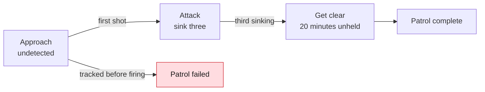

### The replay

When an engagement is over, press `r` on the end-of-mission box. The replay shows the whole encounter **as it really was**: every ship's and torpedo's true track, which the console could never show you while you fought. It is the after-action report: where you were found, how close the hunters came, why a torpedo missed.

- **The map** is flat, but its viewpoint moves in three dimensions: `a`/`d` turn it, `w`/`s` tilt it from overhead to edge-on, `[`/`]` zoom, `o` looks straight down with north up, and `c` centres on your ship. Every ship stands on a drop line to a gridded reference plane, so height reads at any angle: the third dimension the rose and plot can only give as numbers.
- **Lines show who hears whom:** amber from a hostile ship that heard you, red from one tracking you, faint from you to the ships you held.
- **The timeline** runs along the foot: `Space` plays, `←`/`→` step, `+`/`-` change speed, and `n`/`p` jump to the next or previous key moment, marked on the timeline. The strip above it shows **detection pressure**: the taller the bar, the closer a hunter came to tracking you, and a full bar means one did.
- **The debrief** beside the map: for each hunter, the most times it heard you in a minute against the 5 it needed to track you, when, and how far off; who heard whom first, and by how long; your closest approach to each ship; your loudest moment and why; how long you burned and drifted. Below it, every key moment: first contacts, launches, each torpedo's hit or miss distance, what each hit cost the hull and whether it sank her, sinkings and pings. The moments keep their own part of the panel, so a long fight never scrolls the captains' sheets away; when the sheets are too long to fit, `PgUp` and `PgDn` scroll them.

- **The ledger** in the debrief: what you spent, your tanks and battery at the start and the end, and `HIT`, `MISS` and `DUD` totals. One line per torpedo gives its time, tube, weapon and solution grade at launch (`GOOD`, `FAIR`, or `BRG` for a shot down a bearing), then how it ended: hit (with the share of the hull it cost, and `sunk` if it finished her), a dud, went off early, decoyed, target turned, no solution, ran wide, circled back, shot down or ran out. The score follows, part by part: goals, tonnage and escape. Last comes the peak detection pressure, with its time.
- **The log** under the debrief: the lines the boat logged, up to the moment on the timeline, newest at the foot. Step back and you read what it said as it happened; lines from later stay hidden until the timeline reaches them. A short terminal drops the log to leave room for the debrief.

`q` or `r` closes the replay.

**Watching one later.** A finished engagement's replay is kept automatically, in `ghostboat/replays/` beside the saved exercises (`$XDG_DATA_HOME`, or `~/.local/share`), as `<date>-<scenario>-<outcome>.ron` (date and time in UTC, outcome `won` or `lost`). The newest 50 are kept, and older ones are deleted unless you kept them. **Saved Exercises** on the main menu lists them among the saves, newest first, and `Enter` opens one. From a shell:

```
ghostboat --replay ~/.local/share/ghostboat/replays/2026-11-04-125919-duel-won.ron
```

opens the viewer alone and quits when you close it. A replay holds where everyone really was, so it only exists once an engagement is decided: nothing is saved, or can be opened, while one is running. If the file can't be written (a full disk, a folder you can't write to), the log says so in one line and the exercise carries on.

### Verdict bands

Every engagement at every difficulty gets a verdict as well as a result: **Defeat, Draw, Marginal, Substantial** or **Decisive**. It is scored out of 100 from the goals you met, how much of the enemy's tonnage you sank and whether you got out. With something to sink, that is 30 for the goals, 50 for tonnage and 20 for getting out; on a run with nothing to sink, 70 for the goals and 30 for getting out. Tonnage counts every ship not on your side, traders included, except one your orders say to spare.

| Band | Score |
|---|---|
| Decisive | 85 and up |
| Substantial | 60 to 84 |
| Marginal | 35 to 59 |
| Draw | 15 to 34 |
| Defeat | under 15 |

**The instructor's note.** After a failed exercise, at every level, the end-of-mission box may carry an `INSTRUCTOR'S NOTE · THE BLATHER`: one blather, and what to try next time. The instructor finds the point the fight turned against you, usually the first time a hunter tracked you, and names your last action that could answer for it: a burn near a hunter, an early ping, holding course on the firing bearing, a shot without a good solution, a straight runner fired on less than GOOD, emptied tubes, a contact held on one leg, or speed through a rock field. A note says no more than the debrief does, and if nothing clear stands out there is no note. A won exercise gets a note for one thing only: a straight runner fired on less than a GOOD solution that missed, so a miss is blamed on the solution, not the weapon. Press `i` on the box, or point at `i the moment`, to open the replay at the moment it blames. In the replay, `i` or a click on the note goes back there, and a `◆` marks it on the timeline. The note stays in a kept replay.

A band doesn't change whether you won or what unlocks next. It says how well it went: sinking two destroyers and dying is not a Defeat. The verdict shows on the end-of-mission box and in the replay, and goes into your records. At Nightmare, the band is the point.

**Tonnage.** The end-of-mission box and the replay also show the tons you sank and the tons there to sink: each ship's dry mass, not counting your own side or a ship you were told to spare. A ship counts as yours if your weapons sank her, or if she was lost to rock, a body or a mate's torpedo while hunting you: you led her there, and the box lists those apart (`2 wrecked chasing you`). A ship that wrecks herself on patrol is nobody's. Tons are raw, as WWII aces were ranked. The level and iron mode are shown beside them and never multiplied in, and a boat that was lost keeps what it sank.

**Records.** Each finished engagement is recorded: won or lost, the time, the iron mode, ships sunk, hull left, the level, the band and the tons sunk. The title screen shows each engagement's best, and your heaviest bag and running total of tons; a win in a stricter iron mode beats a faster one in a gentler mode, and at the same mode a harder level beats an easier one. See [Title screen](#title-screen).

## 21. The war campaign

The war is an arms race in three eras, after the Battle of the Atlantic. Every technique arrives with its counter, in the same era or the next: pings against dark running, homing torpedoes against static buoys and jamming, jamming against ECCM, convoy masking against an escort outside the convoy.

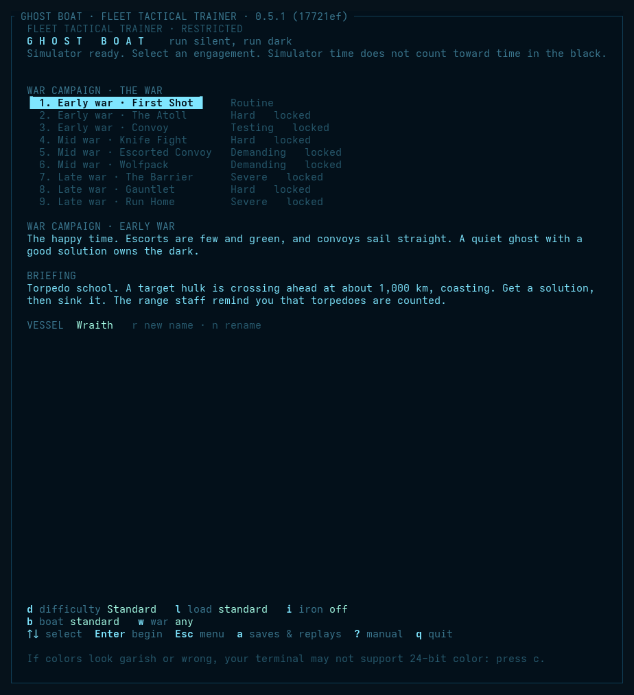

The campaign has its own page, **War Campaign** on the main menu: nine engagements in order. Each opens once you have won the one before it; the first is always open.

| Era | Engagements | What changes | How it feels |
|---|---|---|---|
| **Early war** | First Shot, The Atoll, Convoy | No jamming or ECCM yet. Escorts carry straight runners only. Every enemy crew is a grade greener: seasoned captains fight as green ones. Enemy merchants still broadcast their positions; by mid war they run dark. Torpedoes fail half as often again. | The happy time. A quiet ghost with a good solution owns the dark, and green escorts search the wreck, not the firing point. |
| **Mid war** | Knife Fight, Escorted Convoy, Wolfpack | Nothing: the trainer's baseline. | The counters arrive: drilled escorts that jam and counterattack, homing torpedoes, hunting groups. |
| **Late war** | The Barrier, Gauntlet, Run Home | Warship ears 5 dB sharper. Every enemy crew a grade better: green fights as seasoned, seasoned as escort. Every convoy gets a second escort. Torpedoes fail 0.6 as often. | The hunters win. Every patrol is a fight to get home. |

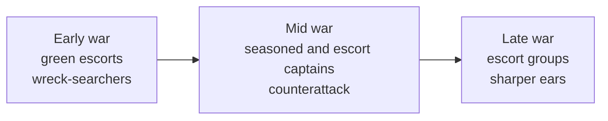

**Magazines.** Early-war destroyers sail with 60% of their load and cruisers with 70%, gauss slugs and torpedoes alike.

**War news.** The enemy's guns grow more lethal in 3130, in the middle of the mid war. From then on destroyer and cruiser guns do 20% more damage. An engagement dated 3129 opens with a warning on the wireless, and one dated 3130 with the news. Plan your hull margins by the date.

The era's changes apply only when you play an engagement from the campaign; the same engagement in free play is the mid-war version. The campaign lives in `data/campaign.ron`, so you can write your own.

### Choosing a boat

The **boat** setting on the title screen (`b`) puts you in a different hull wherever an engagement gives you the standard attack boat. All of them do the same job. They differ in how much room for error they give you, and the sheet for each is in the [ship registry](#23-ship-registry-and-specifications).

| Boat | Room for error | What it costs |
|---|---|---|
| **Standard** | The fleet's balance | Nothing |
| **Cold hull** | Goes cold in about half the time, so it can shoot closer and still get away | Four torpedoes fewer, and no mines |
| **Heavy hull** | Armoured, and the bigger heat sink takes a long burn | Slower to turn and to burn, and half again as long to go cold |
| **Leaky boat** | A nimble hull, and an old torpedo that always runs true | Everything else |

**The leaky boat** is a self-set challenge: a boat from the last war in place of a modern ghost. The Mk 0 torpedo has no duds, prematures or wide runs, and the hull turns half again as fast as the standard boat. Against that it has three bow tubes and no stern tube, seven torpedoes, under half the velocity change, a louder hull, duller ears, no shield, no mines, no jammers and no ECCM. It is slow to go cold, and something breaks about every hour.

Pick the war to suit. In the **early** war the old boat fights a matched fight: green hunters with straight runners and no jammers, and merchants that still broadcast. In the **late** war it is simply a harder boat than the one the hunters were built to catch.

## 22. Scenarios

Lessons live in `data/tutorials/`, one folder per track (`civilian/`, `naval/`, `ghost/`), and challenges in `data/scenarios/`. The title screen lists the lessons under **Training** and the challenges under **Scenarios**. Choose one there, or start one directly with `cargo run --release -- data/tutorials/<track>/<file>` or `cargo run --release -- data/scenarios/<file>`. A third folder, `data/testbench/`, holds physics and sensor checks. They are not exercises for a captain: start the trainer with `--dev` and a **Dev** item on the main menu lists them, or load one by path (see the development guide).

### Tutorials

| Scenario | File | What it teaches |
|---|---|---|
| Civilian 1: The Console | `civilian/01_tutorial_console.ron` | **Start here.** Nothing to do but look: the rose, the contacts table, the waterfall, time compression, and where the menus and manual are. |
| Civilian 2: Flying in Space | `civilian/02_tutorial_flying.ron` | Newton, not the sea: turn, burn, coast, turn your tail to your course and burn to a stop, then fly to a beacon with flight assist. |
| Civilian 3: Up and Down | `civilian/03_tutorial_up_down.ron` | Space is 3-D and the screens are flat: read a contact's elevation (`EL`), pitch the nose, and climb to a beacon using the profile view. |
| Civilian 4: Range from Bearings | `civilian/04_tutorial_range.ron` | A passive contact gives bearing, never range: a leg change for a FAIR solution, a ping for a fix, then a beacon. |
| Civilian 5: Running Quiet | `civilian/05_tutorial_quiet.ron` | A patrol passes, listening. Drifting with the reactor up, your warm hull glows in infrared and it finds you; rig for silent running (`b`) and it goes by; burn and it hears you at once. |
| Civilian 6: The Board | `civilian/05b_tutorial_power.ron` | Short and quiet. Put the board on a named setting, burn on a capped reactor, cut a load by hand, and put it all back. You never have to touch the board, but it can stretch a tank or get you past a fault. |
| Civilian 7: Stopping on a Mark | `civilian/05c_tutorial_stopping.ron` | Stopping is a burn the other way, and it covers ground. Burn to 1 km/s (`burn to 1`), work out how far out to start, turn end for end (`reverse half`), slow to a crawl (`slow to 0.1`), drift in and stop (`full stop`). |
| Civilian 8: Meeting a Moving Ship | `civilian/05d_tutorial_meeting.ron` | To meet a ship, match her velocity before you close. Match a tender by hand from the contacts table, close on her once she sits still on the plot, then match again with the aid (`match s1`): it points the helm, and you burn. |
| Civilian 9: Gravity | `civilian/05e_tutorial_gravity.ron` | A moon bends every coasting course. Watch CSE on the TURN gauge and the helm's collision call show a line that missed on a ruler hit, use the autopilot to get onto a safe line, then coast past by hand. |
| Civilian 10: The Long Passage | `civilian/05f_tutorial_passage.ron` | Three charted waypoints and over 30,000 km. Cross them on the Chart view with time compression (`+`, `step 5m`, `call me waypoint`), see it drop back to x1 when something happens, and plan the stop at the end. |
| Naval 1: Taking Command | `naval/06_naval_command.ron` | **The advanced track starts here.** A warship has no autopilot: dial an order and give it with `Enter`, ring the engine telegraph, order all stop, stop the ship with `full stop`, and make for a beacon with a controlled burn (`burn to 1`). Your crew answers in its own time. |
| Naval 2: Think in Three Dimensions | `naval/07_naval_three_dimensions.ron` | **The duel in the cloud, taught, aboard a ghost.** A hurt cruiser, the *Pequod*, her drive wrecked, comes down on you inside the Shroud, each of you with a FAIR fix on the other, and she fights on a plane. Pitch the nose down, cut the drive, rig for silent running and sink out of her plane; turn your bow tubes to where she will go; hear her pass, ping for a GOOD solution, and sink her with straight runners, keeping the beam to finish her. In a cloud only straight runners and the beam work. The drop has a crew's name, a *Quirk's Standoff*: you hang below her and say nothing. Stay on the plane and she finds you first. Her captain is the same every launch. |
| Naval 3: Torpedo in the Water | `naval/07a_naval_torpedo_in_the_water.ron` | **The answer to a torpedo, and why.** A crippled destroyer shoots at your ghost with homing torpedoes. Turn the torpedo astern, burn, drop a noisemaker and a decoy (`j`, `d`), cut the drive and rig for silent, then get clear. Noisemakers and decoys draw a seeker, and going quiet leaves it nothing better; none of it stops a straight runner, which only getting off its line beats. |
| Naval 4: Damage Control | `naval/07b_naval_damage_control.ron` | **Mend first what you need next.** Start hurt, with the drive failed, the array damaged and the battery meter stuck. Put the parties on the drive (`repair drive`), find the lying gauge by asking the crew (`battery`, `repair battery`, `gauges`), bring the array back, then rig for silent to stand the parties down. |
| Naval 5: Heat and the Radiators | `naval/07c_naval_heat.ron` | **Run hot, cool down unseen.** Burn with the radiators in until the sink is 75% full, put the radiators out and watch the infrared jump (`sig`), bring them in again, and coast cold while the hull sheds the rest. Radiators are fast and seen from thousands of km; the hull is slow and nearly invisible. |
| Naval 6: Ears and Voices | `naval/07d_naval_ears_and_voices.ron` | **The aid points; the captain flies.** Hear a merchant with her beacon on, set how much the crew says (`reports all`, `normal`, `quiet`), and shadow her: `match s1` points the nose for the matching burn, the TURN gauge and `turn status` show how hard the helm is swinging, and you burn it yourself. Then coast beside her at a steady range. |
| Ghost 1: Silent Running, and Why | `ghost/09_ghost_silent_running.ron` | **The warship's choice.** A destroyer sweeps past 170 km off, listening, and your battery is low. Rig for silent running (`b`), then ultra-quiet (`ultra`), and she goes by; run normally and she finds you. Watch the price on `battery` and `air`, then bring the reactor back (`normal`) once she is far off and before the battery decides for you. |
| Ghost 2: The Solution | `ghost/10_ghost_solution.ron` | **No shooting.** Hear a dark merchant, hold one leg for a FAIR solution, change leg with a short burn, and coast to GOOD. A solution is an estimate from bearings, never the truth: the replay's true picture shows how far off it was. |
| Ghost 3: Straight Runners | `ghost/11_ghost_straight_runners.ron` | **The ghost's own shot.** A freighter that has not heard you: make the solution GOOD, put the bow on her (`steer s1`) and fire a fan of three (`salvo 3 s1 straight`). A straight runner can't be jammed, but it trusts your solution completely. |
| Ghost 4: Homing Torpedoes | `ghost/12_ghost_homing.ron` | **Once you are found.** A hurt destroyer knows where you are and dodges what she hears. Fire homing torpedoes on a FAIR solution (`salvo 2 s1 homing`) and watch the seekers follow her turn. |
| Ghost 5: The Line-Up | `ghost/13_ghost_line_up.ron` | **The ghost's attack, by hand.** A freighter 80 km above your level. Pitch up, burn briefly, turn the nose down while you coast, and stop the climb level with her with the same burn the other way. Then set the quiet helm (`helm quiet`), bring the bow on without showing on MAG, and fire straight runners on GOOD. |
| Ghost 6: Jamming | `ghost/14_ghost_jamming.ron` | **The counter to homing.** A hurt destroyer with a jammer swamps your homing torpedo's seeker, and it loses her. Change leg for GOOD and sink her with straight runners, which have no seeker to jam. |
| Ghost 7: The Beam | `ghost/15_ghost_beam.ron` | **The deck gun.** Close on a crippled freighter that already knows you are there, stop, ping for a fresh echo and finish her with `lase s1`. The beam is for a close target that has found you, or a cripple; never while you still want to be unheard. |

### Challenges

The Scenarios page shows each challenge's rating, from Routine through Testing, Demanding and Hard to Severe, and lists each kind of boat's challenges easiest first. The ratings are a first draft.

| Scenario | File | What it teaches |
|---|---|---|
| Blind Man's Bluff | `blind_mans_bluff.ron` | **The duel in a cloud.** Two hurt cruisers inside the Shroud, each with the same poor fix on the other from the fight that drove them in. Nothing hears past a few tens of km, a ping reaches 60, seekers are deaf, and a torpedo's motor is all but silent. He comes down your last bearing: be under it. Choose other ships and captains as in Duel. Teaches: the third dimension as a weapon, and that the enemy has it too. |
| Tollgate Run | `tollgate_run.ron` | **The pirate's side of Bounty.** You fly a raider against two traders escorted by a navy destroyer. The escort jams you the moment it hears you and screens between you and its charges, so the traders vanish inside its cone. Work round the narrow cone (the jammer blinds the destroyer that way and tells you exactly where it is), take a trader with straight runners, and get away. Teaches: jamming from the receiving end, and why a civilian array can't beat it head on. |
| Bounty | `bounty.ron` | **The civilian hunter's first job, and training for the war.** Escort two traders past the Tollgate Shoal, where two raiders lie in the dust, and collect the bounty on both. You fly the `civ-hunter`: civilian ears like the raiders', but a hand-picked crew, homing torpedoes, and the patience they lack. Your licensed beacon is on at the start; the raiders hear it. Pirates prey on traders, and traders run from pirates and torpedoes. Teaches: the beacon as a choice, escorting, and a homing seeker's taste for the loudest thing in its cone. |
| Pirate Waters | `pirate_waters.ron` | **The overpowered test.** Detached from the war to scout pirate space: three converted haulers lie in wait round the dust they call home. Eliminate all three without ever being seen: if any raider holds you on its array, the patrol fails. A pirate is a civilian with guns, ears included: a raider hears a drifting ghost at about 15 km and a burning one at 1,500; you hear it drifting at 500 km and burning at 7,000. They fire on half a solution from too far, and they run a long way from a torpedo. A captain who keeps their head should win nearly every time; burning close, pinging, or chasing one into the other two is how you lose. |
| Convoy | `convoy.ron` | **The classic.** Six merchants and one green escort cross your patrol. Choose your targets before the first shot: when a merchant goes up, the rest scatter flat out from the blast and the escort races to the spot. And stay quiet: merchants listen too, and a convoy that hears a warship or a torpedo makes an emergency turn away and runs. You start on patrol ahead of the convoy, south of its track, so let it come to you. The convoy's own emissions mask the escort's hearing, but only toward the convoy: burn only while the convoy lies between you and the escort. You must stay undetected until you open fire; after that, the escort hunting you is the fight. Then **get clear**: go 20 minutes with no one tracking you to bring the patrol home. Three sunk is a good patrol; five is a famous one. |
| Escorted Convoy | `convoy_escorted.ron` | **Convoy's hard version.** The same six merchants, but the lone escort is a drilled crew under escort doctrine: she jams anything she hears at once and screens between it and the convoy. The convoy vanishes inside her jamming cone; switch on ECCM to see through it (at a cost in emissions) or work round out of the cone. Her jammer blinds her that way and shows you exactly where she is. You start ahead of the convoy, as in Convoy, must stay undetected until you open fire, and must get clear afterwards. |
| Fuel Run | `fuel_run.ron` | **Choosing your target.** One tanker in a screen of cheap hulls. The nearest ships are the worst ones to shoot: listen, read the crew's call with `info`, and sink the *Severn*. A tanker is slow to answer a scatter, so a late shot isn't always a lost one. |
| Cheap Hulls | `cheap_hulls.ron` | **Torpedo economy.** Ten war-standard freighters and thin cover, and twelve torpedoes. Close the range, fire single shots, and count your reloads. They carry no jammers. |
| The Ledger | `the_ledger.ron` | **Weighing the prize against the risk.** 60,000 tons, however you make it up. The heavy hulls lead beside a drilled escort; the cheap ones straggle far astern, and all three together still leave you short. |
| False Flag | `false_flag.ron` | **Who is who.** Five transponding ships in a convoy, all reading friendly (`○`). One is a raider wearing a stolen beacon. Find it by its signature on each channel and a position report that doesn't fit its bearing, sink it, and spare the four honest freighters: sinking one fails the patrol. |
| Lame Duck | `lame_duck.ron` | **Sailing with defects.** Your boat leaves with a loud reactor, an array that drops out and a weak drive, all listed in damage control. Get home past a destroyer picket, using silent running and gentle turns (every hard one costs magnetism). |
| The Atoll | `the_atoll.ron` | **The bait.** A rich tanker sits alone in orbit inside a dusty moon's well. Two destroyers wait cold in the same orbit. When the tanker goes up, everything on its side that hears the blast races to the spot (a flaming datum). Sink it, then get clear. |
| Wolfpack | `wolfpack.ron` | **Leading a pack.** Two more ghosts wait 2,000 km behind you, cold, under radio silence. Lifting it (`datalink on`) is their signal to attack, and shares every bearing for fast cross-fixes, but the escorts' receivers hear every report. Sink both tankers. |
| Minefield Run | `minefield_run.ron` | **Real fuzes, and a clock.** A strait sown with EF, magnetic and captor mines that read real signatures. You start stopped, with scrubbers beyond repair and barely any propellant: coast and you never arrive, go round and the air runs out. Burn on the near side, then go cold and hold your course. |
| The Narrows | `the_narrows.ron` | A charted enemy minefield across the only way to the exit: acoustic, magnetic and captor mines. Teaches silent running and minefields. |
| The Veil | `the_veil.ron` | Goals: reach the exit 6,000 km north, undetected. A dust cloud lies across your route, with an ion cloud and a storm either side and a patrol beyond. Burn in the near half of the dust; drifting all the way also works, slowly. |
| Duel | `duel.ron` | **Choose both ships and the enemy captain.** One on one in open space: attack boat, destroyer, cruiser or (for yourself) a carrier, against any of the first three, under a seasoned, green or silent captain. Sink the other ship. |
| Dry Tanks | `dry_tanks.ron` | **Why a ghost goes home.** The patrol ran long: the tanks hold a twentieth of a percent of fuel and the battery a tenth of its charge, too little to make the trip on it alone. Depot Twelve lies 800 km off, and a destroyer patrols the approach. Burn gently and coast on a capped reactor (`board patrol`): the stop costs as much as the start, and a fast burn arrives with nothing left to stop. Come alongside, stopped, and take on fuel with `refuel`. Teaches: fuel, the generator's thirst, and matching a base. |
| First Shot | `first_shot.ron` | **Torpedo school.** Get a FAIR solution on a crossing target hulk, then sink it. Teaches fire control, `f`, spreads and time to impact. |
| Gauntlet | `gauntlet.ron` | Sink a cruiser crossing your front with a destroyer on each bow. The group shares what it hears, and the cruiser's ears are better than yours. |
| The Flattop | `the_flattop.ron` | **A carrier group.** The carrier *Empyrean* crosses your front with a destroyer on each bow and pickets flying far out. Sink her, then get clear. Her craft are loud and half deaf, and you will hear them long before they hear you. When one comes near, go dark and let it pass: a picket that hears you calls the destroyers down. Teaches: launch transients, going dark under air cover, and a long stalk on a loud prize. |
| The Jammer Screen | `the_jammer_screen.ron` | **Straight runners on GOOD, or nothing.** A convoy of four, warned that a boat is about, with two escorts who start with a rough bearing on you and jam down it from the first minute. A homing torpedo fired into their cone goes blind. Build a GOOD solution quietly, fire a fan of straight runners, and get clear. |
| The Flight Deck | `the_flight_deck.ron` | **Command a carrier, guided.** One step at a time, with a hint for each: launch two pickets and read the sorties, let a picket find a hauler adrift far past your own hearing, launch a screen, then recall the craft and land three. Safe, and the way into *Flight Quarters*. See [Commanding a carrier](#commanding-a-carrier). |
| Flight Quarters | `flight_quarters.ron` | **The Flattop from the other side.** You command the carrier *Aerie* with two destroyers, and a silent ghost waits somewhere ahead for the best prize in the fleet. Your hull is too loud to hear it: put pickets far out, keep a screen for its torpedoes, and send a strike once the group has a solution. Find it, and sink it or drive it off. Teaches: commanding a flight deck. |
| Run Home | `run_home.ron` | **Start already hurt:** hull 45%, drive and array damaged, tubes wrecked, battery and propellant low. Two destroyers comb your track behind you. Get home: let them pass, and be silent when they do. |
| Hunter-Killer | `hunter_killer.ron` | **You have the flag:** a cruiser leading two destroyers, hunting two silent attack boats. Your destroyers share what they hear and leave the pinging to you; they hunt by their own doctrine. |
| Raider | `raider.ron` | A lone cruiser against a convoy: two freighters and a destroyer escort. Sink the freighters. |
| The Barrier | `the_barrier.ron` | Goals: reach the exit 7,000 km north, undetected, past a hunting group of three destroyers in a line. Drifting straight on passes one too close; sidestep early, with the faintest thrust. |
| Knife Fight | `knife_fight.ron` | Goal: sink a destroyer that shoots back. Your attack boat against a seasoned captain with homing torpedoes. |

## 23. Ship registry and specifications

<!-- specs:start -->

*Generated from `data/classes.ron`, `data/captains.ron` and `data/tuning.ron` by `cargo run -p sim --example manual_specs -- docs/manual.md`. Do not edit by hand.*

### Fleet depot (`base-depot`)

A fuel store with a dock and a beacon, parked where the fleet can find it. It does not move, it does not fight, and every ship in the war needs one sooner or later.

| | |
|---|---|
| Drive | 0.000 km/s² (0.00 g), full power in 1 s |
| 0 to 1 km/s | inf s at full throttle |
| Propellant | 0 s of full burn: 0.0 km/s of velocity change in all |
| Turning | up to 0.0°/s, reached in 0 s |
| Crew | answers the helm in 3.0 s and the engines in 4.0 s (1.0× a navy crew; under the computer, its captain's crew) |
| EF, drifting | 125.0 dB |
| EF, full burn | 125.0 dB |
| Target strength | 30 dB (how well its hull returns a ping) |
| Passive array | none |
| Active array | none |
| Flight assist | none |
| Torpedo tubes | none |
| Size | 5.00 km hull radius (what a slug must pass within) |
| Countermeasures | none |
| Radar cross-section | 50,000 m² |
| EF given off | drive 0.0 yW, reactor 0.0 yW, idle 50 W, datalink 1.0 kW |
| Thermal | hull 30,000 m², emissivity 0.90; plume 33 W at full |
| Rocket | 2,072,000 t dry + 0 t propellant; thrust 1.0 kN; exhaust 1 km/s; Δv 0 km/s; 0.00 g loaded (crew limit 0.0 g) |

### Freighter, bulk (`civ-freighter`)

A big, slow merchant hull carrying the cargo the war is really about. It has no weapons and poor ears, and it is loud enough to be heard across a sector. Its one defence is to turn directly away from danger and run flat out, which spoils a torpedo shot more often than you would hope.

| | |
|---|---|
| Drive | 0.002 km/s² (0.20 g), full power in 33 s |
| 0 to 1 km/s | 500 s at full throttle |
| Propellant | 7200 s of full burn: 14.4 km/s of velocity change in all |
| Turning | up to 0.5°/s, reached in 25 s |
| Crew | answers the helm in 4.5 s and the engines in 6.0 s (1.5× a navy crew; under the computer, its captain's crew) |
| EF, drifting | 152.0 dB |
| EF, full burn | 159.0 dB |
| Target strength | 30 dB (how well its hull returns a ping) |
| Passive array | floor 85 dB, threshold 6 dB, bearings ±5.0° at the threshold, baffles 90° astern |
| Active array | none |
| Flight assist | holds up to 2.0 km/s, corrects at 0.001 km/s², thrusters 150 dB |
| Torpedo tubes | none |
| Power | reactor 30 MW, 300 s from cold; generator 2.0 MW; battery 5000 MJ in two banks (926 min at hotel load); idle draw 0.1 MW; drive 20 MW at full; fuel 12000 GJ |
| Heat | sink 50000 MJ; hull sheds 2 MW, radiators 20 MW; silent running 2 dB quieter |
| Time to go cold | 1.6 h to shed half a five-minute burn, radiators in |
| Signatures | IR 115 dB (radiators out 145, plume 140) |
| Size | 1.00 km hull radius (what a slug must pass within) |
| Countermeasures | none |
| Telescope | 0.2 m aperture; sees 10 fW/m² cued (4 targets at once), the wide survey 20 dB less |
| EF array | 3.0 m aperture at 10 cm; floor 10 aW/m²; own-ship leakage 2e-18 of its EF per m² |
| Magnetometer | floor 1.0 nT; bearings ±40° at the threshold |
| Radar cross-section | 20,000 m² |
| EF given off | drive 217 W, reactor 50 W, idle 400 mW, datalink 1.0 kW, transponder 50 W |
| Magnetic moment | reactor coils 1.0 MA·m², hull 1.3 MA·m² |
| Thermal | hull 20,000 m², emissivity 0.90; plume 604 MW at full |
| Rocket | 45,000 t dry + 20,000 t propellant; thrust 128 MN; exhaust 150 km/s; Δv 55 km/s; 0.20 g loaded (crew limit 1.0 g) |
| Life support | 20 crew; cabin loses 80 W per kelvin; 20 oxygen candles |

### Hauler, civilian (`civ-hauler`)

A small civilian cargo ship with a small, hard-pressed crew and an autopilot that does the flying. It is easy to fly and forgiving, and it has no business in a fight. It is loud and half deaf, so anything with a warship's ears hears it long before it hears them.

| | |
|---|---|
| Drive | 0.004 km/s² (0.41 g), full power in 20 s |
| 0 to 1 km/s | 250 s at full throttle |
| Propellant | 3600 s of full burn: 14.4 km/s of velocity change in all |
| Turning | up to 1.0°/s, reached in 25 s |
| Crew | answers the helm in 4.5 s and the engines in 6.0 s (1.5× a navy crew; under the computer, its captain's crew) |
| EF, drifting | 118.0 dB |
| EF, full burn | 140.0 dB |
| Target strength | 20 dB (how well its hull returns a ping) |
| Passive array | floor 80 dB, threshold 6 dB, bearings ±4.0° at the threshold, baffles 70° astern |
| Active array | 165 dB ping, ranges ±10 km, recharge 20 s |
| Flight assist | holds up to 3.0 km/s, corrects at 0.003 km/s², thrusters 128 dB |
| Torpedo tubes | none |
| Power | reactor 15 MW, 180 s from cold; generator 1.0 MW; battery 5000 MJ in two banks (2381 min at hotel load); idle draw 0.0 MW; drive 12 MW at full; fuel 6000 GJ |
| Heat | sink 20000 MJ; hull sheds 0 MW, radiators 12 MW; silent running 3 dB quieter |
| Time to go cold | 2.6 h to shed half a five-minute burn, radiators in |
| Navigational shield | stops strikes to 0.6 km/s; draws 0.5 MW, radiates 30 W (122 dB), adds 400 kA·m² to the field |
| Signatures | IR 105 dB (radiators out 140, plume 125) |
| Other sensors | ESM |
| Size | 0.50 km hull radius (what a slug must pass within) |
| Countermeasures | 2 static buoys, 0 decoys; one every 30 s |
| Telescope | 0.2 m aperture; sees 10 fW/m² cued (4 targets at once), the wide survey 20 dB less |
| EF array | 3.0 m aperture at 10 cm; floor 10 aW/m²; own-ship leakage 2e-18 of its EF per m² |
| Magnetometer | floor 1.0 nT; bearings ±40° at the threshold |
| Radar | 1.0 MW peak EIRP; ranges ±0.50 km |
| Radar cross-section | 300 m² |
| EF given off | drive 54 W, reactor 10 W, idle 40 mW, datalink 1.0 kW, transponder 50 W |
| Magnetic moment | reactor coils 300 kA·m², hull 48 kA·m² |
| Thermal | hull 800 m², emissivity 0.90; plume 51 MW at full |
| Rocket | 1,700 t dry + 1,000 t propellant; thrust 11 MN; exhaust 150 km/s; Δv 69 km/s; 0.41 g loaded (crew limit 1.5 g) |
| Life support | 12 crew; cabin loses 68 W per kelvin; 10 oxygen candles |

### Hunter, civilian (`civ-hunter`)

A bounty crew's ship, built to run pirates down on the civilian scale. It is quiet for a civilian hull, its crew is hand-picked, and it is patient and hard to bluff. It is still a civilian hull: slow, thin-skinned and far below a warship's ears.

| | |
|---|---|
| Drive | 0.004 km/s² (0.41 g), full power in 20 s |
| 0 to 1 km/s | 250 s at full throttle |
| Propellant | 3600 s of full burn: 14.4 km/s of velocity change in all |
| Turning | up to 1.0°/s, reached in 25 s |
| Crew | answers the helm in 2.7 s and the engines in 3.6 s (0.9× a navy crew; under the computer, its captain's crew) |
| EF, drifting | 112.0 dB |
| EF, full burn | 139.0 dB |
| Target strength | 20 dB (how well its hull returns a ping) |
| Passive array | floor 70 dB, threshold 5 dB, bearings ±2.5° at the threshold, baffles 60° astern |
| Active array | 165 dB ping, ranges ±10 km, recharge 20 s |
| Flight assist | holds up to 3.0 km/s, corrects at 0.003 km/s², thrusters 128 dB |
| Torpedo tubes | 2, reload 600 s; carries 4 × MK2H, 2 × MK1; launch 152 dB |
| Power | reactor 15 MW, 150 s from cold; generator 1.0 MW; battery 5000 MJ in two banks (2381 min at hotel load); idle draw 0.0 MW; drive 12 MW at full; fuel 6000 GJ |
| Heat | sink 20000 MJ; hull sheds 0 MW, radiators 12 MW; silent running 3 dB quieter |
| Time to go cold | 2.6 h to shed half a five-minute burn, radiators in |
| Navigational shield | stops strikes to 0.6 km/s; draws 0.5 MW, radiates 30 W (122 dB), adds 400 kA·m² to the field |
| Signatures | IR 103 dB (radiators out 138, plume 125) |
| Other sensors | ESM |
| Size | 0.50 km hull radius (what a slug must pass within) |
| Countermeasures | 4 static buoys, 1 decoys; one every 30 s |
| Telescope | 0.5 m aperture; sees 2.0 fW/m² cued (4 targets at once), the wide survey 20 dB less |
| EF array | 6.0 m aperture at 10 cm; floor 2.0 aW/m²; own-ship leakage 1e-18 of its EF per m² |
| Magnetometer | floor 10 pT; bearings ±25° at the threshold |
| Radar | 1.0 MW peak EIRP; ranges ±0.50 km |
| Radar cross-section | 300 m² |
| EF given off | drive 40 W, reactor 4.0 W, idle 8.0 mW, datalink 1.0 kW, transponder 50 W |
| Magnetic moment | reactor coils 400 kA·m², hull 13 kA·m² |
| Thermal | hull 800 m², emissivity 0.90; plume 12 MW at full |
| Rocket | 460 t dry + 200 t propellant; thrust 2.6 MN; exhaust 150 km/s; Δv 54 km/s; 0.41 g loaded (crew limit 1.5 g) |
| Life support | 16 crew; cabin loses 68 W per kelvin; 10 oxygen candles |
| Default captain | hunter |

### Freighter, war standard (`civ-liberty`)

A mass-built wartime freighter: a third of a bulk carrier, welded fast and sent out in numbers. It is slow, has no jammer and carries a green crew, so it is the easiest tonnage in a convoy, and there are always more of them.

| | |
|---|---|
| Drive | 0.002 km/s² (0.15 g), full power in 33 s |
| 0 to 1 km/s | 667 s at full throttle |
| Propellant | 7200 s of full burn: 10.8 km/s of velocity change in all |
| Turning | up to 0.5°/s, reached in 25 s |
| Crew | answers the helm in 5.1 s and the engines in 6.8 s (1.7× a navy crew; under the computer, its captain's crew) |
| EF, drifting | 149.0 dB |
| EF, full burn | 156.0 dB |
| Target strength | 26 dB (how well its hull returns a ping) |
| Passive array | floor 85 dB, threshold 6 dB, bearings ±5.0° at the threshold, baffles 90° astern |
| Active array | none |
| Flight assist | holds up to 2.0 km/s, corrects at 0.001 km/s², thrusters 150 dB |
| Torpedo tubes | none |
| Power | reactor 30 MW, 300 s from cold; generator 2.0 MW; battery 5000 MJ in two banks (926 min at hotel load); idle draw 0.1 MW; drive 20 MW at full; fuel 12000 GJ |
| Heat | sink 50000 MJ; hull sheds 2 MW, radiators 20 MW; silent running 2 dB quieter |
| Time to go cold | 1.6 h to shed half a five-minute burn, radiators in |
| Signatures | IR 115 dB (radiators out 145, plume 140) |
| Size | 1.00 km hull radius (what a slug must pass within) |
| Countermeasures | none |
| Telescope | 0.2 m aperture; sees 10 fW/m² cued (4 targets at once), the wide survey 20 dB less |
| EF array | 3.0 m aperture at 10 cm; floor 10 aW/m²; own-ship leakage 2e-18 of its EF per m² |
| Magnetometer | floor 1.0 nT; bearings ±40° at the threshold |
| Radar cross-section | 8,000 m² |
| EF given off | drive 222 W, reactor 50 W, idle 400 mW, datalink 1.0 kW, transponder 50 W |
| Magnetic moment | reactor coils 1.0 MA·m², hull 490 kA·m² |
| Thermal | hull 10,000 m², emissivity 0.90; plume 177 MW at full |
| Rocket | 17,500 t dry + 7,500 t propellant; thrust 38 MN; exhaust 150 km/s; Δv 54 km/s; 0.15 g loaded (crew limit 1.0 g) |
| Life support | 20 crew; cabin loses 80 W per kelvin; 20 oxygen candles |

### Tanker, fleet (`civ-tanker`)

A vast hull full of propellant, the fuel the whole war burns. It is the heaviest merchant in the black and the slowest to turn, and it is worth a convoy's worth of tonnage to anyone who can reach it. Escorts put it in the middle for that reason.

| | |
|---|---|
| Drive | 0.001 km/s² (0.10 g), full power in 33 s |
| 0 to 1 km/s | 1000 s at full throttle |
| Propellant | 7200 s of full burn: 7.2 km/s of velocity change in all |
| Turning | up to 0.3°/s, reached in 15 s |
| Crew | answers the helm in 4.5 s and the engines in 6.0 s (1.5× a navy crew; under the computer, its captain's crew) |
| EF, drifting | 154.0 dB |
| EF, full burn | 161.0 dB |
| Target strength | 33 dB (how well its hull returns a ping) |
| Passive array | floor 85 dB, threshold 6 dB, bearings ±5.0° at the threshold, baffles 90° astern |
| Active array | none |
| Flight assist | holds up to 2.0 km/s, corrects at 0.001 km/s², thrusters 150 dB |
| Torpedo tubes | none |
| Power | reactor 30 MW, 300 s from cold; generator 2.0 MW; battery 5000 MJ in two banks (926 min at hotel load); idle draw 0.1 MW; drive 20 MW at full; fuel 12000 GJ |
| Heat | sink 50000 MJ; hull sheds 2 MW, radiators 20 MW; silent running 2 dB quieter |
| Time to go cold | 1.6 h to shed half a five-minute burn, radiators in |
| Signatures | IR 115 dB (radiators out 145, plume 140) |
| Size | 1.00 km hull radius (what a slug must pass within) |
| Countermeasures | none |
| Telescope | 0.2 m aperture; sees 10 fW/m² cued (4 targets at once), the wide survey 20 dB less |
| EF array | 3.0 m aperture at 10 cm; floor 10 aW/m²; own-ship leakage 2e-18 of its EF per m² |
| Magnetometer | floor 1.0 nT; bearings ±40° at the threshold |
| Radar cross-section | 30,000 m² |
| EF given off | drive 212 W, reactor 50 W, idle 400 mW, datalink 1.0 kW, transponder 50 W |
| Magnetic moment | reactor coils 1.0 MA·m², hull 1.6 MA·m² |
| Thermal | hull 28,000 m², emissivity 0.90; plume 600 MW at full |
| Rocket | 57,000 t dry + 70,000 t propellant; thrust 127 MN; exhaust 150 km/s; Δv 120 km/s; 0.10 g loaded (crew limit 1.0 g) |
| Life support | 20 crew; cabin loses 80 W per kelvin; 20 oxygen candles |

### Carrier, military (`mil-carrier`)

The heart of a battle group: a huge, loud hull that carries fighters and strike craft and can hardly fight on its own. Its craft find what its escorts then hunt, and their launches give its position away. Get to it past the escorts, and its craft have nowhere left to land.

| | |
|---|---|
| Drive | 0.006 km/s² (0.61 g), full power in 17 s |
| 0 to 1 km/s | 167 s at full throttle |
| Propellant | 10000 s of full burn: 60.0 km/s of velocity change in all |
| Turning | up to 0.6°/s, reached in 15 s |
| Crew | answers the helm in 3.0 s and the engines in 4.0 s (1.0× a navy crew; under the computer, its captain's crew) |
| EF, drifting | 153.0 dB |
| EF, full burn | 166.2 dB |
| Target strength | 26 dB (how well its hull returns a ping) |
| Passive array | floor 56 dB, threshold 3 dB, bearings ±1.5° at the threshold, baffles 60° astern |
| Active array | 178 dB ping, ranges ±2 km, recharge 15 s |
| Flight assist | none |
| Torpedo tubes | none |
| Power | reactor 90 MW, 120 s from cold; generator 8.0 MW; battery 40000 MJ in two banks (267 min at hotel load); idle draw 2.5 MW; drive 66 MW at full; fuel 36000 GJ |
| Heat | sink 180000 MJ; hull sheds 6 MW, radiators 90 MW; silent running 4 dB quieter |
| Time to go cold | 555.6 h to shed half a five-minute burn, radiators in |
| Navigational shield | stops strikes to 0.8 km/s; draws 2.0 MW, radiates 60 W (128 dB), adds 1200 kA·m² to the field |
| Signatures | IR 118 dB (radiators out 154, plume 145); datalink 128 dB |
| Other sensors | infrared, ESM |
| Gauss gun | 6 slugs at 10 km/s every 6 s, 15% hull each; 240 carried; fire control to 40 km |
| Size | 0.80 km hull radius (what a slug must pass within) |
| Countermeasures | 6 static buoys, 3 decoys; one every 25 s |
| Telescope | 1.0 m aperture; sees 10 aW/m² cued (4 targets at once), the wide survey 20 dB less |
| EF array | 10.0 m aperture at 10 cm; floor 10 zW/m²; own-ship leakage 2e-21 of its EF per m² |
| Magnetometer | floor 10 fT; bearings ±20° at the threshold |
| Radar | 20 GW peak EIRP; ranges ±0.15 km |
| Radar cross-section | 6,000 m² |
| EF given off | drive 1.7 kW, reactor 2.5 W, idle 1.0 mW, datalink 1.0 kW |
| Magnetic moment | reactor coils 2.5 MA·m², hull 540 kA·m² |
| Thermal | hull 12,000 m², emissivity 0.85; plume 1.3 GW at full |
| Rocket | 19,200 t dry + 5,000 t propellant; thrust 142 MN; exhaust 300 km/s; Δv 69 km/s; 0.60 g loaded (crew limit 2.0 g) |
| Life support | 1200 crew; cabin loses 1.6 kW per kelvin; 600 oxygen candles |
| Default captain | carrier |

### Cruiser, military (`mil-cruiser`)

The flagship of a battle group: the best ears in the fleet, the loudest ping, six tubes, guns and beams. It rarely misses what it holds, and it takes a lot of sinking. It turns slowly and is heard a long way off, so a quiet boat can choose its moment, and its escorts are the real problem.

| | |
|---|---|
| Drive | 0.008 km/s² (0.82 g), full power in 12 s |
| 0 to 1 km/s | 125 s at full throttle |
| Propellant | 10000 s of full burn: 80.0 km/s of velocity change in all |
| Turning | up to 0.8°/s, reached in 16 s |
| Crew | answers the helm in 3.0 s and the engines in 4.0 s (1.0× a navy crew; under the computer, its captain's crew) |
| EF, drifting | 150.0 dB |
| EF, full burn | 164.2 dB |
| Target strength | 22 dB (how well its hull returns a ping) |
| Passive array | floor 50 dB, threshold 3 dB, bearings ±1.0° at the threshold, baffles 70° astern |
| Active array | 185 dB ping, ranges ±2 km, recharge 12 s |
| Flight assist | none |
| Torpedo tubes | 6, reload 360 s; carries 8 × MK2H, 4 × MK3L, 6 × MK1; launch 155 dB |
| Power | reactor 80 MW, 120 s from cold; generator 8.0 MW; battery 40000 MJ in two banks (392 min at hotel load); idle draw 1.7 MW; drive 64 MW at full; fuel 32000 GJ |
| Heat | sink 150000 MJ; hull sheds 5 MW, radiators 80 MW; silent running 5 dB quieter |
| Time to go cold | 6.5 h to shed half a five-minute burn, radiators in |
| Navigational shield | stops strikes to 0.8 km/s; draws 2.0 MW, radiates 60 W (128 dB), adds 1000 kA·m² to the field |
| Signatures | IR 115 dB (radiators out 152, plume 143); datalink 125 dB |
| Other sensors | infrared, ESM |
| Gauss gun | 7 slugs at 10 km/s every 6 s, 20% hull each; 200 carried; fire control to 60 km |
| Beam | 2 × 30% hull a shot at 50 km, 7.5 at 100 km; recharges in 60 s at 40 MW each; fire control to 200 km |
| Size | 0.60 km hull radius (what a slug must pass within) |
| Countermeasures | 6 static buoys, 3 decoys; one every 25 s |
| Telescope | 2.0 m aperture; sees 3.0 aW/m² cued (4 targets at once), the wide survey 20 dB less |
| EF array | 20.0 m aperture at 10 cm; floor 3.0 zW/m²; own-ship leakage 1e-21 of its EF per m² |
| Magnetometer | floor 5.0 fT; bearings ±15° at the threshold |
| Radar | 30 GW peak EIRP; ranges ±0.15 km |
| Radar cross-section | 3,000 m² |
| EF given off | drive 1.4 kW, reactor 2.0 W, idle 800 µW, datalink 1.0 kW |
| Magnetic moment | reactor coils 2.0 MA·m², hull 360 kA·m² |
| Thermal | hull 8,000 m², emissivity 0.85; plume 1.2 GW at full |
| Rocket | 12,800 t dry + 4,000 t propellant; thrust 132 MN; exhaust 300 km/s; Δv 82 km/s; 0.80 g loaded (crew limit 3.0 g) |
| Life support | 700 crew; cabin loses 1.1 kW per kelvin; 400 oxygen candles |
| Default captain | seasoned |

### Destroyer, military (`mil-destroyer`)

The navy's hunter of ghosts: fast, loud, nimble and well armed, with torpedoes, gauss guns and the patience to search by sprint and drift. Its strength is that it comes for you, and it rarely comes alone. You beat it by hearing it far off, staying out of its ping, and shooting from outside what it can hear.

| | |
|---|---|
| Drive | 0.012 km/s² (1.22 g), full power in 7 s |
| 0 to 1 km/s | 83 s at full throttle |
| Propellant | 7200 s of full burn: 86.4 km/s of velocity change in all |
| Turning | up to 2.0°/s, reached in 13 s |
| Crew | answers the helm in 3.0 s and the engines in 4.0 s (1.0× a navy crew; under the computer, its captain's crew) |
| EF, drifting | 148.0 dB |
| EF, full burn | 162.2 dB |
| Target strength | 15 dB (how well its hull returns a ping) |
| Passive array | floor 55 dB, threshold 3 dB, bearings ±1.5° at the threshold, baffles 50° astern |
| Active array | 180 dB ping, ranges ±2 km, recharge 10 s |
| Flight assist | none |
| Torpedo tubes | 2, reload 480 s; carries 6 × MK2H, 4 × MK1; launch 155 dB |
| Power | reactor 60 MW, 90 s from cold; generator 6.0 MW; battery 20000 MJ in two banks (476 min at hotel load); idle draw 0.7 MW; drive 50 MW at full; fuel 24000 GJ |
| Heat | sink 60000 MJ; hull sheds 3 MW, radiators 60 MW; silent running 4 dB quieter |
| Time to go cold | 2.5 h to shed half a five-minute burn, radiators in |
| Navigational shield | stops strikes to 0.8 km/s; draws 1.0 MW, radiates 40 W (125 dB), adds 600 kA·m² to the field |
| Signatures | IR 110 dB (radiators out 150, plume 141); datalink 120 dB |
| Other sensors | infrared, ESM |
| Gauss gun | 5 slugs at 10 km/s every 6 s, 20% hull each; 200 carried; fire control to 60 km |
| Size | 0.40 km hull radius (what a slug must pass within) |
| Countermeasures | 4 static buoys, 2 decoys; one every 30 s |
| Telescope | 1.0 m aperture; sees 10 aW/m² cued (4 targets at once), the wide survey 20 dB less |
| EF array | 10.0 m aperture at 10 cm; floor 10 zW/m²; own-ship leakage 2e-21 of its EF per m² |
| Magnetometer | floor 10 fT; bearings ±20° at the threshold |
| Radar | 10 GW peak EIRP; ranges ±0.15 km |
| Radar cross-section | 1,000 m² |
| EF given off | drive 700 W, reactor 1.0 W, idle 400 µW, datalink 1.0 kW |
| Magnetic moment | reactor coils 1.0 MA·m², hull 130 kA·m² |
| Thermal | hull 3,000 m², emissivity 0.85; plume 701 MW at full |
| Rocket | 4,800 t dry + 1,500 t propellant; thrust 74 MN; exhaust 300 km/s; Δv 82 km/s; 1.20 g loaded (crew limit 3.0 g) |
| Life support | 300 crew; cabin loses 500 W per kelvin; 200 oxygen candles |
| Default captain | seasoned |

### Fighter, military (`mil-fighter`)

A small, fast craft from a carrier's deck, flown by pilots who take far more g than any warship's crew, with a gauss gun deadly to a boat it catches near and a drive no torpedo can outfly. It burns nearly all the time, so it is heard from far off, and the same burn leaves it half deaf: it hears what is loud or close and little else. Go dark when you hear one coming, because the destroyers it calls in are the real danger.

| | |
|---|---|
| Drive | 0.060 km/s² (6.12 g), full power in 2 s |
| 0 to 1 km/s | 17 s at full throttle |
| Propellant | 300 s of full burn: 18.0 km/s of velocity change in all |
| Turning | up to 25.0°/s, reached in 2 s |
| Crew | answers the helm in 1.5 s and the engines in 2.0 s (0.5× a navy crew; under the computer, its captain's crew) |
| EF, drifting | 126.0 dB |
| EF, full burn | 160.0 dB |
| Target strength | -5 dB (how well its hull returns a ping) |
| Passive array | floor 62 dB, threshold 4 dB, bearings ±3.0° at the threshold, baffles 90° astern |
| Active array | none |
| Flight assist | none |
| Torpedo tubes | none |
| Power | reactor 10 MW, 20 s from cold; generator 1.0 MW; battery 2000 MJ in two banks (476 min at hotel load); idle draw 0.1 MW; drive 5 MW at full; fuel 600 GJ |
| Heat | sink 6000 MJ; hull sheds 0 MW, radiators 10 MW; silent running 3 dB quieter |
| Time to go cold | 1.1 h to shed half a five-minute burn, radiators in |
| Signatures | IR 108 dB (radiators out 132, plume 146); datalink 125 dB |
| Gauss gun | 4 slugs at 10 km/s every 3 s, 15% hull each; 40 carried; fire control to 30 km |
| Size | 0.05 km hull radius (what a slug must pass within) |
| Countermeasures | none |
| EF array | 1.0 m aperture at 10 cm; floor 1.0 aW/m²; own-ship leakage 1e-17 of its EF per m² |
| Radar | 100 MW peak EIRP; ranges ±0.30 km |
| Radar cross-section | 20 m² |
| EF given off | drive 200 W, reactor 200 mW, idle 100 µW, datalink 1.0 kW |
| Magnetic moment | reactor coils 10 kA·m², hull 1.1 kA·m² |
| Thermal | hull 80 m², emissivity 0.90; plume 57 MW at full |
| Rocket | 40 t dry + 60 t propellant; thrust 4.5 MN; exhaust 400 km/s; Δv 367 km/s; 4.59 g loaded (crew limit 9.0 g) |
| Default captain | pilot |

### Strike fighter, military (`mil-fighter-strike`)

A fighter carrying two homing torpedoes, which it fires from a range the carrier could never reach unheard. It flies out along its carrier's track on a target and turns for home once they are gone. It is heard long before its torpedoes are.

| | |
|---|---|
| Drive | 0.050 km/s² (5.10 g), full power in 2 s |
| 0 to 1 km/s | 20 s at full throttle |
| Propellant | 320 s of full burn: 16.0 km/s of velocity change in all |
| Turning | up to 22.0°/s, reached in 2 s |
| Crew | answers the helm in 1.5 s and the engines in 2.0 s (0.5× a navy crew; under the computer, its captain's crew) |
| EF, drifting | 127.0 dB |
| EF, full burn | 160.0 dB |
| Target strength | -3 dB (how well its hull returns a ping) |
| Passive array | floor 62 dB, threshold 4 dB, bearings ±3.0° at the threshold, baffles 90° astern |
| Active array | none |
| Flight assist | none |
| Torpedo tubes | 2, reload 99999 s; carries 2 × MK2H; launch 150 dB |
| Power | reactor 10 MW, 20 s from cold; generator 1.0 MW; battery 2000 MJ in two banks (476 min at hotel load); idle draw 0.1 MW; drive 5 MW at full; fuel 600 GJ |
| Heat | sink 6000 MJ; hull sheds 0 MW, radiators 10 MW; silent running 3 dB quieter |
| Time to go cold | 1.1 h to shed half a five-minute burn, radiators in |
| Signatures | IR 108 dB (radiators out 132, plume 146); datalink 125 dB |
| Gauss gun | 4 slugs at 10 km/s every 3 s, 15% hull each; 20 carried; fire control to 30 km |
| Size | 0.06 km hull radius (what a slug must pass within) |
| Countermeasures | none |
| EF array | 1.0 m aperture at 10 cm; floor 1.0 aW/m²; own-ship leakage 1e-17 of its EF per m² |
| Radar | 100 MW peak EIRP; ranges ±0.30 km |
| Radar cross-section | 25 m² |
| EF given off | drive 200 W, reactor 200 mW, idle 100 µW, datalink 1.0 kW |
| Magnetic moment | reactor coils 10 kA·m², hull 1.4 kA·m² |
| Thermal | hull 90 m², emissivity 0.90; plume 57 MW at full |
| Rocket | 50 t dry + 60 t propellant; thrust 4.5 MN; exhaust 400 km/s; Δv 315 km/s; 4.17 g loaded (crew limit 9.0 g) |
| Default captain | pilot |

### Attack boat, military (`mil-ghost`)

The ghost, a submarine in space: small, cold and very quiet, with sharp ears, four tubes and a thin hull. It fires first, from a solution nobody heard it build, and it decides whether there is a fight at all. Once found it is fragile, and a boat that is heard and then pinged has very little left but to run.

| | |
|---|---|
| Drive | 0.008 km/s² (0.82 g), full power in 10 s |
| 0 to 1 km/s | 125 s at full throttle |
| Propellant | 5400 s of full burn: 43.2 km/s of velocity change in all |
| Turning | up to 1.5°/s, reached in 15 s |
| Crew | answers the helm in 3.0 s and the engines in 4.0 s (1.0× a navy crew; under the computer, its captain's crew) |
| EF, drifting | 110.0 dB |
| EF, full burn | 150.0 dB |
| Target strength | -28 dB (how well its hull returns a ping) |
| Passive array | floor 58 dB, threshold 4 dB, bearings ±2.0° at the threshold, baffles 60° astern |
| Active array | 172 dB ping, ranges ±3 km, recharge 15 s |
| Flight assist | none |
| Torpedo tubes | 4, reload 600 s; carries 6 × MK1, 4 × MK2H, 2 × CAR; launch 112 dB |
| Power | reactor 20 MW, 90 s from cold; generator 1.5 MW; battery 20000 MJ in two banks (1961 min at hotel load); idle draw 0.2 MW; drive 16 MW at full; fuel 8000 GJ |
| Heat | sink 100000 MJ; hull sheds 1 MW, radiators 20 MW; silent running 8 dB quieter |
| Time to go cold | 3.5 h to shed half a five-minute burn, radiators in |
| Navigational shield | stops strikes to 0.6 km/s; draws 0.5 MW, radiates 20 W (122 dB), adds 400 kA·m² to the field |
| Signatures | IR 95 dB (radiators out 140, plume 128) |
| Other sensors | infrared, ESM |
| Beam | 1 × 15% hull a shot at 15 km, 3.8 at 30 km; recharges in 90 s at 15 MW each; fire control to 60 km |
| Size | 0.25 km hull radius (what a slug must pass within) |
| Countermeasures | 6 static buoys, 3 decoys; one every 20 s |
| Telescope | 1.0 m aperture; sees 10 aW/m² cued (4 targets at once), the wide survey 20 dB less |
| EF array | 10.0 m aperture at 10 cm; floor 10 zW/m²; own-ship leakage 2e-21 of its EF per m² |
| Magnetometer | floor 10 fT; bearings ±20° at the threshold |
| Radar | 1.0 GW peak EIRP; ranges ±0.15 km |
| Radar cross-section | 2 m² |
| EF given off | drive 300 W, reactor 300 mW, idle 40 µW, datalink 1.0 kW |
| Magnetic moment | reactor coils 500 kA·m², hull 50 kA·m² |
| Thermal | hull 1,500 m², emissivity 0.80; plume 178 MW at full |
| Rocket | 1,800 t dry + 600 t propellant; thrust 19 MN; exhaust 300 km/s; Δv 86 km/s; 0.80 g loaded (crew limit 3.0 g) |
| Life support | 70 crew; cabin loses 155 W per kelvin; 40 oxygen candles |

### Attack boat, cold hull (`mil-ghost-cold`)

The attack boat rebuilt to lose heat: a lagged reactor space and a hull that sheds half as much again as the standard build. It goes cold fast, so it can shoot closer and still get away. The price is the magazine, four torpedoes fewer, and no mines.

| | |
|---|---|
| Drive | 0.008 km/s² (0.82 g), full power in 10 s |
| 0 to 1 km/s | 125 s at full throttle |
| Propellant | 5400 s of full burn: 43.2 km/s of velocity change in all |
| Turning | up to 1.5°/s, reached in 15 s |
| Crew | answers the helm in 3.0 s and the engines in 4.0 s (1.0× a navy crew; under the computer, its captain's crew) |
| EF, drifting | 110.0 dB |
| EF, full burn | 150.0 dB |
| Target strength | -28 dB (how well its hull returns a ping) |
| Passive array | floor 58 dB, threshold 4 dB, bearings ±2.0° at the threshold, baffles 60° astern |
| Active array | 172 dB ping, ranges ±3 km, recharge 15 s |
| Flight assist | none |
| Torpedo tubes | 4, reload 600 s; carries 5 × MK1, 3 × MK2H; launch 112 dB |
| Power | reactor 20 MW, 90 s from cold; generator 1.5 MW; battery 20000 MJ in two banks (1961 min at hotel load); idle draw 0.2 MW; drive 16 MW at full; fuel 8000 GJ |
| Heat | sink 100000 MJ; hull sheds 2 MW, radiators 20 MW; silent running 8 dB quieter |
| Time to go cold | 1.8 h to shed half a five-minute burn, radiators in |
| Navigational shield | stops strikes to 0.6 km/s; draws 0.5 MW, radiates 20 W (122 dB), adds 400 kA·m² to the field |
| Signatures | IR 95 dB (radiators out 140, plume 128) |
| Other sensors | infrared, ESM |
| Beam | 1 × 15% hull a shot at 15 km, 3.8 at 30 km; recharges in 90 s at 15 MW each; fire control to 60 km |
| Size | 0.25 km hull radius (what a slug must pass within) |
| Countermeasures | 6 static buoys, 3 decoys; one every 20 s |
| Telescope | 1.0 m aperture; sees 10 aW/m² cued (4 targets at once), the wide survey 20 dB less |
| EF array | 10.0 m aperture at 10 cm; floor 10 zW/m²; own-ship leakage 2e-21 of its EF per m² |
| Magnetometer | floor 10 fT; bearings ±20° at the threshold |
| Radar | 1.0 GW peak EIRP; ranges ±0.15 km |
| Radar cross-section | 2 m² |
| EF given off | drive 300 W, reactor 300 mW, idle 40 µW, datalink 1.0 kW |
| Magnetic moment | reactor coils 500 kA·m², hull 50 kA·m² |
| Thermal | hull 1,500 m², emissivity 0.80; plume 178 MW at full |
| Rocket | 1,800 t dry + 600 t propellant; thrust 19 MN; exhaust 300 km/s; Δv 86 km/s; 0.80 g loaded (crew limit 3.0 g) |
| Life support | 70 crew; cabin loses 155 W per kelvin; 40 oxygen candles |

### Attack boat, heavy hull (`mil-ghost-heavy`)

The attack boat with a thicker pressure hull and a bigger heat sink. It carries the standard load and takes a hit the standard build would not, so it has more room for a mistake under fire. It answers the helm slowly and sheds heat slowly, so it needs a long lead to go cold.

| | |
|---|---|
| Drive | 0.007 km/s² (0.71 g), full power in 10 s |
| 0 to 1 km/s | 143 s at full throttle |
| Propellant | 5400 s of full burn: 37.8 km/s of velocity change in all |
| Turning | up to 1.2°/s, reached in 15 s |
| Crew | answers the helm in 3.0 s and the engines in 4.0 s (1.0× a navy crew; under the computer, its captain's crew) |
| EF, drifting | 110.0 dB |
| EF, full burn | 150.0 dB |
| Target strength | -28 dB (how well its hull returns a ping) |
| Passive array | floor 58 dB, threshold 4 dB, bearings ±2.0° at the threshold, baffles 60° astern |
| Active array | 172 dB ping, ranges ±3 km, recharge 15 s |
| Flight assist | none |
| Torpedo tubes | 4, reload 600 s; carries 8 × MK1, 4 × MK2H; launch 112 dB |
| Power | reactor 20 MW, 90 s from cold; generator 1.5 MW; battery 20000 MJ in two banks (1961 min at hotel load); idle draw 0.2 MW; drive 16 MW at full; fuel 8000 GJ |
| Heat | sink 120000 MJ; hull sheds 1 MW, radiators 20 MW; silent running 8 dB quieter |
| Time to go cold | 5.7 h to shed half a five-minute burn, radiators in |
| Navigational shield | stops strikes to 0.6 km/s; draws 0.5 MW, radiates 20 W (122 dB), adds 400 kA·m² to the field |
| Signatures | IR 95 dB (radiators out 140, plume 128) |
| Other sensors | infrared, ESM |
| Beam | 1 × 15% hull a shot at 15 km, 3.8 at 30 km; recharges in 90 s at 15 MW each; fire control to 60 km |
| Size | 0.25 km hull radius (what a slug must pass within) |
| Countermeasures | 6 static buoys, 3 decoys; one every 20 s |
| Telescope | 1.0 m aperture; sees 10 aW/m² cued (4 targets at once), the wide survey 20 dB less |
| EF array | 10.0 m aperture at 10 cm; floor 10 zW/m²; own-ship leakage 2e-21 of its EF per m² |
| Magnetometer | floor 10 fT; bearings ±20° at the threshold |
| Radar | 1.0 GW peak EIRP; ranges ±0.15 km |
| Radar cross-section | 2 m² |
| EF given off | drive 300 W, reactor 300 mW, idle 40 µW, datalink 1.0 kW |
| Magnetic moment | reactor coils 500 kA·m², hull 50 kA·m² |
| Thermal | hull 1,500 m², emissivity 0.80; plume 178 MW at full |
| Rocket | 1,800 t dry + 600 t propellant; thrust 19 MN; exhaust 300 km/s; Δv 86 km/s; 0.80 g loaded (crew limit 3.0 g) |
| Life support | 70 crew; cabin loses 155 W per kelvin; 40 oxygen candles |

### Attack boat, last war (`mil-ghost-old`)

A boat from the last war, kept in service because the yards are full: worn, short-legged and short of everything. Age left it a nimble hull and an old torpedo that always runs true, and took its stern tube, its shield and its reserves. Something aboard fails every hour or so, and the crew spend the patrol keeping it alive.

| | |
|---|---|
| Drive | 0.005 km/s² (0.51 g), full power in 10 s |
| 0 to 1 km/s | 200 s at full throttle |
| Propellant | 2400 s of full burn: 12.0 km/s of velocity change in all |
| Turning | up to 2.4°/s, reached in 13 s |
| Crew | answers the helm in 3.0 s and the engines in 4.0 s (1.0× a navy crew; under the computer, its captain's crew) |
| EF, drifting | 114.0 dB |
| EF, full burn | 153.0 dB |
| Target strength | -22 dB (how well its hull returns a ping) |
| Passive array | floor 64 dB, threshold 4 dB, bearings ±3.0° at the threshold, baffles 60° astern |
| Active array | 172 dB ping, ranges ±3 km, recharge 15 s |
| Flight assist | none |
| Torpedo tubes | 3, reload 720 s; carries 7 × MK0; launch 112 dB |
| Power | reactor 12 MW, 180 s from cold; generator 1.5 MW; battery 9000 MJ in two banks (882 min at hotel load); idle draw 0.2 MW; drive 10 MW at full; fuel 3000 GJ |
| Heat | sink 100000 MJ; hull sheds 1 MW, radiators 12 MW; silent running 4 dB quieter |
| Time to go cold | 10.3 h to shed half a five-minute burn, radiators in |
| Breakdowns | about one every 60 min running; each down 120 s unless jury rigged |
| Signatures | IR 100 dB (radiators out 142, plume 128) |
| Other sensors | infrared, ESM |
| Beam | 1 × 15% hull a shot at 15 km, 3.8 at 30 km; recharges in 120 s at 10 MW each; fire control to 40 km |
| Size | 0.25 km hull radius (what a slug must pass within) |
| Countermeasures | 3 static buoys, 1 decoys; one every 20 s |
| Telescope | 1.0 m aperture; sees 10 aW/m² cued (4 targets at once), the wide survey 20 dB less |
| EF array | 10.0 m aperture at 10 cm; floor 10 zW/m²; own-ship leakage 2e-21 of its EF per m² |
| Magnetometer | floor 10 fT; bearings ±20° at the threshold |
| Radar | 1.0 GW peak EIRP; ranges ±0.15 km |
| Radar cross-section | 2 m² |
| EF given off | drive 300 W, reactor 300 mW, idle 40 µW, datalink 1.0 kW |
| Magnetic moment | reactor coils 800 kA·m², hull 60 kA·m² |
| Thermal | hull 1,500 m², emissivity 0.80; plume 35 MW at full |
| Rocket | 1,500 t dry + 240 t propellant; thrust 7.5 MN; exhaust 150 km/s; Δv 22 km/s; 0.44 g loaded (crew limit 3.0 g) |
| Life support | 70 crew; cabin loses 155 W per kelvin; 40 oxygen candles |

### Raider, pirate (`pir-raider`)

A pirate's converted trader, a little quieter than the ships it preys on and armed to take them. It is dangerous to merchants, and it shoots too soon and from too far. Against a navy ship it is outheard and outgunned, so hear it first and let it waste its torpedoes.

| | |
|---|---|
| Drive | 0.004 km/s² (0.41 g), full power in 20 s |
| 0 to 1 km/s | 250 s at full throttle |
| Propellant | 3600 s of full burn: 14.4 km/s of velocity change in all |
| Turning | up to 1.0°/s, reached in 25 s |
| Crew | answers the helm in 3.6 s and the engines in 4.8 s (1.2× a navy crew; under the computer, its captain's crew) |
| EF, drifting | 116.0 dB |
| EF, full burn | 139.0 dB |
| Target strength | 20 dB (how well its hull returns a ping) |
| Passive array | floor 80 dB, threshold 6 dB, bearings ±4.0° at the threshold, baffles 70° astern |
| Active array | 165 dB ping, ranges ±10 km, recharge 20 s |
| Flight assist | holds up to 3.0 km/s, corrects at 0.003 km/s², thrusters 128 dB |
| Torpedo tubes | 2, reload 900 s; carries 4 × MK1; launch 152 dB |
| Power | reactor 15 MW, 150 s from cold; generator 1.0 MW; battery 5000 MJ in two banks (2381 min at hotel load); idle draw 0.0 MW; drive 12 MW at full; fuel 6000 GJ |
| Heat | sink 20000 MJ; hull sheds 0 MW, radiators 12 MW; silent running 3 dB quieter |
| Time to go cold | 2.6 h to shed half a five-minute burn, radiators in |
| Navigational shield | stops strikes to 0.6 km/s; draws 0.5 MW, radiates 30 W (122 dB), adds 400 kA·m² to the field |
| Signatures | IR 103 dB (radiators out 138, plume 125) |
| Other sensors | ESM |
| Size | 0.50 km hull radius (what a slug must pass within) |
| Countermeasures | 2 static buoys, 0 decoys; one every 30 s |
| Telescope | 0.2 m aperture; sees 10 fW/m² cued (4 targets at once), the wide survey 20 dB less |
| EF array | 3.0 m aperture at 10 cm; floor 10 aW/m²; own-ship leakage 2e-18 of its EF per m² |
| Magnetometer | floor 30 pT; bearings ±30° at the threshold |
| Radar | 1.0 MW peak EIRP; ranges ±0.50 km |
| Radar cross-section | 300 m² |
| EF given off | drive 40 W, reactor 4.0 W, idle 20 mW, datalink 1.0 kW |
| Magnetic moment | reactor coils 600 kA·m², hull 26 kA·m² |
| Thermal | hull 800 m², emissivity 0.90; plume 12 MW at full |
| Rocket | 460 t dry + 200 t propellant; thrust 2.6 MN; exhaust 150 km/s; Δv 54 km/s; 0.41 g loaded (crew limit 1.5 g) |
| Life support | 12 crew; cabin loses 68 W per kelvin; 10 oxygen candles |
| Default captain | pirate |

### Torpedoes

**Torpedo, captor mine.** The torpedo a captor mine launches, which arms almost at once and goes straight for what the mine heard. It is short ranged, and it homes on EF. Go quiet and drop a static buoy.

**Carrier, torpedo.** A cold shell that coasts silently for up to six hours, then lets two homing torpedoes go. The enemy hears them on a bearing that leads nowhere near you. It hears nothing and takes no orders after launch, so it is only as good as your solution.

**Torpedo Mk 0, old pattern.** The old straight runner from the last war: a simple contact fuze, a plain gyro and nothing to go wrong. It is slower and shorter-legged than the Mk 1 and it hits when it is aimed right. Nobody in the fleet misses the Mk 1's bad days, and nobody on an old boat has any.

**Torpedo Mk 1, straight-running.** The straight runner goes to the point fire control aimed at and nowhere else. It is exact against a ship that keeps coasting, hard to hear once its motor stops, and takes no notice of decoys. Any ship that burns after the launch simply isn't there when it arrives.

**Torpedo Mk 2, homing.** The homing torpedo chases the loudest enemy its seeker hears, once it has armed. It follows a ship that burns and forgives a rough solution. A quiet target is hard for it to hear, and a static buoy or a decoy can draw it off.

**Torpedo Mk 3, linked homing.** A homing torpedo its launcher steers until it arms and tracks all the way, carried by ships that don't mind being heard, which means cruisers. It starts on the right target and the launcher always knows where it is. The link is a transmitter, so the launcher lights up for the whole run and points the way back to itself.

**Torpedo Mk 4, fast.** The fast runner closes in three-quarters of the time, so a target has less warning and less room to turn. Its hot motor is heard far beyond the boat that fired it, and the line of it points home. It is beaten by anyone who hears it early and moves.

**Torpedo Mk 5, cold.** The cold runner is barely louder than a drifting boat, so a shot from inside the screen can arrive unannounced. It is slow and short-legged. A target that burns away is gone, and a long shot gives a poor solution time to go stale.

**Torpedo Mk 6, defensive.** The defensive homer arms at 15 km, where every other torpedo is still a dud, and it runs barely 300 km. It exists for the hunter already on top of the boat. Firing it ends the hunt or tells the hunter exactly where to look.

| Torpedo | Guidance | Velocity change | EF burning / coasting | Arms at | Fuze | Warhead | Run |
|---|---|---|---|---|---|---|---|
| Torpedo, captor mine (`CAPT`) | homing (gain 4) | 8.0 km/s over 160 s | 112 / 95 dB | 5 km | 8 km | 120 | 600 s |
| Carrier, torpedo (`CAR`) | straight | 2.0 km/s over 40 s | 100 / 70 dB | 0 km | 0 km | 0 | 28800 s |
| Torpedo Mk 0, old pattern (`MK0`) | straight | 3.6 km/s over 90 s | 110 / 90 dB | 40 km | 8 km | 130 | 240 s |
| Torpedo Mk 1, straight-running (`MK1`) | straight | 6.0 km/s over 120 s | 110 / 90 dB | 40 km | 8 km | 140 | 260 s |
| Torpedo Mk 2, homing (`MK2H`) | homing (gain 4) | 10.0 km/s over 200 s | 112 / 95 dB | 40 km | 8 km | 120 | 200 s |
| Torpedo Mk 3, linked homing (`MK3L`) | homing (gain 4) | 10.0 km/s over 200 s | 112 / 95 dB | 40 km | 8 km | 120 | 200 s |
| Torpedo Mk 4, fast (`MK4F`) | straight | 8.1 km/s over 90 s | 124 / 90 dB | 40 km | 8 km | 120 | 170 s |
| Torpedo Mk 5, cold (`MK5Q`) | straight | 3.6 km/s over 120 s | 99 / 90 dB | 40 km | 8 km | 120 | 300 s |
| Torpedo Mk 6, defensive (`MK6D`) | homing (gain 4) | 5.5 km/s over 110 s | 112 / 95 dB | 15 km | 8 km | 90 | 110 s |

### Hits to sink

Good hits to sink each hull, by the warhead figure in the torpedo table: proximity then contact, or one figure where they agree. A near miss does far less.

| Hull | Hull points | 140 | 130 | 120 | 90 |
|---|---|---|---|---|---|
| Fleet depot | 140 | 142 / 120 | 153 / 130 | 165 / 140 | 220 / 187 |
| Freighter, bulk | 100 | 1 | 1 | 1 | 2 |
| Hauler, civilian | 90 | 1 | 1 | 1 | 2 / 1 |
| Hunter, civilian | 80 | 1 | 1 | 1 | 2 / 1 |
| Freighter, war standard | 90 | 1 | 1 | 1 | 2 / 1 |
| Tanker, fleet | 500 | 5 / 4 | 5 / 4 | 5 | 7 / 6 |
| Carrier, military | 320 | 3 | 3 | 4 / 3 | 5 / 4 |
| Cruiser, military | 390 | 4 / 3 | 4 / 3 | 4 | 6 / 5 |
| Destroyer, military | 160 | 2 | 2 | 2 | 3 / 2 |
| Fighter, military | 30 | 1 | 1 | 1 | 1 |
| Strike fighter, military | 35 | 1 | 1 | 1 | 1 |
| Attack boat, military | 100 | 1 | 1 | 1 | 2 |
| Attack boat, cold hull | 100 | 1 | 1 | 1 | 2 |
| Attack boat, heavy hull | 125 | 2 / 1 | 2 / 1 | 2 | 2 |
| Attack boat, last war | 90 | 1 | 1 | 1 | 2 / 1 |
| Raider, pirate | 80 | 1 | 1 | 1 | 2 / 1 |

### Countermeasures

| Countermeasure | Does | EF | Lasts |
|---|---|---|---|
| Decoy drone | runs off at 0.4 km/s, sounding and echoing like its launcher | its launcher's | 600 s |
| Jammer drone | runs off at 0.5 km/s and jams all round; masks targets within 20° of its bearing; lures homing seekers | 155 dB | 300 s |
| Static buoy | drops astern at 0.3 km/s; masks targets within 20° of its bearing; lures homing seekers | 158 dB | 90 s |

### Mines

**Mine, acoustic.** A mine that goes off when something loud passes close. Ships that burn through a field find it the hard way, and a drifting boat can pass close and live. A static buoy nearby sets it off harmlessly.

**Mine, captor.** A mine that listens from a long way off and launches a homing torpedo at what it hears. It covers far more space than a plain mine. Silent running gets you very close before it hears anything, and a static buoy deals with its torpedo.

**Mine, magnetic.** A mine that feels a hull's field and goes off close by, however quiet that hull is. Silence won't save you, but a shut-down reactor shrinks the danger a great deal. Keep clear: a ping can find one, at the price of telling everyone where you are.

| Mine | Fuze | Effect | Echo |
|---|---|---|---|
| Mine, acoustic | acoustic, 105 dB at the mine | 80 hull points within 15 km | -25 dB |
| Mine, captor | captor, hears 80 dB out to 100 km | launches a Torpedo, captor mine | -22 dB |
| Mine, magnetic | magnetic, 1 dB field | 80 hull points within 15 km | -25 dB |

### Passive detection ranges, target drifting

Range in km at which the listener (row), drifting, has an even chance each second of hearing the target (column). Baffles and moons ignored.

| Listener | civ-freighter | civ-hauler | civ-hunter | mil-carrier | mil-cruiser |
|---|---|---|---|---|---|
| civ-freighter | 50 | never | never | 56 | 40 |
| civ-hauler | 1,820 | 36 | 18 | 2,040 | 1,450 |
| civ-hunter | 7,020 | 140 | 70 | 7,880 | 5,580 |
| mil-carrier | 18,220 | 360 | 180 | 20,440 | 14,470 |
| mil-cruiser | 43,690 | 870 | 440 | 49,020 | 34,700 |
| mil-destroyer | 28,960 | 580 | 290 | 32,490 | 23,000 |
| mil-fighter | 6,670 | 130 | 67 | 7,490 | 5,300 |
| mil-ghost | 31,610 | 630 | 320 | 35,470 | 25,110 |
| pir-raider | 1,880 | 38 | 19 | 2,110 | 1,490 |

| Listener | mil-destroyer | mil-fighter | mil-ghost | pir-raider |
|---|---|---|---|---|
| civ-freighter | 32 | 3 | never | never |
| civ-hauler | 1,150 | 91 | 14 | 29 |
| civ-hunter | 4,430 | 350 | 56 | 110 |
| mil-carrier | 11,490 | 910 | 140 | 290 |
| mil-cruiser | 27,560 | 2,190 | 350 | 690 |
| mil-destroyer | 18,270 | 1,450 | 230 | 460 |
| mil-fighter | 4,210 | 330 | 53 | 110 |
| mil-ghost | 19,950 | 1,580 | 250 | 500 |
| pir-raider | 1,190 | 94 | 15 | 30 |

### Passive detection ranges, target burning

Range in km at which the listener (row), drifting, has an even chance each second of hearing the target (column). Baffles and moons ignored.

| Listener | civ-freighter | civ-hauler | civ-hunter | mil-carrier | mil-cruiser |
|---|---|---|---|---|---|
| civ-freighter | 110 | 13 | 11 | 260 | 200 |
| civ-hauler | 4,070 | 460 | 410 | 9,360 | 7,400 |
| civ-hunter | 15,680 | 1,770 | 1,570 | 36,070 | 28,510 |
| mil-carrier | 40,660 | 4,590 | 4,080 | 93,570 | 73,960 |
| mil-cruiser | 97,500 | 11,010 | 9,790 | 224,360 | 177,340 |
| mil-destroyer | 64,630 | 7,300 | 6,490 | 148,730 | 117,560 |
| mil-fighter | 14,890 | 1,680 | 1,500 | 34,270 | 27,080 |
| mil-ghost | 70,560 | 7,970 | 7,080 | 162,370 | 128,340 |
| pir-raider | 4,200 | 470 | 420 | 9,660 | 7,630 |

| Listener | mil-destroyer | mil-fighter | mil-ghost | pir-raider |
|---|---|---|---|---|
| civ-freighter | 160 | 130 | 40 | 11 |
| civ-hauler | 5,870 | 4,580 | 1,450 | 410 |
| civ-hunter | 22,650 | 17,650 | 5,580 | 1,580 |
| mil-carrier | 58,750 | 45,770 | 14,470 | 4,090 |
| mil-cruiser | 140,870 | 109,750 | 34,700 | 9,800 |
| mil-destroyer | 93,380 | 72,760 | 23,000 | 6,500 |
| mil-fighter | 21,510 | 16,760 | 5,300 | 1,500 |
| mil-ghost | 101,950 | 79,430 | 25,110 | 7,100 |
| pir-raider | 6,060 | 4,720 | 1,490 | 420 |

### Hearing a torpedo

Range in km at which the listener, drifting, has an even chance each second of hearing the torpedo.

| Listener | CAPT burning | CAPT coasting | CAR burning | CAR coasting | MK0 burning | MK0 coasting |
|---|---|---|---|---|---|---|
| civ-freighter | never | never | never | never | never | never |
| civ-hauler | 18 | 3 | 5 | never | 15 | 1 |
| civ-hunter | 71 | 10 | 18 | never | 56 | 6 |
| mil-carrier | 180 | 26 | 46 | 1 | 150 | 14 |
| mil-cruiser | 440 | 62 | 110 | 3 | 350 | 35 |
| mil-destroyer | 290 | 41 | 73 | 2 | 230 | 23 |
| mil-fighter | 67 | 9 | 17 | never | 53 | 5 |
| mil-ghost | 320 | 45 | 79 | 3 | 250 | 25 |
| pir-raider | 19 | 3 | 5 | never | 15 | 1 |

| Listener | MK1 burning | MK1 coasting | MK2H burning | MK2H coasting | MK3L burning | MK3L coasting |
|---|---|---|---|---|---|---|
| civ-freighter | never | never | never | never | never | never |
| civ-hauler | 15 | 1 | 18 | 3 | 18 | 3 |
| civ-hunter | 56 | 6 | 71 | 10 | 71 | 10 |
| mil-carrier | 150 | 14 | 180 | 26 | 180 | 26 |
| mil-cruiser | 350 | 35 | 440 | 62 | 440 | 62 |
| mil-destroyer | 230 | 23 | 290 | 41 | 290 | 41 |
| mil-fighter | 53 | 5 | 67 | 9 | 67 | 9 |
| mil-ghost | 250 | 25 | 320 | 45 | 320 | 45 |
| pir-raider | 15 | 1 | 19 | 3 | 19 | 3 |

| Listener | MK4F burning | MK4F coasting | MK5Q burning | MK5Q coasting | MK6D burning | MK6D coasting |
|---|---|---|---|---|---|---|
| civ-freighter | 2 | never | never | never | never | never |
| civ-hauler | 73 | 1 | 4 | 1 | 18 | 3 |
| civ-hunter | 280 | 6 | 15 | 6 | 71 | 10 |
| mil-carrier | 730 | 14 | 39 | 14 | 180 | 26 |
| mil-cruiser | 1,740 | 35 | 94 | 35 | 440 | 62 |
| mil-destroyer | 1,150 | 23 | 62 | 23 | 290 | 41 |
| mil-fighter | 270 | 5 | 14 | 5 | 67 | 9 |
| mil-ghost | 1,260 | 25 | 68 | 25 | 320 | 45 |
| pir-raider | 75 | 1 | 4 | 1 | 19 | 3 |

### Active array ranges

**Finds** is the range at which the pinger, drifting, has an even chance of an echo from that target. **Heard by** is the range at which that ship, drifting, hears the ping itself. The gap between the two is why pinging is dangerous.

| Pinger | Target | Finds it at | Heard by it at |
|---|---|---|---|
| civ-hauler | civ-freighter | 400 | 220 |
| civ-hauler | civ-hauler | 230 | 8,140 |
| civ-hauler | civ-hunter | 230 | 31,380 |
| civ-hauler | mil-carrier | 320 | 81,380 |
| civ-hauler | mil-cruiser | 250 | 195,130 |
| civ-hauler | mil-destroyer | 170 | 129,350 |
| civ-hauler | mil-fighter | 54 | 29,800 |
| civ-hauler | mil-ghost | 14 | 141,220 |
| civ-hauler | pir-raider | 230 | 8,400 |
| civ-hunter | civ-freighter | 750 | 220 |
| civ-hunter | civ-hauler | 420 | 8,140 |
| civ-hunter | civ-hunter | 420 | 31,380 |
| civ-hunter | mil-carrier | 590 | 81,380 |
| civ-hunter | mil-cruiser | 470 | 195,130 |
| civ-hunter | mil-destroyer | 310 | 129,350 |
| civ-hunter | mil-fighter | 100 | 29,800 |
| civ-hunter | mil-ghost | 27 | 141,220 |
| civ-hunter | pir-raider | 420 | 8,400 |
| mil-carrier | civ-freighter | 3,020 | 1,000 |
| mil-carrier | civ-hauler | 1,700 | 36,350 |
| mil-carrier | civ-hunter | 1,700 | 140,150 |
| mil-carrier | mil-carrier | 2,400 | 363,490 |
| mil-carrier | mil-cruiser | 1,910 | 871,630 |
| mil-carrier | mil-destroyer | 1,270 | 577,810 |
| mil-carrier | mil-fighter | 400 | 133,120 |
| mil-carrier | mil-ghost | 110 | 630,800 |
| mil-carrier | pir-raider | 1,700 | 37,520 |
| mil-cruiser | civ-freighter | 7,420 | 2,240 |
| mil-cruiser | civ-hauler | 4,170 | 81,380 |
| mil-cruiser | civ-hunter | 4,170 | 313,750 |
| mil-cruiser | mil-carrier | 5,890 | 813,760 |
| mil-cruiser | mil-cruiser | 4,680 | 1,951,350 |
| mil-cruiser | mil-destroyer | 3,130 | 1,293,550 |
| mil-cruiser | mil-fighter | 990 | 298,020 |
| mil-cruiser | mil-ghost | 260 | 1,412,180 |
| mil-cruiser | pir-raider | 4,170 | 83,990 |
| mil-destroyer | civ-freighter | 4,270 | 1,260 |
| mil-destroyer | civ-hauler | 2,400 | 45,760 |
| mil-destroyer | civ-hunter | 2,400 | 176,440 |
| mil-destroyer | mil-carrier | 3,400 | 457,610 |
| mil-destroyer | mil-cruiser | 2,700 | 1,097,320 |
| mil-destroyer | mil-destroyer | 1,800 | 727,420 |
| mil-destroyer | mil-fighter | 570 | 167,590 |
| mil-destroyer | mil-ghost | 150 | 794,130 |
| mil-destroyer | pir-raider | 2,400 | 47,230 |
| mil-ghost | civ-freighter | 2,820 | 500 |
| mil-ghost | civ-hauler | 1,580 | 18,220 |
| mil-ghost | civ-hunter | 1,580 | 70,240 |
| mil-ghost | mil-carrier | 2,240 | 182,180 |
| mil-ghost | mil-cruiser | 1,780 | 436,850 |
| mil-ghost | mil-destroyer | 1,190 | 289,590 |
| mil-ghost | mil-fighter | 380 | 66,720 |
| mil-ghost | mil-ghost | 100 | 316,150 |
| mil-ghost | pir-raider | 1,580 | 18,800 |
| pir-raider | civ-freighter | 410 | 220 |
| pir-raider | civ-hauler | 230 | 8,140 |
| pir-raider | civ-hunter | 230 | 31,380 |
| pir-raider | mil-carrier | 330 | 81,380 |
| pir-raider | mil-cruiser | 260 | 195,130 |
| pir-raider | mil-destroyer | 170 | 129,350 |
| pir-raider | mil-fighter | 55 | 29,800 |
| pir-raider | mil-ghost | 15 | 141,220 |
| pir-raider | pir-raider | 230 | 8,400 |

### Ranges on the physical model

These apply in engagements with the physical channels on (Thermal Range, Shadow of the Giant). Each is the range at which the signal reaches the sensor's detection threshold, in open space, with the listener drifting.

**EF array hears a ship, reactor running, drifting.**

| Listener | civ-freighter | civ-hauler | civ-hunter | mil-carrier | mil-cruiser |
|---|---|---|---|---|---|
| civ-freighter | 305k km | 136k km | 86k km | 68k km | 61k km |
| civ-hauler | 316k km | 141k km | 89k km | 70k km | 63k km |
| civ-hunter | 708k km | 316k km | 200k km | 158k km | 141k km |
| mil-carrier | 10.0 Mkm | 4.5 Mkm | 2.8 Mkm | 2.2 Mkm | 2.0 Mkm |
| mil-cruiser | 0.1 AU | 8.2 Mkm | 5.2 Mkm | 4.1 Mkm | 3.7 Mkm |
| mil-destroyer | 10.0 Mkm | 4.5 Mkm | 2.8 Mkm | 2.2 Mkm | 2.0 Mkm |
| mil-fighter | 1.0 Mkm | 448k km | 283k km | 223k km | 200k km |
| mil-ghost | 10.0 Mkm | 4.5 Mkm | 2.8 Mkm | 2.2 Mkm | 2.0 Mkm |
| pir-raider | 317k km | 141k km | 89k km | 71k km | 63k km |

| Listener | mil-destroyer | mil-fighter | mil-ghost | pir-raider |
|---|---|---|---|---|
| civ-freighter | 43k km | 19k km | 24k km | 86k km |
| civ-hauler | 45k km | 20k km | 24k km | 89k km |
| civ-hunter | 100k km | 45k km | 55k km | 200k km |
| mil-carrier | 1.4 Mkm | 632k km | 774k km | 2.8 Mkm |
| mil-cruiser | 2.6 Mkm | 1.2 Mkm | 1.4 Mkm | 5.2 Mkm |
| mil-destroyer | 1.4 Mkm | 632k km | 774k km | 2.8 Mkm |
| mil-fighter | 141k km | 63k km | 77k km | 283k km |
| mil-ghost | 1.4 Mkm | 632k km | 774k km | 2.8 Mkm |
| pir-raider | 45k km | 20k km | 24k km | 89k km |

**EF array hears a ship, burning at full.**

| Listener | civ-freighter | civ-hauler | civ-hunter | mil-carrier | mil-cruiser |
|---|---|---|---|---|---|
| civ-freighter | 703k km | 344k km | 284k km | 1.8 Mkm | 1.6 Mkm |
| civ-hauler | 728k km | 356k km | 294k km | 1.8 Mkm | 1.7 Mkm |
| civ-hunter | 1.6 Mkm | 798k km | 659k km | 4.1 Mkm | 3.7 Mkm |
| mil-carrier | 0.2 AU | 11.3 Mkm | 9.3 Mkm | 0.4 AU | 0.4 AU |
| mil-cruiser | 0.3 AU | 0.1 AU | 0.1 AU | 0.7 AU | 0.6 AU |
| mil-destroyer | 0.2 AU | 11.3 Mkm | 9.3 Mkm | 0.4 AU | 0.4 AU |
| mil-fighter | 2.3 Mkm | 1.1 Mkm | 933k km | 5.8 Mkm | 5.3 Mkm |
| mil-ghost | 0.2 AU | 11.3 Mkm | 9.3 Mkm | 0.4 AU | 0.4 AU |
| pir-raider | 729k km | 357k km | 295k km | 1.8 Mkm | 1.7 Mkm |

| Listener | mil-destroyer | mil-fighter | mil-ghost | pir-raider |
|---|---|---|---|---|
| civ-freighter | 1.1 Mkm | 609k km | 746k km | 284k km |
| civ-hauler | 1.2 Mkm | 630k km | 772k km | 294k km |
| civ-hunter | 2.6 Mkm | 1.4 Mkm | 1.7 Mkm | 659k km |
| mil-carrier | 0.3 AU | 0.1 AU | 0.2 AU | 9.3 Mkm |
| mil-cruiser | 0.5 AU | 0.2 AU | 0.3 AU | 0.1 AU |
| mil-destroyer | 0.3 AU | 0.1 AU | 0.2 AU | 9.3 Mkm |
| mil-fighter | 3.7 Mkm | 2.0 Mkm | 2.4 Mkm | 933k km |
| mil-ghost | 0.3 AU | 0.1 AU | 0.2 AU | 9.3 Mkm |
| pir-raider | 1.2 Mkm | 631k km | 773k km | 295k km |

**Magnetometer feels a ship.** Reactor running / shut down.

| Listener | civ-freighter | civ-hauler | civ-hunter | mil-carrier | mil-cruiser |
|---|---|---|---|---|---|
| civ-freighter | 613 m / 508 m | 326 m / 172 m | 346 m / 119 m | 672 m / 384 m | 618 m / 336 m |
| civ-hauler | 613 m / 508 m | 326 m / 172 m | 346 m / 119 m | 672 m / 384 m | 618 m / 336 m |
| civ-hunter | 3 km / 2 km | 2 km / 799 m | 2 km / 554 m | 3 km / 2 km | 3 km / 2 km |
| mil-carrier | 28 km / 24 km | 15 km / 8 km | 16 km / 6 km | 31 km / 18 km | 29 km / 16 km |
| mil-cruiser | 36 km / 30 km | 19 km / 10 km | 20 km / 7 km | 39 km / 22 km | 36 km / 20 km |
| mil-destroyer | 28 km / 24 km | 15 km / 8 km | 16 km / 6 km | 31 km / 18 km | 29 km / 16 km |
| mil-ghost | 28 km / 24 km | 15 km / 8 km | 16 km / 6 km | 31 km / 18 km | 29 km / 16 km |
| pir-raider | 2 km / 2 km | 1 km / 554 m | 1 km / 384 m | 2 km / 1 km | 2 km / 1 km |

| Listener | mil-destroyer | mil-fighter | mil-ghost | pir-raider |
|---|---|---|---|---|
| civ-freighter | 483 m / 241 m | 104 m / 49 m | 380 m / 177 m | 397 m / 147 m |
| civ-hauler | 483 m / 241 m | 104 m / 49 m | 380 m / 177 m | 397 m / 147 m |
| civ-hunter | 2 km / 1 km | 481 m / 229 m | 2 km / 819 m | 2 km / 684 m |
| mil-carrier | 22 km / 11 km | 5 km / 2 km | 18 km / 8 km | 18 km / 7 km |
| mil-cruiser | 28 km / 14 km | 6 km / 3 km | 22 km / 10 km | 23 km / 9 km |
| mil-destroyer | 22 km / 11 km | 5 km / 2 km | 18 km / 8 km | 18 km / 7 km |
| mil-ghost | 22 km / 11 km | 5 km / 2 km | 18 km / 8 km | 18 km / 7 km |
| pir-raider | 2 km / 776 m | 333 m / 159 m | 1 km / 568 m | 1 km / 474 m |

**Radar.** *Finds* is the range of an echo from that target (the radar equation: EIRP × cross-section / (4π)² r⁴ against the pinger's own EF floor). *Heard by* is how far the target's EF array hears the pulse itself (one way, over 4πr²). The gap is why a ping is a confession.

| Pinger | Target | Finds it at | Heard by it at |
|---|---|---|---|
| civ-hauler | civ-freighter | 1,330 km | 0.3 AU |
| civ-hauler | civ-hunter | 470 km | 0.7 AU |
| civ-hauler | mil-carrier | 990 km | 9.4 AU |
| civ-hauler | mil-cruiser | 830 km | 17.3 AU |
| civ-hauler | mil-destroyer | 630 km | 9.5 AU |
| civ-hauler | mil-fighter | 240 km | 0.9 AU |
| civ-hauler | mil-ghost | 130 km | 9.5 AU |
| civ-hauler | pir-raider | 470 km | 0.3 AU |
| civ-hunter | civ-freighter | 2,000 km | 0.3 AU |
| civ-hunter | civ-hauler | 700 km | 0.3 AU |
| civ-hunter | mil-carrier | 1,480 km | 9.4 AU |
| civ-hunter | mil-cruiser | 1,240 km | 17.3 AU |
| civ-hunter | mil-destroyer | 940 km | 9.5 AU |
| civ-hunter | mil-fighter | 350 km | 0.9 AU |
| civ-hunter | mil-ghost | 200 km | 9.5 AU |
| civ-hunter | pir-raider | 700 km | 0.3 AU |
| mil-carrier | civ-freighter | 89k km | 40.7 AU |
| mil-carrier | civ-hauler | 31k km | 42.1 AU |
| mil-carrier | civ-hunter | 31k km | 94.3 AU |
| mil-carrier | mil-cruiser | 56k km | 2439.9 AU |
| mil-carrier | mil-destroyer | 42k km | 1336.5 AU |
| mil-carrier | mil-fighter | 16k km | 133.6 AU |
| mil-carrier | mil-ghost | 8,930 km | 1336.5 AU |
| mil-carrier | pir-raider | 31k km | 42.2 AU |
| mil-cruiser | civ-freighter | 134k km | 49.8 AU |
| mil-cruiser | civ-hauler | 47k km | 51.6 AU |
| mil-cruiser | civ-hunter | 47k km | 115.5 AU |
| mil-cruiser | mil-carrier | 99k km | 1636.8 AU |
| mil-cruiser | mil-destroyer | 63k km | 1636.9 AU |
| mil-cruiser | mil-fighter | 24k km | 163.6 AU |
| mil-cruiser | mil-ghost | 13k km | 1636.9 AU |
| mil-cruiser | pir-raider | 47k km | 51.7 AU |
| mil-destroyer | civ-freighter | 75k km | 28.8 AU |
| mil-destroyer | civ-hauler | 26k km | 29.8 AU |
| mil-destroyer | civ-hunter | 26k km | 66.7 AU |
| mil-destroyer | mil-carrier | 56k km | 945.0 AU |
| mil-destroyer | mil-cruiser | 47k km | 1725.2 AU |
| mil-destroyer | mil-fighter | 13k km | 94.5 AU |
| mil-destroyer | mil-ghost | 7,510 km | 945.1 AU |
| mil-destroyer | pir-raider | 26k km | 29.8 AU |
| mil-fighter | civ-freighter | 7,510 km | 2.9 AU |
| mil-fighter | civ-hauler | 2,630 km | 3.0 AU |
| mil-fighter | civ-hunter | 2,630 km | 6.7 AU |
| mil-fighter | mil-carrier | 5,560 km | 94.5 AU |
| mil-fighter | mil-cruiser | 4,670 km | 172.5 AU |
| mil-fighter | mil-destroyer | 3,550 km | 94.5 AU |
| mil-fighter | mil-ghost | 750 km | 94.5 AU |
| mil-fighter | pir-raider | 2,630 km | 3.0 AU |
| mil-ghost | civ-freighter | 42k km | 9.1 AU |
| mil-ghost | civ-hauler | 15k km | 9.4 AU |
| mil-ghost | civ-hunter | 15k km | 21.1 AU |
| mil-ghost | mil-carrier | 31k km | 298.8 AU |
| mil-ghost | mil-cruiser | 26k km | 545.6 AU |
| mil-ghost | mil-destroyer | 20k km | 298.8 AU |
| mil-ghost | mil-fighter | 7,510 km | 29.9 AU |
| mil-ghost | pir-raider | 15k km | 9.4 AU |
| pir-raider | civ-freighter | 1,330 km | 0.3 AU |
| pir-raider | civ-hauler | 470 km | 0.3 AU |
| pir-raider | civ-hunter | 470 km | 0.7 AU |
| pir-raider | mil-carrier | 990 km | 9.4 AU |
| pir-raider | mil-cruiser | 830 km | 17.3 AU |
| pir-raider | mil-destroyer | 630 km | 9.5 AU |
| pir-raider | mil-fighter | 240 km | 0.9 AU |
| pir-raider | mil-ghost | 130 km | 9.5 AU |

### Captains

| Captain | Search speed | Attack speed | Sprint / drift | Uses TMA | Pings: patrol / search / attack | Fires torpedoes | Evades |
|---|---|---|---|---|---|---|---|
| carrier | 0.3 km/s | 0.5 km/s | 60 s / 600 s | yes | never / 120 s / 30 s | never | 240 s |
| escort | 2.0 km/s | 3.0 km/s | 90 s / 30 s | yes | 120 s / 30 s / 15 s | GOOD solution inside 300 km, every 120 s | 90 s |
| green | 2.5 km/s | 3.0 km/s | 600 s / 0 s | no | 60 s / 20 s / 10 s | FAIR solution inside 400 km, every 60 s | 60 s |
| hunter | 1.8 km/s | 2.5 km/s | 90 s / 90 s | yes | never / 120 s / 30 s | GOOD solution inside 250 km, every 120 s | 150 s |
| pilot | 2.5 km/s | 4.0 km/s | 120 s / 20 s | yes | never / never / never | FAIR solution inside 450 km, every 30 s | no |
| pirate | 2.0 km/s | 2.8 km/s | 120 s / 30 s | yes | never / 45 s / 20 s | FAIR solution inside 450 km, every 120 s | 180 s |
| regular | 2.0 km/s | 3.0 km/s | 90 s / 60 s | yes | never / 90 s / 15 s | FAIR solution inside 300 km, every 120 s | 120 s |
| seasoned | 2.0 km/s | 3.0 km/s | 90 s / 60 s | yes | never / 90 s / 15 s | GOOD solution inside 300 km, every 120 s | 120 s |
| silent | 0.8 km/s | 1.2 km/s | 40 s / 300 s | yes | never / never / never | GOOD solution inside 500 km, every 180 s | 90 s |
| veteran | 2.0 km/s | 3.0 km/s | 90 s / 60 s | yes | never / 90 s / 15 s | GOOD solution inside 300 km, every 120 s | 120 s |

<!-- specs:end -->

## 24. Glossary

| Term | Meaning |
|---|---|
| Annunciator | The master alarm: MASTER CAUTION for damage, MASTER WARNING for a failure. Acknowledge with `a`. |
| Arming distance | How far a torpedo must run from the tube before its warhead can explode. Closer than that, a hit is a dud. |
| Baffles | The deaf cone astern of a passive array. |
| Band | The verdict on an engagement, from Defeat to Decisive. |
| Beam weapon | A weapon of light: instant, strong close in, weak with range, loud on EM. |
| Bearing | Compass direction to something, 0° to 360°, measured clockwise from north. |
| The black | Space, in the fleet's slang. A torpedo "in the black" has been launched and is running; "underway" means away from a dockyard. |
| Blather | A tactical error that loses an engagement or puts the boat at risk. The term is fleet usage, after an ensign of that name. The instructor's note after a failed exercise names the blather that decided it. |
| Captor mine | A mine that listens, and launches a homing torpedo at what it hears. |
| COB | Chief of the boat: the senior rating, who runs the air on AUTO and reports it. The title is a holdover from the wet navies, where a submarine's senior enlisted man was its chief of the boat. |
| Course | The direction you are actually moving. |
| Craft | A small crewed ship flown from a carrier's deck: a fighter or a strike fighter. Loud, fast and half deaf. |
| Cross-fix | A position found where bearings from two places cross. A hunting group gets one from two ships at once. |
| Damage control | The crew that repairs systems underway, one at a time, back to 90% at best. |
| dB | Decibel. A logarithmic scale: +10 dB is ten times the power, +3 dB about double. |
| Decoy | A drone that sounds like your ship and runs off on its own course. |
| Difficulty | How hard the trainer plays: Standard, Hard or Nightmare. Chosen before you sail. |
| Echo | The return of a ping off a hull. |
| Elevation | Angle above (+) or below (−) the reference plane. |
| ESM | Electronic support measures: a receiver that hears other ships' transmissions. |
| Fire control | The computer that aims torpedoes and guns from your TMA solution or ping echoes. |
| Flagship | The ship in a hunting group with the strongest active array: it does the group's pinging. |
| Flaw | A weakness on a captain's sheet, such as Hothead or Timid. One captain in four has one. |
| Gauss gun | A gun that fires unguided slugs at 10 km/s, silent in flight. |
| Grade | How good a captain and crew are: Green, Regular, Seasoned or Veteran. |
| Heading | The direction the nose points. |
| Hold | At Nightmare, a hunting group spread in lanes around your last fix, waiting for your battery and air to run out. |
| Hull integrity | How much damage the hull can still take, 100% to 0. |
| Influence mine | A mine set off by a ship's emissions (an acoustic fuze, named for the WWII original) or magnetic field (magnetic), without touching it. |
| Leg change | A change of course made to let TMA find range. |
| Magnetometer | Feels a hull's magnetic field, at very short range. |
| Nebula | A charted cloud that changes what sensors hear: dust, ion or storm. |
| Ping | A pulse of active array. |
| Radiators | Panels that shed heat fast, and glow in infrared while they do. |
| Role | What a captain is for: Line, Silent, Escort, Pirate or Hunter. A good roll never changes it. |
| Sail | To put out on a voyage. Nothing out here has sails: *sail*, *boat*, *tubes*, *convoy* and the like are nautical holdovers, kept by tradition. |
| Salvo, spread | Several torpedoes fanned across the target's track, to cover the uncertainty in a solution. |
| Scram | Shutting the reactor down at once. |
| Scrubbers | The pumps and fans that remove CO₂ from the air. They radiate, so ultra-quiet secures them. |
| Sheet | A captain's or skipper's numbers, name and record, rolled each play and shown only afterwards. |
| Signal excess | How far a signal is above what you need to detect it. |
| Silent running | Reactor shut down, living on the battery: quieter than drifting, for as long as the battery lasts. |
| Sink | To destroy a ship. Nothing sinks in space. The fleet kept the word from naval tradition, along with tonnage and torpedoes. |
| Speciality | A warship captain's standout habit, such as Ambusher or Listener. |
| Static buoy | A countermeasure that roars, masking nearby bearings and luring homing torpedoes. |
| Target strength | How strongly a hull returns a ping. |
| TMA | Target motion analysis: range, course and speed from bearings. |
| Transient | A sudden rise in a contact's emissions, usually a drive lighting up or a torpedo launch. |
| TTI | Time to impact: how long until a torpedo reaches the point fire control aimed it at. |
| Waterfall | The display of passive array output over time. |

## 25. Enclosures

*Papers issued with this manual. Keep them with it.*

### Letter of appointment

> **Flotilla Personnel Office. To the officer named below, on appointment to command.**
>
> You are appointed to command of a ghost boat of this flotilla, and you will report to the Fleet Tactical Trainer until the Flotilla Commander releases you. Your boat, your crew and your first patrol will be assigned from your record there.
>
> Keep your own log. Records will ask for it.
>
> Hours on the trainer are logged in full. Time on the trainer does not count toward time in the black. Do not ask this office to change that.
>
> *Countersigned by the Duty Clerk. Do not reply to this letter.*

### Fleet Bulletin 3127-41

> **ALL BOATS. POSTED AT EVERY TRAINER ROOM.**
>
> 1. Captains are reminded that heavy haulers run on a low burn and open up only to escape. A sudden rise on a steady trace means she has heard you. Shoot then, or let her go.
> 2. Two boats this quarter reported "torpedo running hot" against a target that turned out to be a static buoy. A fish costs more than a captain's patience. Classify before you shoot.
> 3. Trainer returns are due at the end of each watch. Every exercise goes in the return, including the ones that ended badly. Records will not accept "exercise only" as an entry.
> 4. Do not bring food into the trainer room.

### Page from a notebook

*Found in the wardroom of a boat refitting at Depot Twelve. The cover is gone and the name with it.*

> Sixth week. Drift, listen, drift. The new exec asks why I still run the trainer on my off watches. I told him you can't lose a boat twice, and he laughed, so I didn't tell him the rest.
>
> Reactor down makes the hum go away, and you hear your own crew breathing. Nobody tells you that. Nobody tells you the worst hour is the one after the escort stops pinging, when you don't know if she gave up or just got patient.
>
> Rule I wish I'd had at the start: if it looks easy, somebody wants it to look easy.
>
> Records sent back my trainer returns again. The dates are wrong, or mine are. Asked the clerk. He looked at me for a long time and said to keep my own log.
>
> I keep it.
